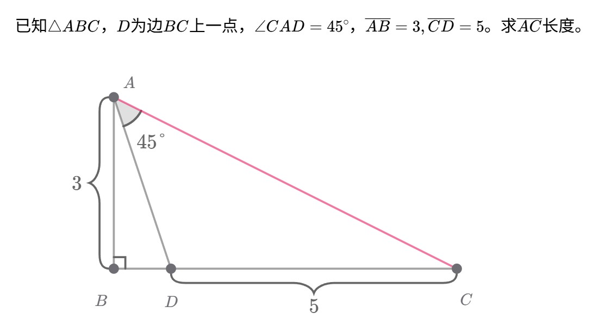
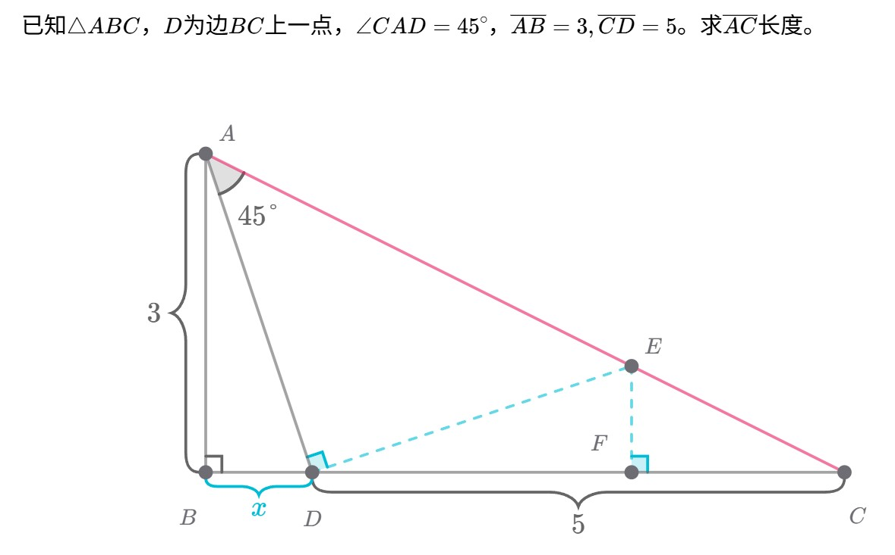
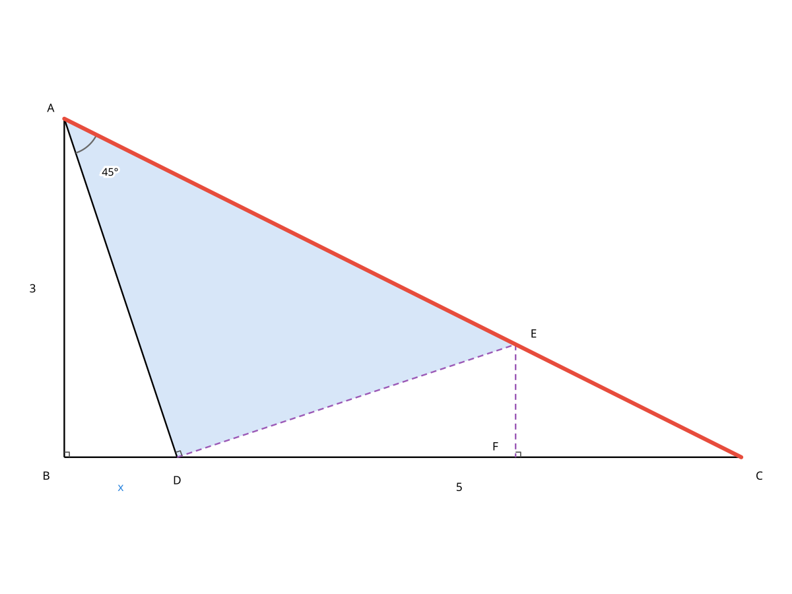

已知 $\triangle ABC$，$D$ 为边 $BC$ 上一点，$\angle CAD=45^{\circ}$，$\overline{AB}=3$，$\overline{CD}=5$。求 $\overline{AC}$ 长度。

> [!question]- 点击查看答案与解析
> 【答案】$3\sqrt{5}$
> 
> 【考点】K 字形全等（一线三等角） → [[【初中数学知识点体系-人教版】#14-2 三角形全等的判定]]、等腰直角三角形 → [[【初中数学知识点体系-人教版】#15-3 等腰三角形]]、勾股定理 → [[【初中数学知识点体系-人教版】#20-1 勾股定理]]
> 
> 【解析】
> 由图中 $B$ 处的直角标记知 $\angle ABC=90^{\circ}$，且 $AB=3$，$CD=5$，$\angle CAD=45^{\circ}$。设 $BD=x$。
>
> **辅助线**（见下方解图）：过 $D$ 作 $DE \perp AD$ 交 $AC$ 于 $E$；过 $E$ 作 $EF \perp BC$ 于 $F$。
>
> 
>
> 1. 在 $\mathrm{Rt}\triangle ADE$ 中，$\angle DAE=\angle CAD=45^{\circ}$，故 $\angle AED=45^{\circ}$，$\triangle ADE$ 为等腰直角三角形，$AD=DE$；
> 2. **K 字全等**：$\angle ABD=\angle DFE=90^{\circ}$；因 $B$、$D$、$F$ 共线且 $\angle ADE=90^{\circ}$，得 $\angle ADB+\angle EDF=90^{\circ}$，又在 $\mathrm{Rt}\triangle ABD$ 中 $\angle ADB+\angle BAD=90^{\circ}$，故 $\angle BAD=\angle EDF$；结合 $AD=DE$，得 $\triangle ABD \cong \triangle DFE$（AAS），所以 $DF=AB=3$，$EF=BD=x$；
> 3. 于是 $BF=BD+DF=x+3$，$BC=BD+CD=x+5$，$FC=BC-BF=2$。由 $EF \parallel AB$ 得 $\triangle CEF \sim \triangle CBA$，$\frac{EF}{AB}=\frac{FC}{BC}$，即 $\frac{x}{3}=\frac{2}{x+5}$，化简得 $x^{2}+5x-6=0$，解得 $x=1$（$x=-6$ 舍去）；
> 4. $\therefore BC=6$，在 $\mathrm{Rt}\triangle ABC$ 中由勾股定理 $AC=\sqrt{AB^{2}+BC^{2}}=\sqrt{9+36}=3 \sqrt{5}$。
>
> 验证（数值自校验全部通过）：$AD=DE=\sqrt{10}$，$DE \perp AD$，$E$ 恰在直线 $AC$ 上，$DF=3$，$EF=1$，$FC=2$，$\angle CAD=45^{\circ}$，$AC=3 \sqrt{5}$ 均严格成立。
> 
> 
> 
> 【易错点】一是漏掉图中直角标记这一隐含条件 $\angle ABC=90^{\circ}$；二是 K 字全等中等角对应写错（应为 $\angle BAD=\angle EDF$，误写成 $\angle BAD=\angle DEF$ 会导致对应边错乱）；三是把 $DF=3$ 误当作 $FC=3$（实际 $FC=CD-DF=2$）；四是解方程后忘记舍去负根 $x=-6$。

<iframe
  src="https://dajiaoai.com/e/ZNES2W6B"
  style="width: 100%; aspect-ratio: 16/9; border: none;"
></iframe>
