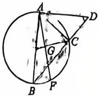
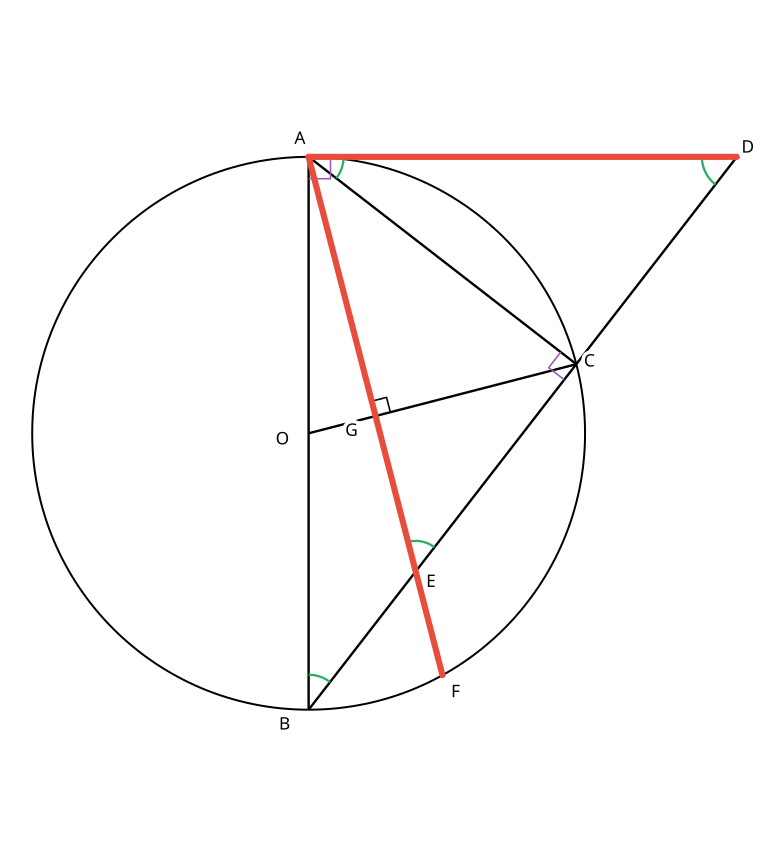

如图，$AB$ 是 $⊙O$ 的直径，点 $C$ 为 $⊙O$ 上一点，过点 $A$ 作 $⊙O$ 的切线交 $BC$ 的延长线于点 $D$。连接 $AC$、$OC$，过点 $A$ 作 $OC$ 的垂线，交 $OC$、$BC$ 于点 $G$、$E$，交 $⊙O$ 于另一点 $F$。

(1) 求证：$AE = AD$；

(2) 若 $\frac{CE}{BE}=\frac{3}{2}$，$OG=\frac{\sqrt{10}}{2}$，求 $AF$ 和 $AD$ 的长。

> [!question]- 点击查看答案与解析
> 【答案】(1) 证明见解析；(2) $AF=5\sqrt{6}$，$AD=4\sqrt{6}$（原答案正确）
> 
> 【考点】切线的性质（切线垂直于过切点的半径）、圆周角定理（直径所对的圆周角是直角）、等腰三角形的判定（等角对等边）、余角代换、垂径定理、勾股定理与坐标法 → [[【初中数学知识点体系-人教版】#30-1 直线和圆的位置关系]]、[[【初中数学知识点体系-人教版】#29-1 圆的基本性质]]、[[【初中数学知识点体系-人教版】#15-3 等腰三角形]]、[[【初中数学知识点体系-人教版】#20-1 勾股定理]]
> 
> 【解析】
> (1) 证明 $AE=AD$：
> $\because AD$ 是 $⊙O$ 的切线，$AB$ 为直径，$\therefore \angle DAB=90^\circ$。
> $\because AB$ 为直径，$\therefore \angle ACB=90^\circ$，即 $\angle ACD=90^\circ$。
> 在 $\mathrm{Rt}△ACD$ 中，$\angle DAC+\angle D=90^\circ$；又 $\angle DAC+\angle BAC=\angle DAB=90^\circ$，$\therefore \angle D=\angle BAC$。
> 在 $\mathrm{Rt}△ABC$ 中，$\angle BAC+\angle ABC=90^\circ$，结合 $\angle DAC+\angle BAC=90^\circ$ 得 $\angle DAC=\angle ABC$。
> $\because OC=OB$（半径），$\therefore \angle OCB=\angle ABC$，$\therefore \angle DAC=\angle OCB$。
> $\because AG\perp OC$ 于 $G$，在 $\mathrm{Rt}△CGE$ 中 $\angle GCE+\angle GEC=90^\circ$，即 $\angle OCB+\angle AEC=90^\circ$（射线 $EG$ 与 $EA$ 重合）。
> 又 $\angle DAC+\angle D=90^\circ$，$\therefore \angle AEC=\angle D$，即 $\angle AED=\angle ADE$（射线 $EC$ 与 $ED$ 重合）。
> 在 $△AED$ 中由等角对等边得 $AE=AD$。
> (2) 求 $AF$ 和 $AD$ 的长：
> 以 $O$ 为原点、直线 $AB$ 为 $y$ 轴建系（方位同原卷），设半径为 $r$，则 $A(0,r)$、$B(0,-r)$，$C(x_c,y_c)$（$x_c>0$）。
> $\because G$ 是 $A$ 在直线 $OC$ 上的垂足，$\therefore OG=\dfrac{\vec A\cdot\vec C}{r}=y_c$，即 $y_c=\dfrac{\sqrt{10}}{2}$。
> $\because \dfrac{CE}{BE}=\dfrac32$ 且 $E$ 在线段 $BC$ 上，$\therefore BE:EC=2:3$，$E=B+\dfrac25(C-B)=\left(\dfrac{2x_c}{5},\ \dfrac{2y_c-3r}{5}\right)$。
> $\because A$、$E$、$G$ 共线且 $AE\perp OC$，$\therefore E$ 在直线 $OC$ 上的投影等于 $A$ 的投影：$\dfrac{\vec E\cdot\vec C}{r}=y_c$，
> 即 $2x_c^2+(2y_c-3r)y_c=5ry_c$，用 $x_c^2+y_c^2=r^2$ 化为 $2r^2-3ry_c=5ry_c$，$\therefore y_c=\dfrac r4$。
> $\therefore r=4y_c=4\cdot\dfrac{\sqrt{10}}{2}=2\sqrt{10}$，$C\left(\dfrac{5\sqrt6}{2},\dfrac{\sqrt{10}}{2}\right)$、$E(\sqrt6,-\sqrt{10})$。
> 在 $\mathrm{Rt}△OAG$ 中，$AG=\sqrt{OA^2-OG^2}=\sqrt{40-\dfrac52}=\dfrac{5\sqrt6}{2}$。
> $\because OC$ 过圆心且 $OC\perp AF$，由垂径定理 $G$ 是弦 $AF$ 的中点，$\therefore AF=2AG=5\sqrt6$。
> $AE=\sqrt{(\sqrt6)^2+(-\sqrt{10}-2\sqrt{10})^2}=\sqrt{6+90}=4\sqrt6$，由 (1) $AD=AE=4\sqrt6$。
> 
> 验证（数值自校验 43 项全部通过）：建系方位同原卷（$AB$ 竖直直径、$A$ 上 $B$ 下，$C$ 右侧略高于 $O$、$D$ 右上圆外与 $A$ 同高、$G$ 在 $OC$ 上、$E$ 在 $BC$ 上、$F$ 在圆下方、点序 $A\text{-}G\text{-}E\text{-}F$），精确坐标 $O(0,0)$、$A(0,2\sqrt{10})$、$B(0,-2\sqrt{10})$、$C\left(\frac{5\sqrt6}{2},\frac{\sqrt{10}}{2}\right)$、$D(4\sqrt6,2\sqrt{10})$、$E(\sqrt6,-\sqrt{10})$、$G\left(\frac{5\sqrt6}{8},\frac{\sqrt{10}}{8}\right)$、$F\left(\frac{5\sqrt6}{4},-\frac{7\sqrt{10}}{4}\right)$、$r=2\sqrt{10}$。其中方位检查 6 项："方位: $AB$ 竖直且 $A$ 上 $B$ 下"、"方位: $C$ 在右侧且略高于 $O$"、"方位: $D$ 在右上圆外（与 $A$ 同高、$C$ 右侧）"、"方位: $G$ 在 $OC$ 上、$E$ 在 $BC$ 上、点序 $A\text{-}G\text{-}E\text{-}F$"、"方位: $F$ 在圆下方"、"方位: 切线 $AD$ 水平"。逐项成立：$A、B、C、F$ 在圆上、$D$ 在圆外、$AB$ 是直径、$\angle DAB=90^\circ$、$O$ 到直线 $AD$ 距离 $=r$（切于 $A$）、$\angle ACB=90^\circ$、$B、C、D$ 共线且顺序 $B\text{-}C\text{-}D$、$A、G、E、F$ 共线且顺序 $A\text{-}G\text{-}E\text{-}F$、$AG\perp OC$、$OG=\frac{\sqrt{10}}{2}$、$CE/BE=3/2$（$BE=4$、$CE=6$）、证明链 $\angle DAC=\angle ABC$、$\angle OCB=\angle ABC$、$\angle AEC=\angle D$、$AE=AD$；数值链 $y_c=\frac r4$、$x_c=\frac{5\sqrt6}{2}$、$AG=\frac{5\sqrt6}{2}$、$G$ 是 $AF$ 中点（垂径）、$AF=2AG=5\sqrt6$、$AE=AD=4\sqrt6$、$AD=\frac{8x_c}{5}$、$F$ 与 $A$ 关于直线 $OC$ 对称、弦心距 $OG$；交叉验证：$\mathrm{Rt}△ABC$ 勾股 $60+100=160$、$\mathrm{Rt}△ABD$ 勾股 $96+160=256$（$BD=16$）、射影关系 $AC^2=CD\cdot CB$（$60=6\times10$）；唯一性：共线约束化为线性方程 $2r^2=8ry_c$ 唯一解 $y_c=\frac r4$，再由 $OG=y_c=\frac{\sqrt{10}}{2}$ 唯一确定 $r=2\sqrt{10}$，构型唯一。**修正说明**：原答案 $AF=5\sqrt6$、$AD=4\sqrt6$ 正确，但原解析 (2) 有两处含糊："利用 $AE=AD$ 及坐标关系可解得 $r=2\sqrt{10}$"——$AE=AD$ 是 (1) 的恒等结论，不能用来解 $r$，真正定 $r$ 的约束是 $E$ 在过 $A$ 垂直 $OC$ 的直线上（即本解析的投影方程 $y_c=\frac r4$）；"由坐标计算 $AE=4\sqrt6$"无任何推导，本解析已补全。原解析取 $AB$ 为 $x$ 轴（$A(-r,0)$、$B(r,0)$、$C(-\frac{\sqrt{10}}{2},\frac{5\sqrt6}{2})$），与原卷图方位（$AB$ 竖直）不一致，配图已按刚体旋转 $(x,y)\to(-y,x)$ 对齐原卷，数值经检查项验证一致。配图中 $AF$、$AD$ 红色加粗为所求两线段，$G$ 处黑色直角标记为 $AG\perp OC$，$A$、$C$ 处紫色直角标记为 $\angle DAB=90^\circ$（切线）与 $\angle ACB=90^\circ$（直径所对圆周角），$A$、$B$ 两处绿色角弧表示 $\angle DAC=\angle ABC$，$E$、$D$ 两处绿色角弧表示 $\angle AEC=\angle D$。
> 
> 
> 
> 【易错点】一是 (1) 中 $\angle AEC$ 与 $\angle GEC$ 是同一个角（射线 $EA$、$EG$ 重合），$\angle AED$ 与 $\angle AEC$ 也是同一个角（$D$ 在 $BC$ 延长线上，射线 $ED$、$EC$ 重合），代换时别丢；二是垂径定理的条件是"过圆心的直线 $OC$ 垂直于弦 $AF$"，结论是 $G$ 平分 $AF$，不要误用于 $BC$；三是 $\frac{CE}{BE}=\frac32$ 对应 $BE:BC=2:5$，分点公式系数别反（$E=B+\frac25(C-B)$）；四是 $OG=y_c$ 是 $A$ 在直线 $OC$ 方向上投影的长度，不要误当成 $C$ 的横坐标（原解析以 $AB$ 为 $x$ 轴时才是横坐标 $-\frac{\sqrt{10}}{2}$）；五是 $AE=AD$ 是 (1) 已证的恒等式，不能反过来当作 (2) 中解 $r$ 的方程，定形状的约束是 $A$、$E$、$G$ 共线。
