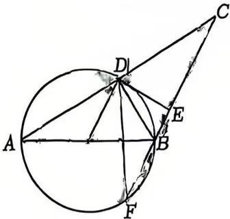
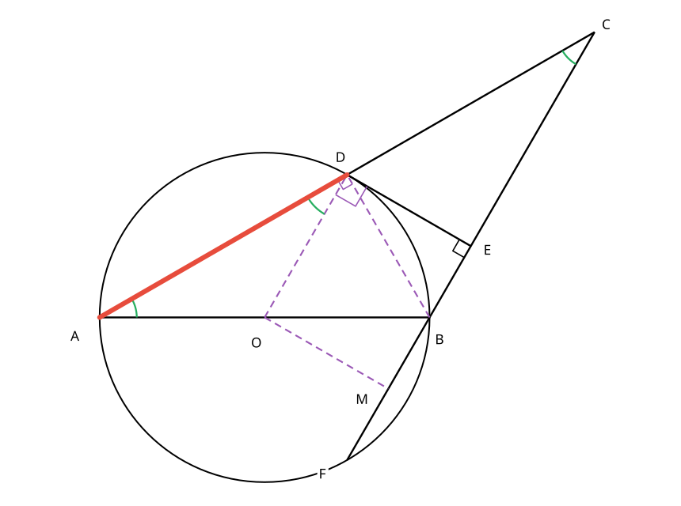

如图，在 $△ABC$ 中，$AB=BC$，$AB$ 为 $⊙O$ 的直径，边 $AC$ 与 $⊙O$ 相交于点 $D$，过点 $D$ 作 $DE⊥BC$ 于点 $E$，$CB$ 延长线交 $⊙O$ 于点 $F$。

(1) 求证：$DE$ 为 $\odot O$ 的切线；

(2) 若 $BE = 1$, $BF = 2$, 求 $AD$ 的长.

> [!question]- 点击查看答案与解析
> 【答案】(1) 证明见解析；(2) $AD=2\sqrt{3}$
> 
> 【考点】切线的判定（过半径外端且垂直于半径）、等腰三角形性质（等边对等角、三线合一）、垂径定理、矩形的判定与性质、勾股定理 → [[【初中数学知识点体系-人教版】#30-1 直线和圆的位置关系]]、[[【初中数学知识点体系-人教版】#15-3 等腰三角形]]、[[【初中数学知识点体系-人教版】#29-1 圆的基本性质]]、[[【初中数学知识点体系-人教版】#21-2 特殊的平行四边形]]
> 
> 【解析】
> (1) 证明 $DE$ 为 $⊙O$ 的切线：
> 连接 $OD$。
> $\because AB=BC$，$\therefore \angle BAC=\angle BCA$。
> $\because OA=OD$（半径），$\therefore \angle ODA=\angle OAD=\angle BAC$。
> $\therefore \angle ODA=\angle BCA$（直线 $AC$ 截 $OD$、$BC$ 所得同位角相等），$\therefore OD\parallel BC$。
> $\because DE\perp BC$，$\therefore DE\perp OD$。
> 又 $OD$ 是半径、$D$ 在 $⊙O$ 上，$\therefore DE$ 是 $⊙O$ 的切线。
> (2) 求 $AD$ 的长：
> 过 $O$ 作 $OM\perp BF$ 于 $M$。$\because BF$ 是弦，$\therefore$ 由垂径定理 $BM=MF=\dfrac12 BF=1$。
> 由 (1) 知 $OD\parallel BC$，即 $OD\parallel ME$；又 $DE\perp BC$、$OM\perp BC$，$\therefore DE\parallel OM$，
> $\therefore$ 四边形 $ODEM$ 是平行四边形，而 $\angle DEM=90^\circ$，$\therefore ODEM$ 是矩形。
> $\therefore OD=ME=MB+BE=1+1=2$，即半径 $r=2$，$AB=4$；且 $DE=OM$。
> 在 $\mathrm{Rt}△OBM$ 中，$OM=\sqrt{OB^2-BM^2}=\sqrt{4-1}=\sqrt3$，$\therefore DE=\sqrt3$。
> 在 $\mathrm{Rt}△BDE$ 中，$BD=\sqrt{BE^2+DE^2}=\sqrt{1+3}=2$。
> $\because AB$ 是直径，$\therefore \angle ADB=90^\circ$，在 $\mathrm{Rt}△ABD$ 中，
> $AD=\sqrt{AB^2-BD^2}=\sqrt{16-4}=2\sqrt3$。
> 
> 验证（数值自校验 38 项全部通过）：建系方位同原卷（$AB$ 为水平直径、$A$ 左 $B$ 右，$C$ 右上、$D$ 在上方且位于 $A$、$C$ 之间、$E$ 在 $BC$ 上、$F$ 在 $AB$ 下方），精确坐标 $A(-4,0)$、$B(0,0)$、$C(2,2\sqrt3)$、$D(-1,\sqrt3)$、$E(0.5,\frac{\sqrt3}{2})$、$F(-1,-\sqrt3)$、$O(-2,0)$、$M(-0.5,-\frac{\sqrt3}{2})$、$r=2$。其中方位检查 6 项："方位: $AB$ 水平且 $A$ 左 $B$ 右"、"方位: $C$ 在右上（$B$ 右侧且 $AB$ 上方）"、"方位: $D$ 在上方且在 $A$、$C$ 之间"、"方位: $E$ 在 $B$、$C$ 之间"、"方位: $F$ 在 $AB$ 下方"、"方位: $\angle ABC$ 为钝角（原卷 $120^\circ$）"。逐项成立：$A、B、D、F$ 在圆上、$C$ 不在圆上、$AB$ 是直径、$AB=BC=4$、$D$ 是 $AC$ 中点、$\angle ADB=90^\circ$、$BD\perp AC$（三线合一）、点序 $C\text{-}E\text{-}B\text{-}M\text{-}F$、$DE\perp BC$、$BE=1$、$BF=2$、$\angle A=\angle C=30^\circ$、$\angle ODA=\angle A$、$OD\parallel BC$、$DE\perp OD$、$O$ 到直线 $DE$ 距离 $=r$（切于 $D$）、$\angle ABC=120^\circ$、$OM\perp BF$ 且 $BM=MF=1$、$ODEM$ 是矩形、$r=OD=ME=MB+BE=2$、$DE=OM=\sqrt3$、$BD=2$、$AD=2\sqrt3$、$AC=4\sqrt3$；交叉验证原解析两条路线数值一致：$DE^2=3=BE\cdot EF$（切割线）、$BD^2=4=BE\cdot BC$（相似）、$CB\cdot CF=CD\cdot CA=24$（点 $C$ 的幂）；唯一性：$r=BE+\frac12 BF$ 由矩形 $OD=ME$ 恒成立，构型唯一。**修正说明**：其一，题面"∠C 与 ⊙O 相交于点 D"系 OCR 笔误，依原卷图与解法应为"边 AC 与 ⊙O 相交于点 D"（$AB$ 为直径 $\Rightarrow\angle ADB=90^\circ$，$BD$ 恰是等腰 $△ABC$ 底边上的高，$D$ 为 $AC$ 中点，构型自洽），已修正。其二，原答案 $AD=2\sqrt3$ 正确，但原解析 (2) 依赖切割线定理 $DE^2=BE\cdot EF$——该定理不在人教版课标正文内容内，且未说明 $E$ 在圆外、割线为直线 $EBF$；本解析改用垂径定理（$BM=\frac12BF$）+ 矩形 $ODEM$（$r=OD=ME$）+ 勾股定理，全部为课标内容，结论不变。配图中 $AD$ 红色加粗为所求线段，$OD$、$BD$、$OM$ 紫色虚线为辅助线，$E$ 处黑色直角标记为 $DE\perp BC$，$D$ 处两个紫色直角标记分别为 $\angle ADB=90^\circ$ 与 $\angle ODE=90^\circ$（切线），$A$、$C$ 两处绿色角弧表示 $\angle A=\angle C$，$D$ 处绿色角弧表示 $\angle ODA=\angle A$。
> 
> 
> 
> 【易错点】一是 (1) 中 $OD\parallel BC$ 的依据是同位角 $\angle ODA=\angle BCA$（截线是 $AC$），$\angle ODA=\angle A$ 与 $\angle A=\angle C$ 两个等量代换缺一不可；二是点序是 $C$-$E$-$B$-$M$-$F$，故 $ME=MB+BE=2$，不要写成 $MB-BE$；三是垂径定理用在这条倾斜割线（直线 $CBF$）的弦 $BF$ 上，$M$ 是 $BF$ 中点而非 $EF$ 中点；四是求 $AD$ 用 $\mathrm{Rt}△ABD$（直角在 $D$，来自直径所对圆周角），别误当直角在 $A$；五是若坚持用切割线定理，注意 $E$ 在圆外、割线交圆于 $B$、$F$ 两点，$EF=EB+BF=3$ 而不是 $2$。
