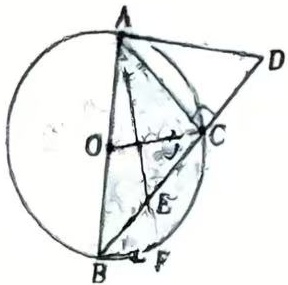
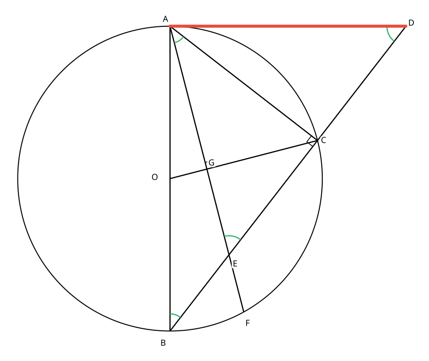

如图，$△ABD$ 中 $AB$ 是 $\odot O$ 的直径，且 $C$ 为 $\odot O$ 一点，连接 $AC，OC$，过点 $A$ 作 $OC$ 的垂线，交 $OC，BC$ 于点 $G，E$，交 $\odot O$ 于另一点 $F$，已知 $AE=AD$（依原卷图，$D$ 在 $BC$ 的延长线上）。

(1) 求证：$AD$ 是 $⊙O$ 的切线。

(2) 若 $\frac{CE}{BE} = \frac{3}{2}$，$OG = 1$，求 $AD$ 的长

> [!question]- 点击查看答案与解析
> 【答案】(1) 证明见解析；(2) $AD=\frac{8\sqrt{15}}{5}$（原答案 $4\sqrt6$ 有误）
> 
> 【考点】切线的判定（过半径外端且垂直于半径）、圆周角定理（直径所对圆周角是直角）、等腰三角形性质（等边对等角）、余角代换、坐标法求线段长 → [[【初中数学知识点体系-人教版】#30-1 直线和圆的位置关系]]、[[【初中数学知识点体系-人教版】#29-1 圆的基本性质]]、[[【初中数学知识点体系-人教版】#15-3 等腰三角形]]
> 
> 【解析】
> (1) 证明 $AD$ 是 $⊙O$ 的切线：
> $\because AB$ 为直径，$C$ 在圆上，$\therefore \angle ACB=90^\circ$，即 $AC\perp BC$。
> 在 $\mathrm{Rt}△ACE$ 中，$\angle AEC+\angle CAE=90^\circ$，即 $\angle AEC+\angle CAG=90^\circ$。
> $\because AG\perp OC$ 于 $G$，在 $\mathrm{Rt}△CGE$ 中，$\angle GCE+\angle GEC=90^\circ$，即 $\angle OCB+\angle AEC=90^\circ$（射线 $EG$ 与 $EA$ 重合）。
> $\therefore \angle CAG=\angle OCB$。
> $\because OC=OB$，$\therefore \angle OCB=\angle OBC=\angle ABC$，$\therefore \angle CAG=\angle ABC$。
> $\because D$ 在 $BC$ 延长线上，$\therefore$ 射线 $ED$ 与射线 $EC$ 重合；又 $AE=AD$，
> $\therefore \angle ADE=\angle AED$，即 $\angle D=\angle AEC=90^\circ-\angle CAG=90^\circ-\angle ABC$。
> 在 $△ABD$ 中，$\angle BAD=180^\circ-\angle ABD-\angle D=180^\circ-\angle ABC-(90^\circ-\angle ABC)=90^\circ$。
> $\therefore DA\perp AB$，又 $A$ 在 $⊙O$ 上，$\therefore AD$ 是 $⊙O$ 的切线。
> (2) 求 $AD$ 的长：
> 以 $O$ 为原点、直线 $AB$ 为 $y$ 轴建系（方位同原卷），设半径为 $r$，则 $A(0,r)$、$B(0,-r)$，$C(x_c,y_c)$（$x_c>0,y_c>0$）。
> $\because AG\perp OC$ 于 $G$，$\therefore G$ 是 $A$ 在直线 $OC$ 上的垂足，
> $OG=\dfrac{\vec A\cdot\vec C}{r}=\dfrac{r\,y_c}{r}=y_c$，$\therefore y_c=OG=1$。
> $\because \dfrac{CE}{BE}=\dfrac32$ 且 $E$ 在线段 $BC$ 上，$\therefore BE:EC=2:3$，$E=B+\dfrac25(C-B)=\left(\dfrac{2x_c}{5},\ \dfrac{2y_c-3r}{5}\right)$。
> $\because A$、$E$、$G$ 共线且 $AE\perp OC$，$\therefore E$ 在直线 $OC$ 上的投影等于 $A$ 的投影：$\dfrac{\vec E\cdot\vec C}{r}=1$，
> 即 $2x_c^2+(2-3r)y_c=5r$，代入 $y_c=1$ 得 $x_c^2=4r-1$。
> 又 $C$ 在圆上：$x_c^2+y_c^2=r^2$，$\therefore 4r-1+1=r^2$，解得 $r=4$（舍 $r=0$）。
> $\therefore C(\sqrt{15},1)$，$E\left(\dfrac{2\sqrt{15}}{5},-2\right)$，
> $AD=AE=\sqrt{\left(\dfrac{2\sqrt{15}}{5}\right)^2+(-2-4)^2}=\sqrt{\dfrac{60}{25}+36}=\sqrt{\dfrac{192}{5}}=\dfrac{8\sqrt{15}}{5}$。
> 
> 验证（数值自校验 33 项全部通过）：建系方位同原卷（$A$ 上 $B$ 下、$AB$ 竖直直径、$C$ 在右、$D$ 右上、$E$ 内右下、$F$ 下、$G$ 在 $OC$ 上），精确坐标 $O(0,0)$、$A(0,4)$、$B(0,-4)$、$C(\sqrt{15},1)$、$D\left(\frac{8\sqrt{15}}{5},4\right)$、$E\left(\frac{2\sqrt{15}}{5},-2\right)$、$F\left(\frac{\sqrt{15}}{2},-\frac72\right)$、$G\left(\frac{\sqrt{15}}{4},\frac14\right)$、$r=4$。逐项成立：$A、B、C、F$ 在圆上、$O$ 是 $AB$ 中点、$G$ 在线段 $OC$ 上、$AG\perp OC$、$OG=1$、$A、G、E、F$ 共线且顺序 $A\text{-}G\text{-}E\text{-}F$、$B、E、C、D$ 共线且顺序 $B\text{-}E\text{-}C\text{-}D$、$\angle ACB=90^\circ$、$CE/BE=3/2$、$AE=AD$、$\angle BAD=90^\circ$、$O$ 到直线 $AD$ 距离 $=r$（切于 $A$）、证明链 $\angle CAG=\angle OCB=\angle ABC$、$\angle D=\angle AEC$、$\angle AEC+\angle CAG=90^\circ$、$\angle OCB+\angle GEC=90^\circ$、坐标关系 $OG=y_c=1$、$x_c^2=4r-1$、$x_c^2+y_c^2=r^2$、相似比 $AC^2=CG\cdot AB$、$EC^2=EA\cdot EG$、$AG=\sqrt{15}$、$BE=\frac{4\sqrt{10}}{5}$、$CE=\frac{6\sqrt{10}}{5}$、$AE=AD=\frac{8\sqrt{15}}{5}$；唯一性：垂直条件给出 $t=\frac{BE}{BC}=\frac{2\sin\theta}{1+\sin\theta}$ 在 $\sin\theta\in(0,1)$ 严格递增，$t=\frac25$ 唯一对应 $\sin\theta=\frac14$、$r=4$。**原答案错误的根因**：原解析 (2) 前半正确（$r=4$、$AG=\sqrt{15}$ 均与数值验证一致），但末句"利用 $AE=AD$ 及 $AG\perp OC$ 的几何关系"含糊带过，"由坐标计算 $AE=4\sqrt6$"无任何推导且数值错误——实际 $AE^2=\frac{192}{5}=38.4$，而 $(4\sqrt6)^2=96$，正确值为 $AD=AE=\frac{8\sqrt{15}}{5}\approx6.20$。另原解析 (1) 中"$\angle AFC=\angle AEC$ 同弧"类表述未出现，但"$\angle D=\angle AEC$"一步隐含依赖"$D$ 在 $BC$ 延长线上（射线 $ED$ 与 $EC$ 重合）"，题面已依原卷图补注。配图中 $AD$ 红色加粗为所求切线段，$G$、$C$ 两处黑色直角标记为 $AG\perp OC$、$\angle ACB=90^\circ$，$A$、$B$ 两处绿色角弧表示 $\angle CAG=\angle ABC$，$D$、$E$ 两处绿色角弧表示 $\angle D=\angle AEC$。
> 
> 
> 
> 【易错点】一是 $\angle D=\angle AED$ 的等腰底角在 $△AED$ 中，要用"$D$ 在 $BC$ 延长线上、射线 $ED$ 与 $EC$ 重合"才能换成 $\angle AEC$；二是 $\angle AEC$ 与 $\angle GEC$ 是同一个角（射线 $EA$、$EG$ 重合），$\angle CAG$ 即 $\angle CAE$，代换时别丢；三是坐标法中 $OG$ 是 $A$ 在直线 $OC$ 上的投影长度，本题恰等于 $y_c$，不要误当成横坐标；四是 $CE:BE=3:2$ 对应 $BE:BC=2:5$，分点公式系数别反（$E=B+\frac25(C-B)$）；五是最后 $AE=\sqrt{192/5}=\frac{8\sqrt{15}}{5}$，原答案 $4\sqrt6$（即 $\sqrt{96}$）是错的。
