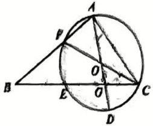
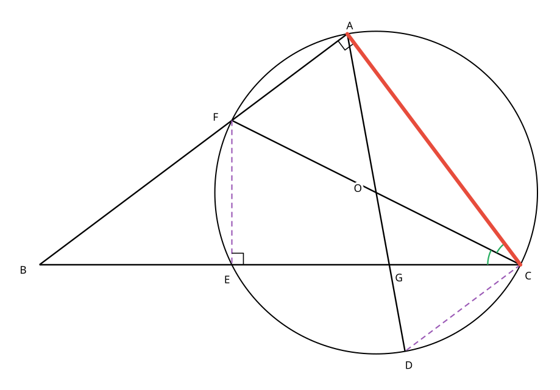

如图，已知 $AD，CF$ 为 $\odot O$ 的直径，连接 $AF，AC$，点 $E$ 是 $\odot O$ 上一点，连接 $CE$ 并延长交 $AF$ 延长线于点 $B$，$AC=EC$，$AD$ 与 $BC$ 交于点 $G$。

(1) 求证：$\angle ACF = \angle ECF$.

(2) 若 $BE = 4, \quad OG = \frac{5}{6}DG.$ 求 $AC$.

> [!question]- 点击查看答案与解析
> 【答案】(1) 证明见解析；(2) $AC=6$（此时 $BC=10$，原答案 $10$ 实为 $BC$ 之长）
> 
> 【考点】直径所对的圆周角是直角、直角三角形全等的判定（HL）、矩形的判定与性质（对角线互相平分且相等）、相似三角形（平行线构成的"8 字形"）、勾股定理、三角形面积比 → [[【初中数学知识点体系-人教版】#29-1 圆的基本性质]]、[[【初中数学知识点体系-人教版】#14-2 三角形全等的判定]]、[[【初中数学知识点体系-人教版】#21-2 特殊的平行四边形]]、[[【初中数学知识点体系-人教版】#31-2 相似三角形]]
> 
> 【解析】
> (1) 证明 $\angle ACF=\angle ECF$：
> $\because CF$ 为 $\odot O$ 的直径，$A、E$ 在圆上，$\therefore \angle CAF=\angle CEF=90^\circ$。
> 在 $\mathrm{Rt}△CAF$ 与 $\mathrm{Rt}△CEF$ 中，$CA=CE$（已知），$CF=CF$（公共斜边），
> $\therefore △CAF\cong△CEF$（HL），$\therefore \angle ACF=\angle ECF$。
> (2) 求 $AC$ 的长：
> 由 (1) 的全等还得到 $FA=FE$。
> $\because AD、CF$ 都是直径，$\therefore$ 四边形 $ACDF$ 的两条对角线互相平分且相等，
> $\therefore ACDF$ 是矩形，$\therefore CD\parallel AF$ 即 $CD\parallel AB$，且 $CD=AF$。
> $\because CD\parallel AB$，$\therefore △GCD\sim△GAB$（"8 字形"），$\therefore \dfrac{GD}{GA}=\dfrac{CD}{AB}$。
> 设 $DG=6k$，则 $OG=5k$。由图，$G$ 在线段 $OD$ 上，$\therefore OD=OG+GD=11k$，即半径为 $11k$，
> $\therefore AD=22k$，$AG=AD-DG=16k$，$\therefore \dfrac{CD}{AB}=\dfrac{GD}{GA}=\dfrac{6k}{16k}=\dfrac{3}{8}$。
> 设 $CD=3s$、$AB=8s$，则 $AF=CD=3s$，$FB=AB-AF=5s$。
> $\because \angle CEF=90^\circ$ 且 $C、E、B$ 共线，$\therefore \angle FEB=90^\circ$。
> 在 $\mathrm{Rt}△FEB$ 中，$FE=FA=3s$，$BE=4$，由勾股定理：$(3s)^2+4^2=(5s)^2$，
> 解得 $16s^2=16$，$s=1$，$\therefore AF=FE=3$，$FB=5$。
> $\because E$ 在线段 $CB$ 上，$\therefore \angle ECF=\angle BCF$，即 $CF$ 平分 $\angle ACB$。
> 在 $△ACB$ 中用面积法：$\dfrac{AF}{FB}=\dfrac{S_{△ACF}}{S_{△BCF}}=\dfrac{\frac12\cdot AC\cdot AF}{\frac12\cdot BC\cdot FE}=\dfrac{AC}{BC}$（因 $AF=FE$），
> $\therefore \dfrac{AC}{BC}=\dfrac{AF}{FB}=\dfrac{3}{5}$。设 $AC=3u$，$BC=5u$，
> $\because CE=CA=3u$，$\therefore BE=BC-CE=2u=4$，$u=2$，
> $\therefore AC=6$（$BC=10$，$AB=8$，恰为 $6\text{-}8\text{-}10$ 直角三角形）。
> 
> 验证（数值自校验 33 项全部通过）：建系方位同原卷（$B$ 左、$C$ 右、$BC$ 水平、$A$ 上顶点、$D$ 在下、$F$ 左上、$G$ 在 $O$ 正下方），$B(0,0)$、$C(10,0)$、$A(6.4,4.8)$、$F(4,3)$、$E(4,0)$、$O(7,1.5)$、$D(7.6,-1.8)$、$G\left(\frac{80}{11},0\right)$、$R=\frac{3\sqrt5}{2}$。逐项成立：$A、C、D、E、F$ 在圆上、$O$ 分别是 $AD、CF$ 中点（两直径）、$\angle CAF=\angle CEF=90^\circ$、$A、F、B$ 共线且 $F$ 在 $AB$ 之间、$C、E、B$ 共线且 $E$ 在 $CB$ 之间、$B$ 在圆外、修正条件 $AC=EC$ 成立、(1) $\angle ACF=\angle ECF$、HL 全等对应边 $FA=FE$、$CF$ 平分 $\angle ACB$、$BE=4$、$G=AD\cap BC$ 且顺序 $A、O、G、D$、$OG=\frac56 DG$、矩形 $ACDF$（$CD\parallel AF$ 且 $CD=AF$）、相似比 $\frac{GD}{GA}=\frac{CD}{AB}=\frac38$、$\mathrm{Rt}△FEB$ 勾股 $9+16=25$、面积比 $\frac{AF}{FB}=\frac{AC}{CB}=\frac35$、$AC=6、AB=8、BC=10$；唯一性扫描：在 $AC=EC$ 归一化构型族（$t=\frac{AB}{AC}\in[0.3,3]$）中 $OG/DG=\frac56$ 仅一解 $t=\frac43$，归一化 $BE=\frac23$，按 $BE=4$ 缩放得 $AC=6$ 唯一。**原卷两处错误的根因**：其一，题面"$AC=BC$"与构型矛盾——$CF$ 为直径且 $B$ 在 $AF$ 延长线上迫使 $\angle CAB=90^\circ$，直角边 $AC$ 不可能等于斜边 $BC$，且原解析"$\because AC=BC\ \therefore\angle B=\angle BAC$"在此退化构型下无意义；结合 (1) 的求证目标（$AC=EC$ 时 $\angle ACF=\angle ECF$ 恰由 HL 直接得出，二者在该构型族中等价）判定为 OCR 将 $EC$ 误作 $BC$，题面已修正为 $AC=EC$。其二，原答案"$AC=10$"：数值上 $AC=6$，而 $10$ 恰是 $BC$ 之长，系把 $BC$ 误标为 $AC$（或原题所问本为 $BC$）；原解析 (2) 中"由等腰三角形三线合一及相似三角形性质可列方程解得 $m=\frac{10}{11}$"无任何具体推导，且"$OD=OG+DG=11m$ 而 $OA=11m$、$AG=6m$"的线段关系与 $OG=\frac56 DG$ 的设参自相矛盾。另题面原未定义 $G$，依原卷图（$G$ 标注于 $AD$ 与 $BC$ 交点处）补"AD 与 BC 交于点 G"。配图中 $AC$ 红色加粗为 (2) 所求线段，$FE$、$CD$ 紫色虚线为辅助线（构造 $\mathrm{Rt}△FEB$ 与矩形 $ACDF$），$A$、$E$ 两处黑色直角标记为 $\angle CAF=\angle CEF=90^\circ$，$C$ 处绿色双角弧为 $\angle ACF=\angle ECF$（(1) 结论）。
> 
> 
> 
> 【易错点】一是别把题面读成 $AC=BC$：$\angle CAB=90^\circ$ 下直角边不可能等于斜边，条件只能是 $AC=EC$；二是设参时看清点的顺序，$G$ 在线段 $OD$ 上，故 $OD=OG+GD=11k$、$AG=AD-DG=16k$，不要写成 $AD=OG+GD$；三是 $FE=FA$ 来自 (1) 的 HL 全等，$\angle FEB=90^\circ$ 是 $\angle CEF=90^\circ$ 的邻补角，两者合起来才有 $\mathrm{Rt}△FEB$ 的勾股定理；四是 $\dfrac{AF}{FB}=\dfrac{AC}{BC}$ 是角平分线分边之比，若不记得角平分线定理，用"同高三角形面积比 $+$ $AF=FE$"现场推出更稳妥；五是最后 $AC=6$、$BC=10$ 别混淆，原答案的 $10$ 是 $BC$。
