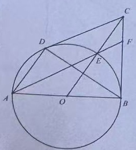
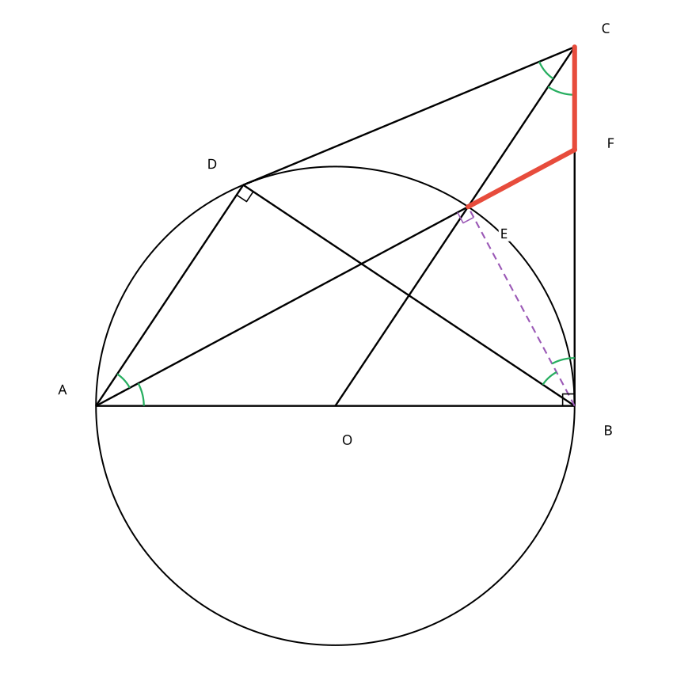

如图，已知 $AB$ 是 $⊙O$ 的直径，$CD，CB$ 是 $⊙O$ 的切线，$D，B$ 是切点，$OC$ 交 $⊙O$ 于点 $E$，$AE$ 的延长线交 $BC$ 于点 $F$，连接 $AD$，$BD$，给出以下结论：

$① AD∥OC$；

$②$ 点 $E$ 为 $△CDB$ 的内心；

$③FC=EF$，

其中正确的有___。

> [!question]- 点击查看答案与解析
> 【答案】$①②$
> 
> 【考点】切线长定理及其推论（两切点连线被圆外点与圆心连线垂直平分）、圆周角定理（直径所对圆周角是直角）、平行线判定、角平分线与三角形内心、等腰三角形性质 → [[【初中数学知识点体系-人教版】#30-1 直线和圆的位置关系]]、[[【初中数学知识点体系-人教版】#29-1 圆的基本性质]]、[[【初中数学知识点体系-人教版】#14-3 角的平分线]]
> 
> 【解析】
> 判断 $①$ $AD\parallel OC$（正确）：
> $\because CD、CB$ 是 $⊙O$ 的切线，$\therefore CD=CB$，且 $OC$ 平分 $\angle DCB$，
> $\therefore OC\perp BD$（等腰三角形顶角平分线垂直平分底边）。
> $\because AB$ 是直径，$\therefore \angle ADB=90^\circ$，即 $AD\perp BD$。
> $\therefore AD\parallel OC$（同垂直于 $BD$），$①$ 正确。
> 判断 $②$ 点 $E$ 为 $△CDB$ 的内心（正确）：
> 连接 $BE$。$\because OA=OE$，$\therefore \angle OAE=\angle OEA$。
> $\because AD\parallel OC$，$\therefore \angle DAE=\angle OEA$（内错角），$\therefore \angle DAE=\angle OAE$，即 $AE$ 平分 $\angle DAB$。
> 设 $\angle DAE=\angle EAB=\beta$。$\because AB$ 是直径，$\therefore \angle AEB=90^\circ$，在 $\mathrm{Rt}△AEB$ 中 $\angle ABE=90^\circ-\beta$；
> 在 $\mathrm{Rt}△ADB$ 中 $\angle ABD=90^\circ-2\beta$。
> $\therefore \angle DBE=\angle ABE-\angle ABD=(90^\circ-\beta)-(90^\circ-2\beta)=\beta$。
> $\because CB$ 切 $⊙O$ 于 $B$，$\therefore CB\perp AB$，$\therefore \angle EBC=90^\circ-\angle ABE=\beta$。
> $\therefore \angle DBE=\angle EBC$，即 $BE$ 平分 $\angle DBC$。
> 又 $\because CE$ 平分 $\angle DCB$（切线长定理），两条角平分线 $CE$、$BE$ 交于 $E$，
> $\therefore E$ 是 $△CDB$ 的内心，$②$ 正确。
> 判断 $③$ $FC=EF$（错误）：
> $\because A、E、F$ 共线，$O、E、C$ 共线，$\therefore \angle FEC=\angle AEO$（对顶角）$=\angle OAE=\beta$（等腰 $△OAE$）。
> 在 $\mathrm{Rt}△OBC$ 中，$\angle FCE=\angle OCB=90^\circ-\angle BOC$；而 $\angle BOC$ 是弧 $BE$ 所对圆心角，$\angle BAE$ 是同弧所对圆周角，$\therefore \angle BOC=2\beta$，$\therefore \angle FCE=90^\circ-2\beta$。
> 若 $FC=EF$，则 $\angle FEC=\angle FCE$，即 $\beta=90^\circ-2\beta$，解得 $\beta=30^\circ$（即 $\angle BOC=60^\circ$ 时才成立）。
> $\beta$ 随切线位置变化，并非恒为 $30^\circ$，$\therefore FC=EF$ 不恒成立，$③$ 错误。
> 综上，正确的有 $①②$。
> 
> 验证（数值自校验 26 项全部通过）：建系 $r=1$、$C(1,1.5)$（方位同原卷），精确坐标 $O(0,0)$、$A(-1,0)$、$B(1,0)$、$D\left(-\frac{5}{13},\frac{12}{13}\right)$、$E\left(\frac{2}{\sqrt{13}},\frac{3}{\sqrt{13}}\right)$、$F(1,1.0704)$。逐项成立：$D$、$E$ 在圆上、$OD\perp CD$、$OB\perp CB$（切线）、$CD=CB$（切线长）、$O$、$E$、$C$ 共线、$A$、$E$、$F$ 共线、$F$ 在线段 $BC$ 上、$\angle ADB=90^\circ$、$\angle AEB=90^\circ$、$①\ AD\parallel OC$、$AE$ 平分 $\angle DAB$、$CE$ 平分 $\angle DCB$、$BE$ 平分 $\angle DBC$、$E$ 到 $△CDB$ 三边等距（内心）、$\angle ABE=90^\circ-\beta$、$\angle ABD=90^\circ-2\beta$、$\angle DBE=\beta$、$\angle FEC=\beta$、$\angle FCE=90^\circ-2\beta$、本图 $FC\neq EF$、$c$ 取 $0.8\sim3$ 七组值 $①②$ 恒成立、同组值下 $③$ 恒不成立、$c=\sqrt3$（$\angle BOC=60^\circ$）时 $③$ 巧合成立 $FC=EF$、此时 $\beta=30^\circ$。原答案"$①②$ 正确，$③$ 错误"结论正确，但原解析有两处论证缺口：一是 $②$ 中"结合角度关系可证 $BE$ 平分 $\angle DBC$"含糊带过，未给出关键链条 $\angle DBE=\angle ABE-\angle ABD=\beta=\angle EBC$；二是 $③$ 仅写"由角度关系和线段比例分析，$FC\neq EF$"，没有任何论证——正确做法是推出 $\angle FEC=\beta$、$\angle FCE=90^\circ-2\beta$，指出 $FC=EF$ 仅当 $\beta=30^\circ$ 的特殊位置成立，故不恒成立。另原解析 $②$ 虽给出"同弧 $DE$ 得 $\angle DBE=\angle DAE$"（此步成立），却未先证关键前提"$AE$ 平分 $\angle DAB$"（应由 $AD\parallel OC$ 的内错角加 $OA=OE$ 的等腰底角推出），链条缺口导致 $\angle DBE=\beta$ 无出处。配图中 $FC$、$EF$ 红色加粗为结论 $③$ 比较的两线段，$BE$ 紫色虚线为辅助线，$D$、$B$ 处黑色直角标记为 $\angle ADB=90^\circ$、$CB\perp AB$，$E$ 处紫色直角标记为 $\angle AEB=90^\circ$，$A$、$B$、$C$ 三处绿色双角弧分别表示 $\angle DAE=\angle EAB$、$\angle DBE=\angle EBC$、$\angle DCE=\angle ECB$（内心所需的三条角平分线）。
> 
> 
> 
> 【易错点】一是 $①$ 的关键是"$OC\perp BD$"，它来自切线长定理+等腰三角形三线合一，漏掉这一步平行线就无从谈起；二是 $②$ 判定内心必须给出两条角平分线（$CE$、$BE$）交于 $E$，只证 $CE$ 一条不够；三是 $③$ 这类等式结论要问"是否恒成立"，本题它只在 $\angle BOC=60^\circ$ 的特殊位置成立，不能拿特殊位置当一般结论；四是 $\angle AEB=90^\circ$ 要用"$AB$ 是直径"，$E$ 在圆上这一条件别丢；五是 $\angle DBE=\angle ABE-\angle ABD$ 的角差关系依赖射线 $BD$ 在 $\angle ABE$ 内部，看图想清楚再做角的加减。
