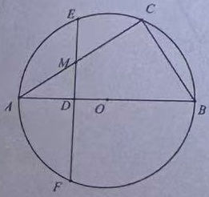
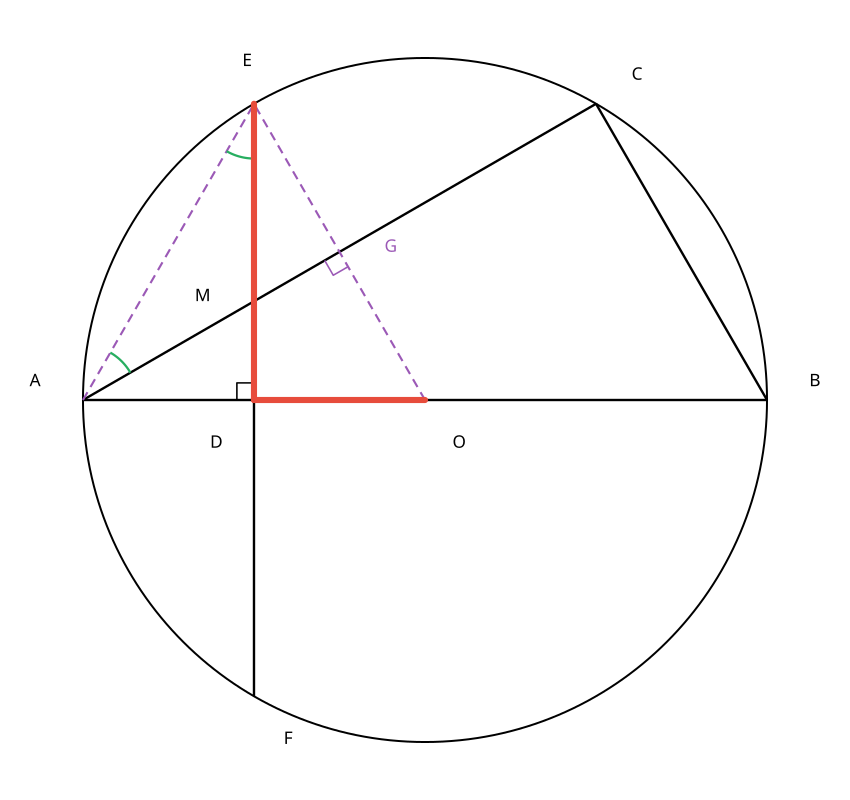

如图，$⊙O$ 是 $Rt△ABC$ 的外接圆，$E$ 是 $\overset{\frown}{AC}$ 的中点，过 $E$ 作 $EF⊥AB$ 于点 $D$，交 $⊙O$ 于 $F$，交 $AC$ 于 $M$，下列结论：

$① AM = ME$；

$② DE = \frac{1}{2}AC$；

$③ DM = \frac{1}{2}EM$；

$④ OD = \frac{1}{2}BC$，

其中正确的有___。

> [!question]- 点击查看答案与解析
> 【答案】$①②④$
> 
> 【考点】直角三角形外接圆（斜边为直径）、圆周角定理、垂径定理及其推论（弧、弦、圆心角关系）、等腰三角形判定、三角形中位线定理、全等三角形判定（AAS） → [[【初中数学知识点体系-人教版】#29-1 圆的基本性质]]、[[【初中数学知识点体系-人教版】#21-1 平行四边形]]、[[【初中数学知识点体系-人教版】#14-2 三角形全等的判定]]
> 
> 【解析】
> 由 $⊙O$ 是 $Rt△ABC$ 的外接圆知斜边 $AB$ 是直径，$O$ 是 $AB$ 中点，$\angle ACB=90^\circ$；$E$ 是 $\overset{\frown}{AC}$ 的中点，即 $\overset{\frown}{AE}=\overset{\frown}{EC}$。设 $\angle AOE=\angle EOC=\alpha$，则 $\angle BOC=180^\circ-2\alpha$。
> 判断 $①$ $AM=ME$（正确）：
> $\angle MAE=\angle CAE$ 是 $\overset{\frown}{EC}$ 所对的圆周角，$\therefore\angle MAE=\dfrac{1}{2}\alpha$。
> $\angle DAE=\angle BAE$ 是 $\overset{\frown}{BCE}$（$=\overset{\frown}{BC}+\overset{\frown}{CE}$，圆心角 $180^\circ-\alpha$）所对的圆周角，$\therefore\angle BAE=90^\circ-\dfrac{\alpha}{2}$。
> 在 $\mathrm{Rt}△ADE$ 中，$\angle AED=90^\circ-\angle DAE=90^\circ-\left(90^\circ-\dfrac{\alpha}{2}\right)=\dfrac{\alpha}{2}$。
> $\therefore\angle MAE=\angle MEA$，$\therefore AM=ME$，$①$ 正确。
> 判断 $②$ $DE=\dfrac{1}{2}AC$（正确）：
> $\because$ 直径 $AB\perp$ 弦 $EF$，$\therefore$ 由垂径定理 $ED=DF$（即 $EF=2DE$），且 $\overset{\frown}{AE}=\overset{\frown}{AF}$。
> $\therefore\overset{\frown}{EF}$（过 $A$ 一侧）$=\overset{\frown}{EA}+\overset{\frown}{AF}=2\overset{\frown}{AE}$，而 $\overset{\frown}{AC}$（过 $E$ 一侧）$=\overset{\frown}{AE}+\overset{\frown}{EC}=2\overset{\frown}{AE}$，
> $\therefore\overset{\frown}{EF}=\overset{\frown}{AC}$，$\therefore EF=AC$（等弧对等弦），$\therefore DE=\dfrac{1}{2}EF=\dfrac{1}{2}AC$，$②$ 正确。
> 判断 $③$ $DM=\dfrac{1}{2}EM$（错误）：
> 该比例只在特殊形状下巧合成立，不具有一般性。反例：取 $⊙O$ 半径为 $1$，$C$ 在 $O$ 正上方（即 $AC=BC$），建系 $A(-1,0)$、$B(1,0)$、$C(0,1)$，则 $E\left(-\dfrac{\sqrt2}{2},\dfrac{\sqrt2}{2}\right)$、$D\left(-\dfrac{\sqrt2}{2},0\right)$，直线 $AC$ 为 $y=x+1$，得 $M\left(-\dfrac{\sqrt2}{2},1-\dfrac{\sqrt2}{2}\right)$。
> 于是 $DM=1-\dfrac{\sqrt2}{2}\approx0.293$，$EM=\sqrt2-1\approx0.414$，$\dfrac{DM}{EM}=\dfrac{\sqrt2}{2}\neq\dfrac{1}{2}$，$③$ 错误。
> 判断 $④$ $OD=\dfrac{1}{2}BC$（正确）：
> 连接 $OE$ 交 $AC$ 于 $G$。$\because E$ 是 $\overset{\frown}{AC}$ 的中点，$\therefore OE\perp AC$ 且 $G$ 是 $AC$ 的中点（平分弧的直径垂直平分弧所对的弦）。
> 在 $\triangle ODE$ 与 $\triangle OGE$ 中，$\angle ODE=\angle OGE=90^\circ$，$\angle DOE=\angle GOE$（等弧对等圆心角），$OE=OE$，
> $\therefore△ODE\cong△OGE$（AAS），$\therefore OD=OG$。
> 又 $\because O$、$G$ 分别是 $AB$、$AC$ 的中点，$\therefore OG$ 是 $△ABC$ 的中位线，$\therefore OG=\dfrac{1}{2}BC$，$\therefore OD=\dfrac{1}{2}BC$，$④$ 正确。
> 综上，正确的有 $①②④$。
> 
> 验证（数值自校验 27 项全部通过）：配图取 $r=1$、$\angle BOC=60^\circ$（方位同原卷），坐标 $O(0,0)$、$A(-1,0)$、$B(1,0)$、$C(0.5,\frac{\sqrt3}{2})$、$E(-0.5,\frac{\sqrt3}{2})$、$D(-0.5,0)$、$F(-0.5,-\frac{\sqrt3}{2})$、$M(-0.5,\frac{\sqrt3}{6})$、$G(-0.25,\frac{\sqrt3}{4})$。逐项成立：$A$、$B$、$C$、$E$、$F$ 在圆上、$AB$ 是直径、$\angle ACB=90^\circ$、$\angle AOE=\angle EOC$（弧 $AE=$ 弧 $EC$）、弦 $AE=EC$、$EF\perp AB$、$D$ 在 $AB$ 上、$M$ 在弦 $AC$ 上、$M$ 在线段 $ED$ 上、$ED=DF$（垂径定理）、$①\ AM=ME$、$②\ DE=\frac{1}{2}AC$、$④\ OD=\frac{1}{2}BC$、弦 $EF=AC$、$G$ 是 $AC$ 中点、$O$、$G$、$E$ 共线且 $OE\perp AC$、$OD=OG$（全等对应边）、$OG=\frac{1}{2}BC$（中位线）、$\angle MAE=\angle MEA$、$\theta$ 取 $30^\circ\sim120^\circ$ 七组值 $①②④$ 恒成立、$③$ 在 $\theta=60^\circ$ 时 $DM/EM=0.5$（巧合）、$③$ 在 $\theta=90^\circ$ 时 $DM/EM\neq0.5$（反例）。原答案"$④$ 正确，$①②③$ 错误"有误：一是把题面"$E$ 是 $\overset{\frown}{AC}$ 的中点"误读为"线段 $AC$ 的中点"（若按线段中点理解，$M$ 与 $E$ 重合、题目退化，与原卷图矛盾），导致 $①②$ 被误判为错误；二是 $④$ 的证明用"$OE$ 是中位线"再"利用垂径定理和圆的对称性"含糊带过，逻辑不闭合。正确结论为 $①②④$。题面 $E$ 处已按原卷图补回弧号。配图中 $DE$、$OD$ 红色加粗为结论 $②④$ 涉及的线段，$AE$、$OE$ 紫色虚线为辅助线，$D$ 处黑色直角标记为 $EF\perp AB$，$G$ 处紫色直角标记为 $OE\perp AC$，$A$、$E$ 处绿色同半径角弧表示 $\angle MAE=\angle MEA$（$①$ 的等腰依据）。
> 
> 
> 
> 【易错点】一是 "$E$ 是 $\overset{\frown}{AC}$ 的中点"与"$E$ 是 $AC$ 的中点"是两回事，前者 $E$ 在圆上，是本题全部结论的出发点；二是 $①$ 的证法核心是"等弧 $\Rightarrow$ 圆心角 $\Rightarrow$ 圆周角"两次换算，别用全等硬证；三是 $②$ 要想到垂径定理的双结论——直径垂直弦时既平分弦也平分弦所对的弧，从而把 $EF$ 与 $AC$ 通过弧长搭桥；四是 $③$ 这类"比例结论"必须验证一般性，特殊值巧合成立不等于恒成立，判错要用反例；五是 $④$ 中 $OD$ 不是中位线，需先经 $△ODE\cong△OGE$ 转移到 $OG$ 再用中位线。
