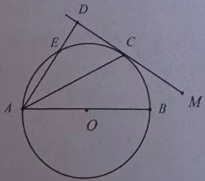
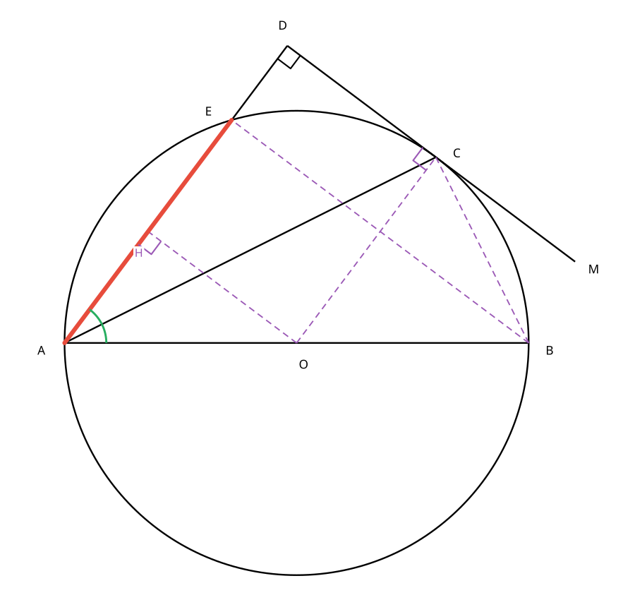

如图，$AB$ 是 $⊙O$ 的直径，直线 $MC$ 与 $⊙O$ 相切于点 $C$，过 $A$ 作 $MC$ 的垂线，垂足为 $D$，线段 $AD$ 与 $⊙O$ 相交于点 $E$。

$①$ 求证：$AC$ 是 $\angle DAB$ 的角平分线；

$②$ 若 $AB=10$，$AC=4 \sqrt{5}$, 求 $AE$ 的长.

> [!question]- 点击查看答案与解析
> 【答案】(1) 证明见解析；(2) $AE=6$
> 
> 【考点】切线的性质、平行线判定与性质、等腰三角形与角平分线、相似三角形、垂径定理、勾股定理 → [[【初中数学知识点体系-人教版】#30-1 直线和圆的位置关系]]、[[【初中数学知识点体系-人教版】#29-1 圆的基本性质]]、[[【初中数学知识点体系-人教版】#31-2 相似三角形]]、[[【初中数学知识点体系-人教版】#32-1 锐角三角函数]]
> 
> 【解析】
> (1) 证明 $AC$ 是 $\angle DAB$ 的角平分线：
> 连接 $OC$。
> $\because MC$ 与 $⊙O$ 相切于点 $C$，$\therefore OC\perp MC$。
> $\because AD\perp MC$，$\therefore AD\parallel OC$。
> $\therefore \angle DAC=\angle OCA$（内错角相等）。
> $\because OA=OC$，$\therefore \angle OCA=\angle OAC$，即 $\angle CAB=\angle OCA$。
> $\therefore \angle DAC=\angle CAB$，$\therefore AC$ 平分 $\angle DAB$。
> 
> (2) 求 $AE$ 的长：
> $\because AB$ 是直径，$\therefore \angle ACB=90^\circ$。连接 $BC$。
> 在 $\mathrm{Rt}△ABC$ 中，$BC=\sqrt{AB^2-AC^2}=\sqrt{100-80}=2\sqrt{5}$。
> $\because AC$ 平分 $\angle DAB$，$\therefore \angle DAC=\angle CAB$；又 $\angle ADC=\angle ACB=90^\circ$，
> $\therefore △ADC\sim△ACB$，$\therefore \dfrac{AD}{AC}=\dfrac{AC}{AB}=\dfrac{DC}{CB}$，
> $\therefore AD=\dfrac{AC^2}{AB}=\dfrac{80}{10}=8$，$DC=\dfrac{AC\cdot CB}{AB}=\dfrac{4\sqrt5\cdot 2\sqrt5}{10}=4$。
> 过 $O$ 作 $OH\perp AD$ 于 $H$。$\because AD\perp MC$、$OC\perp MC$，$\therefore$ 四边形 $OHDC$ 是矩形（三个角是直角），
> $\therefore OH=DC=4$。
> 在 $\mathrm{Rt}△OHA$ 中，$AH=\sqrt{OA^2-OH^2}=\sqrt{25-16}=3$。
> $\because OH\perp AE$ 且 $AE$ 是弦，$\therefore H$ 是 $AE$ 的中点（垂径定理），$\therefore AE=2AH=6$。
> （旁证：连接 $BE$，$\angle AEB=90^\circ$，$BE=8$，$AE=\sqrt{AB^2-BE^2}=6$ ✓）
> 
> 验证（数值自校验 30 项全部通过）：建系 $O(0,0)$、$A(-5,0)$、$B(5,0)$、$C(3,4)$、$D(-0.2,6.4)$、$E(-1.4,4.8)$、$H(-3.2,2.4)$，$r=5$。逐项成立：$A$、$B$、$C$、$E$ 在圆上、$AB$ 是直径、$AC=4\sqrt5$、$BC=2\sqrt5$、$\angle ACB=90^\circ$、$M$、$C$、$D$ 共线、$OC\perp MC$（切线）、$AD\perp MC$、$AD\parallel OC$、$\angle DAC=\angle CAB$（角平分线）、$\angle DAC=\angle OCA$、$\angle OCA=\angle OAC$、$AD=\dfrac{AC^2}{AB}=8$、$DC=4$、$E$ 在线段 $AD$ 上、$\angle AEB=90^\circ$、$BE=8$、$OH\perp AD$、四边形 $OHDC$ 是矩形、$OH=DC=4$、$AH=3$、$H$ 是 $AE$ 中点（垂径定理）、$AE=2AH=6$、$AE=AB\cos\angle BAE$ 旁证、$DE=AD-AE=2$、$AE\neq 4$（原答案错误）。原答案 $AE=4$ 错误：$4$ 恰是线段 $DC$ 的长；原解析 (2) 末句"在 $\mathrm{Rt}△ADE$ 中，利用相似或三角函数关系，可求得 $AE=4$"有双重错误——一是 $D$、$E$、$A$ 三点共线（$E$ 在线段 $AD$ 上），$\triangle ADE$ 是退化三角形，根本不存在；二是把中间量 $DC=4$ 误当作 $AE$。正确路线是"作 $OH\perp AD$，矩形 $OHDC$ 得 $OH=4$，勾股得 $AH=3$，垂径定理得 $AE=6$"。配图中 $AE$ 红色加粗为所求线段，$OC$、$OH$、$BC$、$BE$ 紫色虚线为辅助线，$D$ 处黑色直角标记为 $AD\perp MC$，$C$、$H$ 处紫色直角标记为切线垂直与 $OH\perp AD$，$A$ 处绿色同半径角弧表示 $\angle DAC=\angle CAB$。
> 
> 
> 
> 【易错点】一是 $E$ 在线段 $AD$ 上，$A$、$E$、$D$ 共线，不存在"$\mathrm{Rt}△ADE$"，求 $AE$ 不能在这个"三角形"里做文章；二是求 $AE$ 的标准工具是垂径定理：作 $OH\perp AD$ 后 $AE=2AH$，而 $OH$ 通过矩形 $OHDC$ 转化为已求出的 $DC$；三是 $△ADC\sim△ACB$ 的对应比例 $\dfrac{AD}{AC}=\dfrac{AC}{AB}=\dfrac{DC}{CB}$ 要整体用，$DC=4$ 只是中间量别当结论；四是 (1) 的推理链"切线 $\Rightarrow OC\perp MC$，$AD\perp MC\Rightarrow AD\parallel OC\Rightarrow$ 内错角 $+$ 等腰底角"缺一环就断。
