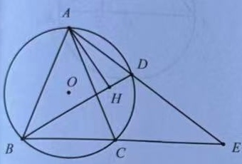
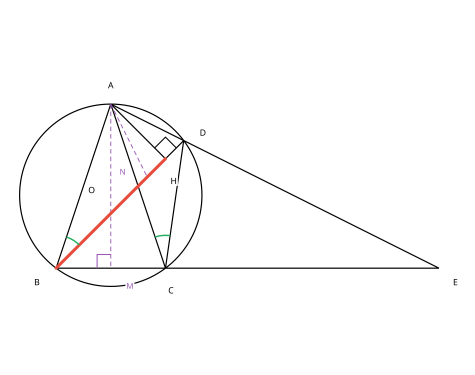

如图，$\triangle ABC$ 内接于 $\odot O$, $BC = 2$, $AB = AC$, $D$ 是 $AC$ 上的动点，且 $\cos \angle ABC = \frac{\sqrt{10}}{10}$.

(1) 求 $AB$ 的长度；

(2) 在点 $D$ 的运动过程中，弦 $AD$ 的延长线交 $BC$ 延长于点 $E$，问 $AD\cdot AE$ 的值是否变化，若不变，求 $AD\cdot AE$ 的值；若变化，请说明理由；

(3) 在点 $D$ 的运动过程中，过点 $A$ 作 $AH \perp BD$，求证：$BH = CD + DH$.

> [!question]- 点击查看答案与解析
> 【答案】(1) $AB=\sqrt{10}$；(2) 不变，$AD\cdot AE=10$；(3) 证明见解析
> 
> 【考点】等腰三角形三线合一、锐角三角函数、圆周角定理（同弧圆周角相等）、相似三角形判定与性质、全等三角形判定（AAS）、截长补短法 → [[【初中数学知识点体系-人教版】#29-1 圆的基本性质]]、[[【初中数学知识点体系-人教版】#15-3 等腰三角形]]、[[【初中数学知识点体系-人教版】#31-2 相似三角形]]、[[【初中数学知识点体系-人教版】#14-2 三角形全等的判定]]、[[【初中数学知识点体系-人教版】#32-1 锐角三角函数]]
> 
> 【解析】
> (1) 求 $AB$ 的长度：
> 过 $A$ 作 $AM\perp BC$ 于 $M$。$\because AB=AC$，$\therefore M$ 是 $BC$ 中点（三线合一），$BM=\dfrac{1}{2}BC=1$。
> 在 $\mathrm{Rt}△ABM$ 中，$\cos\angle ABC=\dfrac{BM}{AB}$，$\therefore AB=BM\div\cos\angle ABC=1\div\dfrac{\sqrt{10}}{10}=\sqrt{10}$。
> 
> (2) $AD\cdot AE$ 不变，值为 10：
> $\because AB=AC$，$\therefore \angle ABC=\angle ACB$。
> $\because \angle ADB$ 与 $\angle ACB$ 都是弧 $AB$（不含 $D$）所对的圆周角，$\therefore \angle ADB=\angle ACB=\angle ABC$。
> $\because E$ 在 $BC$ 的延长线上，$\therefore \angle ABE=\angle ABC$，即 $\angle ADB=\angle ABE$。
> 又 $\because E$ 在 $AD$ 的延长线上，射线 $AD$ 与射线 $AE$ 相同，$\therefore \angle DAB=\angle EAB$（公共角）。
> $\therefore △ADB\sim△ABE$（AA），$\therefore \dfrac{AD}{AB}=\dfrac{AB}{AE}$，
> $\therefore AD\cdot AE=AB^2=10$，与 $D$ 的位置无关，值不变。
> 
> (3) 证明 $BH=CD+DH$：
> 在 $HB$ 上截取 $HN=HD$，连接 $AN$。
> $\because AH\perp BD$ 且 $HN=HD$，$\therefore AH$ 是 $DN$ 的垂直平分线，$\therefore AN=AD$，$\therefore \angle AND=\angle ADN$。
> $\therefore \angle ANB=180^\circ-\angle AND=180^\circ-\angle ADN=180^\circ-\angle ADB$。
> $\because$ 四边形 $ABCD$ 内接于 $⊙O$（顶点顺序 $A$、$B$、$C$、$D$），$\therefore \angle ADC+\angle ABC=180^\circ$，即 $\angle ADC=180^\circ-\angle ABC$；
> 又 $\angle ADB=\angle ABC$（见 (2)），$\therefore \angle ANB=\angle ADC$。
> $\because \angle ABN=\angle ABD$ 与 $\angle ACD$ 都是弧 $AD$ 所对的圆周角，$\therefore \angle ABN=\angle ACD$。
> 在 $△ABN$ 与 $△ACD$ 中：$\angle ANB=\angle ADC$，$\angle ABN=\angle ACD$，$AB=AC$，
> $\therefore △ABN\cong△ACD$（AAS），$\therefore BN=CD$。
> $\therefore BH=BN+NH=CD+DH$。
> 
> 验证（数值自校验 36 项全部通过）：建系 $B(-1,0)$、$C(1,0)$、$M(0,0)$、$A(0,3)$、$O\left(0,\dfrac{4}{3}\right)$、$D\left(\dfrac{4}{3},\dfrac{7}{3}\right)$、$E(6,0)$、$H(1,2)$、$N\left(\dfrac{2}{3},\dfrac{5}{3}\right)$，$r=\dfrac{5}{3}$。逐项成立：$A$、$B$、$C$、$D$ 在圆上、$BC=2$、$AB=AC=\sqrt{10}$、$\cos\angle ABC=\dfrac{\sqrt{10}}{10}$、$AM\perp BC$、$BM=1$、$AM=3$、勾股 $BM^2+AM^2=AB^2$、$A$、$D$、$E$ 共线且 $D$ 在中间、$B$、$C$、$E$ 共线且 $C$ 在中间、$\angle ADB=\angle ACB$（同弧）、$\angle ABE=\angle ABC$（同角）、$\angle DAB=\angle EAB$（同角）、$\angle ADB=\angle ABE$（相似关键）、$\dfrac{AD}{AB}=\dfrac{AB}{AE}$、$AD\cdot AE=10$、$AD=\dfrac{2\sqrt5}{3}$、$AE=3\sqrt5$、**第二位置** $D_2\left(\dfrac{\sqrt{21}}{3},2\right)$、$E_2(\sqrt{21},0)$ 处 $AD\cdot AE$ 仍 $=10$（不变性直接验证）、$H$ 在 $BD$ 上、$AH\perp BD$、$BH=2\sqrt2$、$DH=\dfrac{\sqrt2}{3}$、$CD=\dfrac{5\sqrt2}{3}$、$BH=CD+DH$（结论成立）、$N$ 在 $BH$ 上、$HN=HD$（构造）、$AN=AD$（垂直平分线）、$\angle ANB=\angle ADC$、$\angle ABN=\angle ACD$（同弧）、$BN=CD$（全等对应）。原答案数值 (1)(2) 正确，但原解析 (2) 推理链错误：一是"连接 $BE$"无意义（$B$、$E$ 同在直线 $BC$ 上）；二是"$\angle ADE=\angle ABC$（圆内接四边形外角等于内对角）"用错角——$A$、$D$、$E$ 三点共线，$\angle ADE$ 是平角，不是任何三角形的内角；三是由此写"$△ADE\sim△ABE$"根本不存在（$△ADE$ 退化成线段），正确对应是 $△ADB\sim△ABE$（$\angle ADB=\angle ABE$、公共角 $\angle DAB=\angle EAB$）。原解析 (3) 构造错误："延长 $HD$ 至 $N$ 使 $DN=CD$"得到的 $N$ 在 $D$ 外侧，此时 $BN=BH+HD+DN>BH$，与要证的 $BN=CD$ 自相矛盾，且"$△ABN\cong△ACD$（利用角度和边的关系）"纯跳步无依据；正确构造是在 $HB$ 上截取 $HN=HD$。配图中 $BH$ 红色加粗为所证线段，$AM$、$AN$ 紫色虚线为辅助线，$M$ 处紫色直角标记为 $AM\perp BC$，$H$ 处黑色小方块为 $AH\perp BD$，$B$、$C$ 处绿色同半径角弧表示 $\angle ABN=\angle ACD$。
> 
> 
> 
> 【易错点】一是 (2) 的相似对应：$△ADB\sim△ABE$ 中 $D\leftrightarrow B$、$B\leftrightarrow E$，比例式 $\dfrac{AD}{AB}=\dfrac{AB}{AE}$，别把 $\angle ADE$（平角）当三角形内角；二是 $\angle ADB=\angle ABC$ 要分两步：同弧圆周角 $\angle ADB=\angle ACB$，再加等腰 $\angle ACB=\angle ABC$；三是 (3) 截长补短方向：在 $HB$ 内截取 $HN=HD$（靠近 $B$ 一侧），不是延长 $HD$，否则结论反号；四是全等用 AAS（$\angle ANB=\angle ADC$、$\angle ABN=\angle ACD$、$AB=AC$ 是 $\angle ANB$、$\angle ADC$ 的对边），别误用 SSA。
