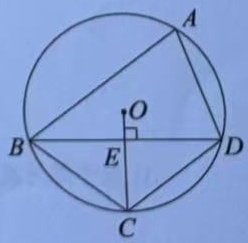
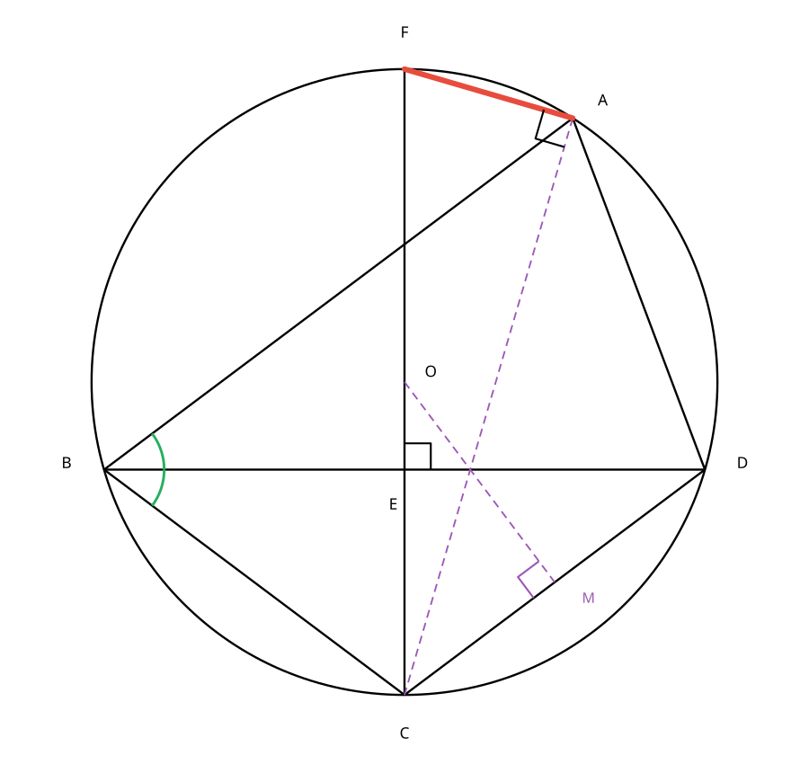

如图，$⊙O$ 为四边形 $ABCD$ 的外接圆，$BD$ 平分 $\angle ABC$，$OC ⊥ BD$ 于点 $E$.

(1) 求证：$AD = BC$;

(2) 延长 $CO$ 交 $⊙O$ 于点 $F$，连接 $AF$，若 $AD = 5$，$\sin \angle CBD = \frac{3}{5}$，求 $AF$ 的长.

> [!question]- 点击查看答案与解析
> 【答案】(1) 证明见解析；(2) $AF=\dfrac{7}{3}$
> 
> 【考点】圆周角定理（圆周角与弧、弦的对应）、垂径定理（垂直于弦的直径平分弦所对的弧）、等弧对等弦、锐角三角函数、勾股定理、等腰三角形三线合一 → [[【初中数学知识点体系-人教版】#29-1 圆的基本性质]]、[[【初中数学知识点体系-人教版】#32-1 锐角三角函数]]、[[【初中数学知识点体系-人教版】#20-1 勾股定理]]、[[【初中数学知识点体系-人教版】#15-3 等腰三角形]]
> 
> 【解析】
> (1) 证明 $AD=BC$：
> $\because BD$ 平分 $\angle ABC$，$\therefore \angle ABD=\angle CBD$。
> $\therefore$ 弧 $AD=$ 弧 $CD$（在同圆中，相等的圆周角所对的弧相等）。
> $\because CF$ 过圆心 $O$ 且 $OC\perp BD$，$\therefore$ 弧 $BC=$ 弧 $CD$（垂径定理：垂直于弦的直径平分这条弦所对的弧）。
> $\therefore$ 弧 $AD=$ 弧 $BC$，$\therefore AD=BC$（等弧对等弦）。
> 
> (2) 求 $AF$ 的长：
> 由 (1)，弧 $AD=$ 弧 $CD=$ 弧 $BC$，$\therefore DC=BC=AD=5$。
> 设 $\angle CBD=\alpha$，$\sin\alpha=\dfrac{3}{5}$，$\cos\alpha=\dfrac{4}{5}$。
> 求半径 $r$：连接 $OD$、$OC$，作 $OM\perp CD$ 于 $M$。$\because OD=OC$，$\therefore M$ 是 $CD$ 中点（三线合一），$CM=\dfrac{5}{2}$，且 $OM$ 平分 $\angle COD$，$\therefore \angle COM=\dfrac{1}{2}\angle COD=\angle CBD=\alpha$（圆心角是同弧圆周角的二倍）。
> 在 $\mathrm{Rt}△OMC$ 中，$\sin\angle COM=\dfrac{CM}{OC}$，$\therefore r=OC=CM\div\sin\alpha=\dfrac{5}{2}\div\dfrac{3}{5}=\dfrac{25}{6}$，直径 $CF=2r=\dfrac{25}{3}$。
> 求 $AC$：$\because DA=DC$，$\therefore △DAC$ 是等腰三角形，底角 $\angle DAC=\angle DCA$。
> 又 $\angle DAC=\angle DBC=\alpha$、$\angle DCA=\angle DBA=\alpha$（同弧圆周角，弧 $DC$ 与弧 $AD$ 相等），两底角都是 $\alpha$。
> 过 $D$ 作 $DN\perp AC$ 于 $N$，则 $N$ 是 $AC$ 中点（三线合一）。在 $\mathrm{Rt}△DNA$ 中，$AN=AD\cos\angle DAC=5\times\dfrac{4}{5}=4$，$\therefore AC=8$。
> $\because CF$ 是直径，$\therefore \angle CAF=90^\circ$（直径所对圆周角是直角）。
> 在 $\mathrm{Rt}△CAF$ 中，$AF=\sqrt{CF^2-AC^2}=\sqrt{\left(\dfrac{25}{3}\right)^2-64}=\sqrt{\dfrac{625-576}{9}}=\sqrt{\dfrac{49}{9}}=\dfrac{7}{3}$。
> 
> 验证（数值自校验 28 项全部通过）：建系 $O(0,0)$、$A\left(2.24,\dfrac{527}{150}\right)$、$B\left(-4,-\dfrac{7}{6}\right)$、$C\left(0,-\dfrac{25}{6}\right)$、$D\left(4,-\dfrac{7}{6}\right)$、$E\left(0,-\dfrac{7}{6}\right)$、$F\left(0,\dfrac{25}{6}\right)$、$M\left(2,-\dfrac{8}{3}\right)$，$r=\dfrac{25}{6}$。逐项成立：$A$、$B$、$C$、$D$、$F$ 在圆上、$BD$ 平分 $\angle ABC$、$OC\perp BD$ 于 $E$、$F$ 在 $CO$ 延长线上（$O$ 在中间）、$CF$ 是直径、$AD=5$、$BC=5$、$CD=5$（等弧对等弦）、$AD=BC$（(1) 成立）、$\sin\angle CBD=\dfrac35$、$OM\perp CD$、$M$ 是 $CD$ 中点、$CM=\dfrac52$、$\angle COM=\angle CBD$、$r=\dfrac{25}{6}$、$OM=\dfrac{10}{3}$、$AC=8$、$\angle CAF=90^\circ$、$\angle CDF=90^\circ$、$DF=\dfrac{20}{3}$、$CD^2+DF^2=CF^2$、$AF=\dfrac{7}{3}$、$AF^2+AC^2=CF^2$、$AF\neq8$（原答案错误）。原答案 $AF=8$ 错误：$8$ 恰是**弦 $AC$** 的长；原解析 (2) 写到 $AF=\sqrt{CF^2-AC^2}$ 这一步框架是对的，但末句"由 $\sin\angle CBD=\dfrac{3}{5}$ 和已知条件，计算得 $AF=8$"无任何代入过程，实际把中间量 $AC=8$ 误当成了 $AF$（正确代入应得 $AF=\sqrt{\dfrac{625}{9}-64}=\dfrac{7}{3}$）。原解析 (1) 正确。配图中 $AF$ 红色加粗为所求线段，$AC$、$OM$ 紫色虚线为辅助线（$AC$ 为解析中的关键中间量，$OM\perp CD$ 用于求半径），$E$、$A$ 处黑色小方块为 $OC\perp BD$、$\angle CAF=90^\circ$，$M$ 处紫色直角标记为 $OM\perp CD$，$B$ 处两段绿色同半径角弧表示 $\angle ABD=\angle DBC$。
> 
> 
> 
> 【易错点】一是 (1) 中垂径定理用的是"直径 $CF$ 垂直弦 $BD$ ⇒ 平分弧 $BD$"，得到的是弧 $BC=$ 弧 $CD$（含 $C$ 的那段弧），别写成弧 $BAD$；二是求 $r$ 的关键是 $\angle COM=\angle CBD$（半圆心角等于同弧圆周角），比值别写反成 $OC=\dfrac{CM}{\cos\alpha}$；三是 $AC=8$ 只是中间量，$\sqrt{CF^2-AC^2}=\sqrt{\dfrac{625}{9}-64}=\dfrac{7}{3}$，原答案就是把 $AC$ 误当 $AF$；四是 $CF$ 是直径才有 $\angle CAF=90^\circ$，用勾股定理前要先说明直角在 $A$ 处。
