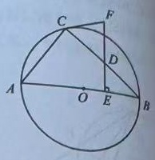
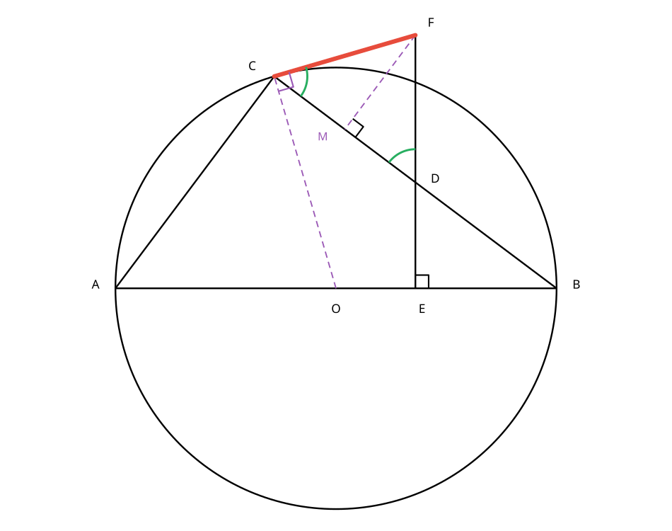

如图，$⊙O$ 是 $△ABC$ 的外接圆，$AB$ 是 $⊙O$ 的直径，过 $BC$ 上一点 $D$ 作 $DE⊥AB$ 于点 $E$，过点 $C$ 作 $⊙O$ 的切线交 $ED$ 的延长线于点 $F$.

(1) 求证: $\angle DCF = \angle CDF$;

(2) 若 $D$ 为 $BC$ 的中点, $\odot O$ 的半径为 5, $\cos \angle CDF = \frac{3}{5}$, 求 $CF$ 的长.

> [!question]- 点击查看答案与解析
> 【答案】(1) 证明见解析；(2) $CF=\dfrac{10}{3}$
> 
> 【考点】切线的性质、圆周角定理（直径所对圆周角为直角）、对顶角与同角的余角、等腰三角形判定与三线合一、锐角三角函数 → [[【初中数学知识点体系-人教版】#30-1 直线和圆的位置关系]]、[[【初中数学知识点体系-人教版】#29-1 圆的基本性质]]、[[【初中数学知识点体系-人教版】#15-3 等腰三角形]]、[[【初中数学知识点体系-人教版】#32-1 锐角三角函数]]
> 
> 【解析】
> (1) 证明 $\angle DCF=\angle CDF$：
> 连接 $OC$。
> $\because CF$ 是 $⊙O$ 的切线，$\therefore OC\perp CF$，即 $\angle OCF=90^\circ$，$\therefore \angle DCF=90^\circ-\angle OCD$。
> $\because DE\perp AB$，$\therefore \angle DEB=90^\circ$，在 $\mathrm{Rt}△DEB$ 中，$\angle EDB=90^\circ-\angle DBE$。
> $\because F$ 在 $ED$ 的延长线上、$C$ 在 $BD$ 的延长线上，$\therefore \angle CDF=\angle EDB$（对顶角），
> $\therefore \angle CDF=90^\circ-\angle DBE$。
> $\because OB=OC$，$\therefore \angle OCB=\angle OBC$，即 $\angle OCD=\angle DBE$（$D$ 在线段 $BC$ 上，$\angle OCD$ 即 $\angle OCB$）。
> $\therefore \angle DCF=\angle CDF$。
> 
> (2) 求 $CF$ 的长：
> 由 (1) 知 $\angle DCF=\angle CDF$，$\therefore CF=DF$（等角对等边）。
> $\because AB$ 是直径，$\therefore \angle ACB=90^\circ$，$AB=10$。
> 在 $\mathrm{Rt}△DEB$ 中，$\angle EDB$ 与 $\angle DBE$ 互余；在 $\mathrm{Rt}△ACB$ 中，$\angle BAC$ 与 $\angle ABC$ 互余，而 $\angle DBE=\angle ABC$（同一个角），
> $\therefore \angle BAC=\angle EDB=\angle CDF$，$\therefore \cos\angle BAC=\dfrac{3}{5}$，$\sin\angle BAC=\dfrac{4}{5}$。
> 在 $\mathrm{Rt}△ACB$ 中，$BC=AB\cdot\sin\angle BAC=10\times\dfrac{4}{5}=8$。
> $\because D$ 是 $BC$ 的中点，$\therefore CD=\dfrac{1}{2}BC=4$。
> 过 $F$ 作 $FM\perp CD$ 于 $M$。$\because FC=FD$，$\therefore M$ 是 $CD$ 的中点（三线合一），$DM=\dfrac{1}{2}CD=2$。
> 在 $\mathrm{Rt}△FMD$ 中，$\cos\angle FDM=\dfrac{DM}{DF}$，即 $\dfrac{3}{5}=\dfrac{2}{DF}$，
> $\therefore DF=\dfrac{10}{3}$，$\therefore CF=DF=\dfrac{10}{3}$。
> 
> 验证（数值自校验 30 项全部通过）：建系 $O(-5,0)$、$A(-10,0)$、$B(0,0)$、$C(-6.4,4.8)$、$D(-3.2,2.4)$、$E(-3.2,0)$、$F\left(-3.2,\dfrac{86}{15}\right)$、$M(-4.8,3.6)$，$r=5$。逐项成立：$A$、$B$、$C$ 在圆上、$AB$ 是直径、$\angle ACB=90^\circ$、$BC=8$、$AC=6$、$D$ 是 $BC$ 中点、$DB=DC=4$、$DE\perp AB$、$E$ 在线段 $AB$ 上、$DE=\dfrac{12}{5}$、$BE=\dfrac{16}{5}$、$F$ 在 $ED$ 延长线上（越过 $D$）、$OC\perp CF$（切线）、$\angle CDF=\angle EDB$（对顶角）、$\cos\angle CDF=\dfrac35$、$\angle DCF=\angle CDF$（(1) 成立）、$CF=DF$、$\angle EDB=\angle BAC$、$\sin\angle BAC=\dfrac45$、$FM\perp CD$、$M$ 是 $CD$ 中点、$DM=2$、$DF=\dfrac{DM}{\cos\angle CDF}=\dfrac{10}{3}$、$CF=\dfrac{10}{3}$、$FM=\dfrac{8}{3}$、$OF^2=OC^2+CF^2$、$CF\neq\dfrac{25}{4}$（原答案错误）。原答案 $CF=\dfrac{25}{4}$ 错误：原解析 (2) 在写出 $\angle ACB=90^\circ$ 后仅写"在 $\mathrm{Rt}△ABC$ 中，利用中点和三角函数关系，可求得 $CF=\dfrac{25}{4}$"，无任何列式过程，结论无依据（$\dfrac{25}{4}=6.25$ 比 $BC=8$ 的一半还小的关系都凑不出，正确值 $\dfrac{10}{3}\approx3.33$）。原解析 (1) 思路正确但漏掉关键一步：$\angle CDF$ 与 $\mathrm{Rt}△DEB$ 内角 $\angle EDB$ 是对顶角关系，需先说明"$\angle CDF=\angle EDB$"再转化，原文直接写"$\angle CDF=90^\circ-\angle DBE$"属跳步。配图中 $CF$ 红色加粗为所求线段，$OC$、$FM$ 紫色虚线为辅助线，$C$ 处紫色直角标记为 $\angle OCF=90^\circ$，$E$、$M$ 处黑色小方块为 $DE\perp AB$、$FM\perp CD$，$C$、$D$ 处绿色同半径角弧表示 $\angle DCF=\angle CDF$。
> 
> 
> 
> 【易错点】一是 (1) 中 $\angle CDF$ 不在 $\mathrm{Rt}△DEB$ 内，必须先用对顶角 $\angle CDF=\angle EDB$ 搭桥，再与 $\angle OCD=\angle DBE$（同底角）配合完成余角代换；二是 $\cos\angle BAC=\dfrac35$ 是通过"两个直角三角形同余一个 $\angle ABC$"转来的（$\angle BAC=\angle EDB$），别直接把 $\dfrac35$ 安到 $\angle ABC$ 上导致 $BC$、$AC$ 互换；三是 (2) 的核心是 $FC=FD$ 后作底边 $CD$ 上的高 $FM$，用三线合一得 $DM=2$，再 $\cos\angle CDF=\dfrac{DM}{DF}$ 解出 $DF$，比值别写反成 $DF=\dfrac{6}{5}$；四是所求 $CF$ 等于 $DF$ 而不是 $CD$ 或 $DE$ 等相关线段，数值 $\dfrac{25}{4}$ 在原解析中无任何推导支撑，不可当作验证锚点。
