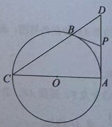
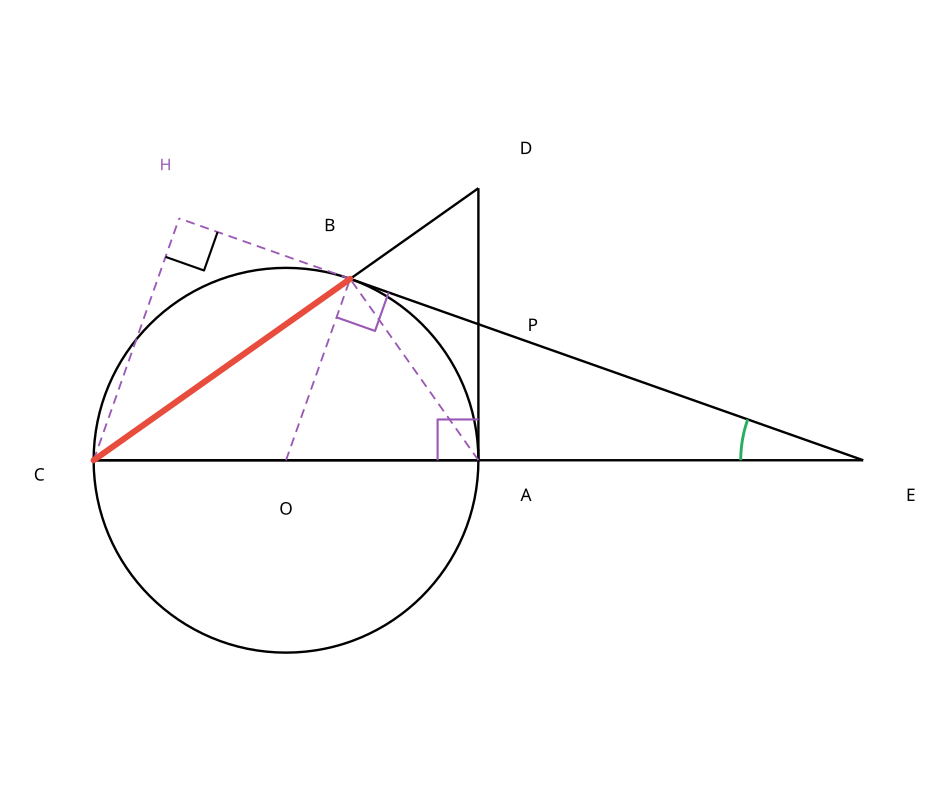

如图，过 $⊙O$ 外一点 $P$ 作 $⊙O$ 的两条切线 $PA，PB$，切点分别为 $A，B$，$AC$ 是 $⊙O$ 的直径，连接 $CB$ 并延长交直线 $AP$ 于点 $D$。

(1) 求证：$PD = PA$;

(2) 延长 $BP$ 交 $CA$ 的延长线于点 $E$．若 $\odot O$ 的半径为 $\sqrt{2}$，$\sin E = \frac{1}{3}$，求 $BC$ 的长.

> [!question]- 点击查看答案与解析
> 【答案】(1) 证明见解析；(2) $BC=\dfrac{4\sqrt{3}}{3}$
> 
> 【考点】切线长定理与切线性质、圆周角定理（直径所对圆周角为直角）、等腰三角形三线合一、过中点平行线平分第三边、锐角三角函数、勾股定理 → [[【初中数学知识点体系-人教版】#30-1 直线和圆的位置关系]]、[[【初中数学知识点体系-人教版】#29-1 圆的基本性质]]、[[【初中数学知识点体系-人教版】#15-3 等腰三角形]]、[[【初中数学知识点体系-人教版】#32-1 锐角三角函数]]、[[【初中数学知识点体系-人教版】#20-1 勾股定理]]
> 
> 【解析】
> (1) 证明 $PD=PA$：
> 连接 $AB$、$OP$。
> $\because PA、PB$ 是 $⊙O$ 的两条切线，$\therefore PA=PB$，$\angle OPA=\angle OPB$（切线长定理）。
> $\therefore OP\perp AB$（等腰 $△PAB$ 三线合一）。
> $\because AC$ 是直径，$\therefore \angle ABC=90^\circ$，即 $AB\perp CD$。
> $\therefore OP\parallel CD$。
> 在 $△ACD$ 中，$O$ 是 $CA$ 的中点且 $OP\parallel CD$，$\therefore P$ 是 $AD$ 的中点，$\therefore PD=PA$。
> 
> (2) 求 $BC$ 的长：
> 连接 $OB$。$\because BE$ 切 $⊙O$ 于 $B$，$\therefore OB\perp BE$，即 $\angle OBE=90^\circ$。
> 在 $\mathrm{Rt}△OBE$ 中，$\sin E=\dfrac{OB}{OE}=\dfrac{1}{3}$，$OB=\sqrt{2}$，$\therefore OE=3\sqrt{2}$，
> $BE=\sqrt{OE^2-OB^2}=\sqrt{18-2}=4$。
> $\therefore EC=EO+OC=3\sqrt{2}+\sqrt{2}=4\sqrt{2}$。
> $\because \sin E=\dfrac{1}{3}$，$\therefore \cos E=\sqrt{1-\dfrac{1}{9}}=\dfrac{2\sqrt{2}}{3}$。
> 过 $C$ 作 $CH\perp EB$，交 $EB$ 的延长线于点 $H$（$\angle EBC$ 为钝角，垂足落在延长线上）。
> 在 $\mathrm{Rt}△ECH$ 中，$CH=EC\cdot\sin E=4\sqrt{2}\times\dfrac{1}{3}=\dfrac{4\sqrt{2}}{3}$，
> $EH=EC\cdot\cos E=4\sqrt{2}\times\dfrac{2\sqrt{2}}{3}=\dfrac{16}{3}$。
> $\therefore HB=EH-EB=\dfrac{16}{3}-4=\dfrac{4}{3}$。
> 在 $\mathrm{Rt}△CHB$ 中，$BC=\sqrt{CH^2+HB^2}=\sqrt{\dfrac{32}{9}+\dfrac{16}{9}}=\sqrt{\dfrac{48}{9}}=\dfrac{4\sqrt{3}}{3}$。
> 
> 验证（数值自校验 33 项全部通过）：建系 $O(0,0)$、$C(-\sqrt2,0)$、$A(\sqrt2,0)$、$B\left(\dfrac{\sqrt2}{3},\dfrac{4}{3}\right)$、$P(\sqrt2,1)$、$D(\sqrt2,2)$、$E(3\sqrt2,0)$、$H\left(-\dfrac{5\sqrt2}{9},\dfrac{16}{9}\right)$，$r=\sqrt2$。逐项成立：$A$、$B$、$C$ 在圆上、$AC$ 是直径、$OA\perp AD$（$A$ 处切线）、$OB\perp BE$（$B$ 处切线）、$PA=PB=1$（切线长）、$P$ 在线段 $AD$ 与 $EB$ 上、$C$、$B$、$D$ 共线且 $B$ 在线段 $CD$ 上、$D$ 在直线 $AP$ 上、$PD=PA=1$（(1) 成立）、$OP\parallel BC$、$\angle ABC=90^\circ$、$AB\perp CD$、$\sin E=\dfrac13$、$E$ 在 $CA$ 延长线上（越过 $A$）、$OE=3\sqrt2$、$BE=4$、$EC=4\sqrt2$、$EA=2\sqrt2$、$EB^2=EA\cdot EC=16$（切割线旁证）、$CH\perp EH$、$H$ 在 $EB$ 延长线上（越过 $B$，$\angle EBC$ 钝角）、$CH=\dfrac{4\sqrt2}{3}$、$EH=\dfrac{16}{3}$、$HB=\dfrac{4}{3}$、$BC=\dfrac{4\sqrt{3}}{3}\approx2.31$、$AB^2+BC^2=AC^2=8$、$BC\neq2$（原答案错误）。原答案 $BC=2$ 错误：原解析 (2) 在求出 $AC=2\sqrt2$ 后仅写"在 $\mathrm{Rt}△OBE$ 中，利用三角函数关系和相似三角形，可求得 $BC=2$"，无任何过程，结论无依据（$\mathrm{Rt}△OBE$ 里根本没有 $BC$ 这条边）。原解析 (1) 正确。配图中 $BC$ 红色加粗为所求线段，$OB$、$AB$、$CH$ 紫色虚线为辅助线，$BH$ 紫色虚线为切线 $EB$ 越过 $B$ 的延长段（与 $CH$ 在垂足 $H$ 相接），$B$ 处紫色直角标记为 $\angle OBE=90^\circ$，$A$ 处紫色直角标记为 $\angle OAD=90^\circ$，$H$ 处黑色小方块为 $CH\perp EH$，$E$ 处绿色角弧为 $\angle E$。
> 
> 
> 
> 【易错点】一是 (1) 中"$OP\parallel CD$ 且 $O$ 是 $CA$ 中点 $\Rightarrow P$ 是 $AD$ 中点"用的是"过三角形一边中点且平行于另一边的直线平分第三边"，别倒因为果先假设 $P$ 是中点；二是 $\sin E=\dfrac{OB}{OE}$ 的斜边是 $OE$（直角在 $B$ 处），别错用 $\dfrac{OB}{BE}$ 解出 $BE$；三是 $\angle EBC$ 是钝角，高 $CH$ 的垂足 $H$ 落在 $EB$ 的延长线上，$HB=EH-EB$ 是减不是加，若误以为 $H$ 在线段 $EB$ 上会用 $HB=EB-EH$ 得负值；四是最后一步必须在 $\mathrm{Rt}△CHB$ 中用勾股定理开方：$\sqrt{\dfrac{48}{9}}=\dfrac{4\sqrt{3}}{3}$，别把 $\dfrac{48}{9}$ 误算成 $4$ 而得 $BC=2$。
