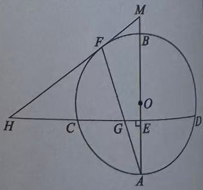
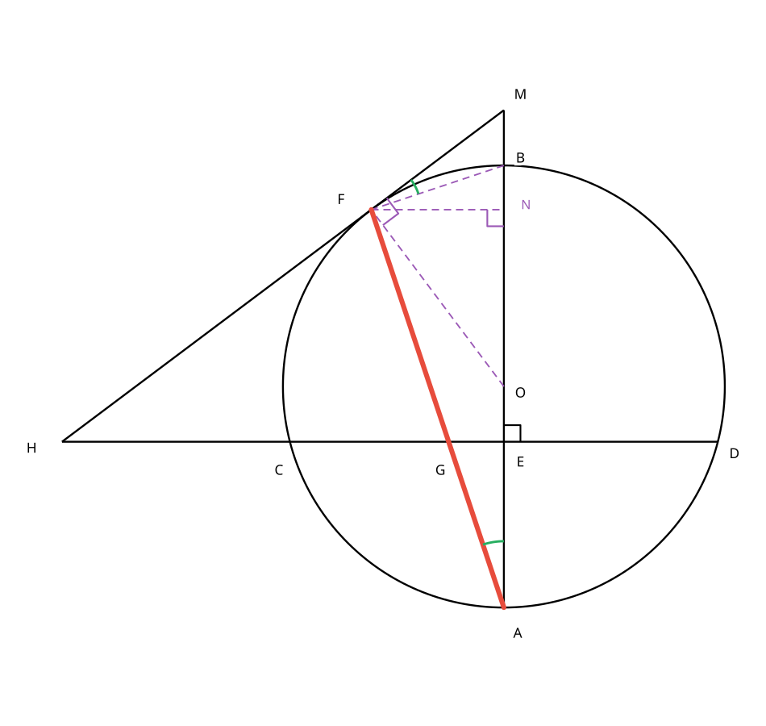

如图，$AB$ 是 $⊙O$ 的直径，弦 $CD⊥AB$ 于点 $E$，点 $F$ 在弧 $BC$ 上，$AF$ 与 $CD$ 交于点 $G$，点 $H$ 在 $DC$
的延长线上，且 $HG = HF$，延长 $HF$ 交 $AB$ 的延长线于点 $M$.

(1) 求证：$HF$ 是 $\odot O$ 的切线；

(2) 若 $\sin M = \frac{4}{5}$，$BM = 1$，求 $AF$ 的长.

> [!question]- 点击查看答案与解析
> 【答案】(1) 证明见解析；(2) $AF=\dfrac{12\sqrt{10}}{5}$
> 
> 【考点】垂径定理、切线的判定与性质、等腰三角形性质、对顶角与直角三角形两锐角互余、锐角三角函数、勾股定理 → [[【初中数学知识点体系-人教版】#29-1 圆的基本性质]]、[[【初中数学知识点体系-人教版】#30-1 直线和圆的位置关系]]、[[【初中数学知识点体系-人教版】#15-3 等腰三角形]]、[[【初中数学知识点体系-人教版】#32-1 锐角三角函数]]、[[【初中数学知识点体系-人教版】#20-1 勾股定理]]
> 
> 【解析】
> (1) 证明 $HF$ 是 $⊙O$ 的切线：
> 连接 $OF$。
> $\because HG=HF$，$\therefore \angle HGF=\angle HFG$（等边对等角）。
> $\because$ 点 $H$、$C$ 在 $G$ 同侧（顺序 $H$、$C$、$G$、$E$、$D$），$\therefore \angle HGF=\angle AGE$（对顶角）。
> $\because CD\perp AB$ 于 $E$，$\therefore$ 在 $\mathrm{Rt}△AGE$ 中，$\angle AGE=90^\circ-\angle GAE=90^\circ-\angle OAF$。
> $\because OA=OF$，$\therefore \angle OAF=\angle OFA$，$\therefore \angle HFG=\angle AGE=90^\circ-\angle OFA$。
> $\because$ 点 $G$ 在线段 $AF$ 上，射线 $FG$ 即射线 $FA$，$\therefore \angle AFH=\angle HFG$。
> $\therefore \angle OFH=\angle OFA+\angle AFH=\angle OFA+(90^\circ-\angle OFA)=90^\circ$，
> 即 $OF\perp HF$，又 $F$ 在 $⊙O$ 上，$\therefore HF$ 是 $⊙O$ 的切线。
> 
> (2) 求 $AF$ 的长：
> 设半径为 $r$，则 $OF=r$，$OM=OB+BM=r+1$。
> $\because HM$ 切 $⊙O$ 于 $F$，$\therefore \angle OFM=90^\circ$。
> 在 $\mathrm{Rt}△OFM$ 中，$\sin M=\dfrac{OF}{OM}=\dfrac{r}{r+1}=\dfrac{4}{5}$，解得 $r=4$，
> $\therefore OM=5$，$FM=\sqrt{OM^2-OF^2}=\sqrt{25-16}=3$。
> 过 $F$ 作 $FN\perp AB$ 于 $N$。在 $\mathrm{Rt}△OFM$ 中由面积法：$FN=\dfrac{OF\cdot FM}{OM}=\dfrac{4\times 3}{5}=\dfrac{12}{5}$；
> 在 $\mathrm{Rt}△OFN$ 中，$ON=\sqrt{OF^2-FN^2}=\sqrt{16-\dfrac{144}{25}}=\sqrt{\dfrac{256}{25}}=\dfrac{16}{5}$。
> $\therefore AN=AO+ON=4+\dfrac{16}{5}=\dfrac{36}{5}$（$N$ 在 $O$ 上方、$A$ 在 $O$ 下方）。
> 在 $\mathrm{Rt}△AFN$ 中，$AF=\sqrt{FN^2+AN^2}=\sqrt{\dfrac{144}{25}+\dfrac{1296}{25}}=\sqrt{\dfrac{1440}{25}}=\dfrac{12\sqrt{10}}{5}$。
> （旁证：连 $BF$，$\angle AFB=90^\circ$，可算得 $BF=\dfrac{4\sqrt{10}}{5}$，$AF=3BF$，$AF^2+BF^2=64=AB^2$ ✓。）
> 
> 验证（数值自校验 44 项全部通过）：建系 $O(0,0)$、$A(0,-4)$、$B(0,4)$、$M(0,5)$、$F(-2.4,3.2)$、$E(0,-1)$、$C(-\sqrt{15},-1)$、$D(\sqrt{15},-1)$、$G(-1,-1)$、$H(-8,-1)$、$N(0,3.2)$（按原卷 $E$ 在 $O$ 下方）。逐项成立：$A$、$B$、$C$、$D$、$F$ 在圆上、$AB$ 是直径、$CD\perp AB$、$E$ 是 $CD$ 中点（垂径）、$E$ 在 $O$ 下方、$F$ 在弧 $BC$ 上、$A$、$G$、$F$ 共线、$G$ 在线段 $CD$ 上、$H$、$C$、$G$、$E$、$D$ 依次共线、$H$ 在 $DC$ 延长线上、$HG=HF=7$、$M$、$F$、$H$ 共线、$M$ 在 $AB$ 延长线上、$BM=1$、$OM=5$、$\sin M=\dfrac45$、$OF\perp FM$（切线）、$\angle HGF=\angle AGE$（对顶角）、$\angle HGF\neq\angle AGC$（原解析错误）、$\angle OAF=\angle OFA$、$\angle AGE=90^\circ-\angle OAF$、$\angle HFG=\angle HGF$、$\angle OFH=90^\circ$、$FM=3$、$MA=9$、$MF^2=MB\cdot MA$（切割线旁证）、$\angle AFB=90^\circ$、$\angle MFB=\angle MAF$（弦切角旁证）、$AF=3BF$、$AF^2+BF^2=AB^2$、$FN\perp AB$、$FN=\dfrac{12}{5}$（面积法）、$ON=\dfrac{16}{5}$、$AN=\dfrac{36}{5}$、$AF=\dfrac{12\sqrt{10}}{5}\approx7.59$、$\cos\angle FAB=\dfrac{3}{\sqrt{10}}$（非 $\dfrac35$）、$AF\neq\dfrac{24}{5}$（原答案错误）。原答案 $AF=\dfrac{24}{5}$ 错误：$\dfrac{24}{5}=8\times\dfrac{3}{5}$ 是把 $\mathrm{Rt}△ABF$ 中的 $\cos\angle FAB$ 误当成 $\dfrac{3}{5}$（即误认为 $\angle FAB$ 与 $\angle M$ 互余；实际 $\cos\angle FAB=\dfrac{3}{\sqrt{10}}$，$\angle FAB\approx18.4^\circ$、$\angle M\approx53.1^\circ$，两角和约 $71.6^\circ\neq90^\circ$），且原解析 (2) 末句"利用相似三角形或三角函数，在 $\mathrm{Rt}△ABF$ 中可求得"整段跳步无依据。原解析 (1) 角度链有两处硬伤：一是"$\angle HGF=\angle AGC$（对顶角）"错——$H$、$C$ 在 $G$ 同侧，$\angle HGF$ 与 $\angle AGC$ 实为邻补角关系，正确的对顶角是 $\angle HGF=\angle AGE$；二是"$\angle AGC=\angle OAF$（同弧 $AF$ 所对圆周角）"不成立——$G$ 不在圆上，$\angle AGC$ 根本不是圆周角，且 $\angle OAF$ 是圆心处等腰三角形的底角，与圆周角无关；正确路线是直角三角形 $AGE$ 的两锐角互余。配图（按原卷取 $E$ 在 $O$ 下方 $OE=1$ 的情形；可验证 $HG=HF$ 对弦 $CD$ 的任意位置恒成立，$AF$ 长与 $E$ 位置无关）中 $AF$ 红色加粗为所求线段，$OF$、$BF$、$FN$ 紫色虚线为辅助线，$F$ 处紫色直角标记为 $\angle OFM=90^\circ$，$N$ 处紫色直角标记为 $FN\perp AB$，$E$ 处黑色小方块为 $CD\perp AB$，$F$、$A$ 处绿色同半径角弧为弦切角旁证 $\angle MFB=\angle MAF$。
> 
> 
> 
> 【易错点】一是 (1) 中对顶角要找对：$H$、$C$ 在 $G$ 同侧，$\angle HGF$ 的对顶角是 $\angle AGE$ 而不是 $\angle AGC$；转化链是"$\angle HFG=\angle HGF=\angle AGE=90^\circ-\angle OAF=90^\circ-\angle OFA$"，最后用"射线 $FG$ 即射线 $FA$"合并成 $\angle OFH=90^\circ$；二是 $\sin M=\dfrac{OF}{OM}$ 中斜边是 $OM$（直角在 $F$ 处），别写成 $\dfrac{FM}{OM}$；三是 $AF$ 不能靠"$\cos\angle FAB=\dfrac35$"直接算——$\angle FAB$ 与 $\angle M$ 并不互余，正确中间量是作 $FN\perp AB$，面积法得 $FN=\dfrac{12}{5}$、勾股得 $ON=\dfrac{16}{5}$，再在 $\mathrm{Rt}△AFN$ 中 $AN=AO+ON=\dfrac{36}{5}$；四是 $N$ 在 $O$ 上方（$ON=\dfrac{16}{5}$），$AN=AO+ON$ 是加不是减，若误用 $AN=AO-ON$ 会得到错误数值。
