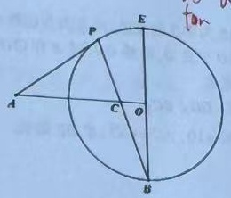
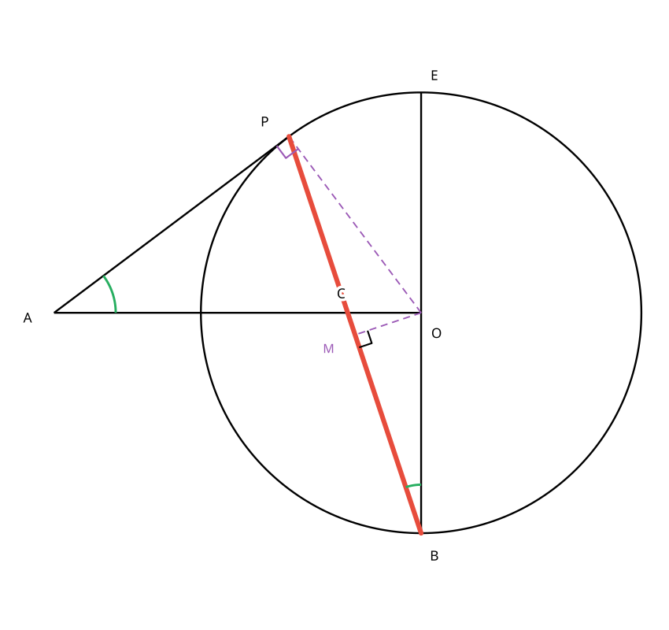

如图，$BE$ 是 $⊙O$ 直径，点 $A$ 是 $⊙O$ 外一点：$OA⊥OB$，$AP$ 切 $⊙O$ 于点 $P$，连接 $BP$ 交 $AO$ 于点 $C$.

(1) 求证：$\angle PAO=2\angle PBO$；

(2) 若 $⊙O$ 的半径为 5，$\tan\angle PAO=\frac{3}{4}$，求 $BP$ 的长.

> [!question]- 点击查看答案与解析
> 【答案】(1) 证明见解析；(2) $BP=3\sqrt{10}$
> 
> 【考点】切线的性质、等腰三角形性质、三角形内角和与外角、锐角三角函数、勾股定理、垂径定理 → [[【初中数学知识点体系-人教版】#30-1 直线和圆的位置关系]]、[[【初中数学知识点体系-人教版】#15-3 等腰三角形]]、[[【初中数学知识点体系-人教版】#29-1 圆的基本性质]]、[[【初中数学知识点体系-人教版】#32-1 锐角三角函数]]、[[【初中数学知识点体系-人教版】#20-1 勾股定理]]
> 
> 【解析】
> (1) 证明 $\angle PAO=2\angle PBO$：
> 连接 $OP$，设 $\angle PBO=\alpha$。
> $\because OB=OP$（半径），$\therefore \angle OPB=\angle PBO=\alpha$，$\therefore \angle BOP=180^\circ-2\alpha$（三角形内角和）。
> 由图，射线 $OA$ 在 $\angle BOP$ 内部，且 $\angle BOA=90^\circ$（$OA\perp OB$），
> $\therefore \angle AOP=\angle BOP-\angle BOA=(180^\circ-2\alpha)-90^\circ=90^\circ-2\alpha$。
> $\because AP$ 切 $⊙O$ 于 $P$，$\therefore OP\perp AP$，即 $\angle OPA=90^\circ$。
> 在 $\mathrm{Rt}△OPA$ 中，$\angle PAO=90^\circ-\angle AOP=90^\circ-(90^\circ-2\alpha)=2\alpha$。
> $\therefore \angle PAO=2\angle PBO$。
> 
> (2) 求 $BP$ 的长：
> 记 $\angle PAO=2\alpha$。$\because \tan\angle PAO=\dfrac{3}{4}$，在 $\mathrm{Rt}△OPA$ 中 $\tan\angle PAO=\dfrac{OP}{AP}$，
> $\therefore AP=OP\div\dfrac{3}{4}=5\times\dfrac{4}{3}=\dfrac{20}{3}$，$OA=\sqrt{OP^2+AP^2}=\sqrt{25+\dfrac{400}{9}}=\dfrac{25}{3}$。
> 由 (1)，$\angle PAC=\angle PAO=2\alpha$。在 $\mathrm{Rt}△OBC$ 中（$\angle BOC=90^\circ$），$\angle OCB=90^\circ-\angle OBC=90^\circ-\alpha$，
> $\therefore \angle ACP=\angle OCB=90^\circ-\alpha$（对顶角）。
> 在 $△APC$ 中，$\angle APC=180^\circ-\angle PAC-\angle ACP=180^\circ-2\alpha-(90^\circ-\alpha)=90^\circ-\alpha=\angle ACP$，
> $\therefore AC=AP=\dfrac{20}{3}$（等角对等边）。
> $\therefore OC=OA-AC=\dfrac{25}{3}-\dfrac{20}{3}=\dfrac{5}{3}$。
> 在 $\mathrm{Rt}△OBC$ 中，$BC=\sqrt{OB^2+OC^2}=\sqrt{25+\dfrac{25}{9}}=\sqrt{\dfrac{250}{9}}=\dfrac{5\sqrt{10}}{3}$，
> $\therefore \cos\angle PBO=\cos\angle OBC=\dfrac{OB}{BC}=5\div\dfrac{5\sqrt{10}}{3}=\dfrac{3}{\sqrt{10}}=\dfrac{3\sqrt{10}}{10}$。
> 过 $O$ 作 $OM\perp BP$ 于 $M$。$\because OM$ 过圆心且垂直于弦 $BP$，$\therefore M$ 是 $BP$ 的中点（垂径定理）。
> 在 $\mathrm{Rt}△OBM$ 中，$BM=OB\cdot\cos\angle OBM=5\times\dfrac{3\sqrt{10}}{10}=\dfrac{3\sqrt{10}}{2}$，
> $\therefore BP=2BM=3\sqrt{10}$。
> 
> 验证（数值自校验 31 项全部通过）：建系 $O(0,0)$、$B(0,-5)$、$E(0,5)$、$A\left(-\dfrac{25}{3},0\right)$、$P(-3,4)$、$C\left(-\dfrac{5}{3},0\right)$、$M(-1.5,-0.5)$，$r=5$。逐项成立：$B$、$E$、$P$ 在圆上、$BE$ 是直径、$A$ 在圆外、$OA\perp OB$、$OP\perp AP$（切线）、$C$ 在线段 $AO$ 上、$B$、$C$、$P$ 共线且 $C$ 在线段 $BP$ 上、$\tan\angle PAO=\dfrac34$、$AP=\dfrac{20}{3}$、$OA=\dfrac{25}{3}$、$\angle PAO=2\angle PBO$、$\angle BOP=180^\circ-2\alpha$、$\angle AOP=90^\circ-2\alpha$、射线 $OA$ 在 $\angle BOP$ 内部、$\angle ACP=\angle OCB$（对顶角）、$\angle APC=90^\circ-\alpha$、$AC=AP$、$OC=\dfrac53$、$BC=\dfrac{5\sqrt{10}}{3}$、$\cos\alpha=\dfrac{3}{\sqrt{10}}$、$OM\perp BP$、$M$ 是 $BP$ 中点、$BM=\dfrac{3\sqrt{10}}{2}$、$BP=3\sqrt{10}$、$\angle BPE=90^\circ$（直径所对圆周角，旁证 $PE=\sqrt{100-90}=\sqrt{10}$）、$BP\neq6$（原答案错误）。原答案 $BP=6$ 错误（$3\sqrt{10}\approx9.49$）：原解析 (2) 求出 $AP$、$OA$ 后仅写"在 $△OAB$ 中，利用余弦定理或相似关系，可求得 $BP=6$"，无任何过程，结论无依据（余弦定理亦超出初中考纲）。原解析 (1) 的角度分解写反：$\angle AOP$ 应是 $\angle BOP-\angle BOA=(180^\circ-2\alpha)-90^\circ=90^\circ-2\alpha$，原式误写为 $90^\circ-(180^\circ-2\alpha)=2\alpha-90^\circ$，由此推出 $\angle PAO=180^\circ-2\alpha$（这实际是 $\angle BOP$ 的度数，不是 $\angle PAO$），末句"结合图形关系整理得"无任何依据。配图中 $BP$ 红色加粗为所求线段，$OP$、$OM$ 紫色虚线为辅助线，$P$ 处紫色直角标记为 $\angle OPA=90^\circ$，$M$ 处黑色小方块为 $OM\perp BP$，$A$、$B$ 处绿色同半径角弧表示 $\angle PAO=2\angle PBO$ 的倍角关系。
> 
> 
> 
> 【易错点】一是 (1) 中 $\angle AOP=\angle BOP-\angle BOA$（$OA$ 在 $\angle BOP$ 内部），别写成 $90^\circ-(180^\circ-2\alpha)$ 把差算反，否则得 $\angle PAO=180^\circ-2\alpha$ 恰好是 $\angle BOP$；二是 $\tan\angle PAO=\dfrac{OP}{AP}$（$\angle PAO$ 的对边是 $OP$、邻边是 $AP$），别倒置成 $\dfrac{AP}{OP}$；三是求 $BP$ 的关键中间步是 $△APC$ 等腰（$\angle APC=\angle ACP=90^\circ-\alpha$）得 $AC=AP$，从而 $OC=OA-AC=\dfrac53$，跳过这步就只能依赖超纲的余弦定理；四是 $OM\perp BP$ 后用垂径定理 $BP=2BM$，$BM=OB\cos\angle OBM$ 中的 $\cos\angle OBM$ 要用 $\mathrm{Rt}△OBC$ 里的 $\dfrac{OB}{BC}=\dfrac{3}{\sqrt{10}}$，别与 $\cos\angle PAO=\dfrac45$ 混用。
