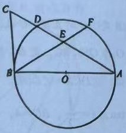
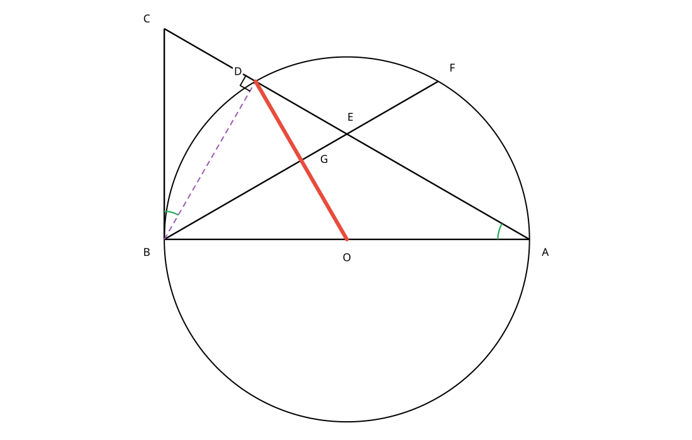

如图，在 $△ABC$ 中，$\angle ABC = 90°$，以 $AB$ 为直径作 $⊙O$ 交 $AC$ 于点 $D$. 点 $E$ 在线段 $AD$ 上，$DE = CD$. 连接 $BE$ 并延长交 $⊙O$ 于点 $F$.

(1) 求证：$\angle CBE = 2\angle BAC$;

(2) 连接 $OD$ 交 $BF$ 于点 $G$. 若 $EF = 2EG，CD = 3$，求 $\odot O$ 的半径.

> [!question]- 点击查看答案与解析
> 【答案】(1) 证明见解析；(2) 半径 $r=3\sqrt{3}$
> 
> 【考点】圆周角定理（直径所对圆周角为直角）、线段垂直平分线与等腰三角形三线合一、射影定理、相似三角形 → [[【初中数学知识点体系-人教版】#29-1 圆的基本性质]]、[[【初中数学知识点体系-人教版】#15-3 等腰三角形]]、[[【初中数学知识点体系-人教版】#31-2 相似三角形]]
> 
> 【解析】
> (1) 证明 $\angle CBE=2\angle BAC$：
> 连接 $BD$。
> $\because AB$ 是直径，$\therefore \angle ADB=90^\circ$，即 $BD\perp AC$。
> $\because DE=CD$ 且 $BD\perp EC$（$E$、$D$、$C$ 都在直线 $AC$ 上），$\therefore BD$ 是线段 $EC$ 的垂直平分线，$\therefore BE=BC$。
> $\therefore BD$ 平分 $\angle CBE$（等腰三角形三线合一），即 $\angle CBE=2\angle CBD$。
> 在 $\mathrm{Rt}△BDC$ 中，$\angle CBD=90^\circ-\angle C$；在 $\mathrm{Rt}△ABC$ 中，$\angle BAC=90^\circ-\angle C$（同一个 $\angle C$）。
> $\therefore \angle CBD=\angle BAC$，$\therefore \angle CBE=2\angle BAC$。
> 
> (2) 求 $⊙O$ 的半径：
> 设 $AD=a$。$\because \angle ABC=90^\circ$、$BD\perp AC$，由射影定理：$BD^2=AD\cdot DC=3a$。
> 在 $\mathrm{Rt}△BDC$ 中，$BC^2=BD^2+DC^2=3a+9$，$\therefore BE=BC=\sqrt{3a+9}$。
> 又 $AE=AD-DE=a-3$。
> 求 $EG$：过 $O$ 作 $ON\parallel BE$ 交 $AC$ 于 $N$。$\because O$ 是 $AB$ 中点，$\therefore ON$ 是 $△ABE$ 的中位线：$ON=\dfrac{1}{2}BE$，$AN=NE=\dfrac{a-3}{2}$。
> $\therefore ND=NE+ED=\dfrac{a-3}{2}+3=\dfrac{a+3}{2}$。
> $\because EG\parallel ON$（$G$ 在 $BE$ 上），$\therefore △DEG\sim△DNO$，$\therefore \dfrac{EG}{ON}=\dfrac{DE}{DN}$，
> $\therefore EG=\dfrac{1}{2}BE\cdot\dfrac{3}{(a+3)/2}=\dfrac{3BE}{a+3}$。
> 求 $EF$：$\angle AFE=\angle AFB=\angle ADB=90^\circ$（同弧 $AB$ 所对圆周角），又 $\angle AEF=\angle BED$（对顶角），$\therefore △EFA\sim△EDB$，
> $\therefore \dfrac{EF}{ED}=\dfrac{EA}{EB}$，$\therefore EF=\dfrac{EA\cdot ED}{BE}=\dfrac{3(a-3)}{BE}$。
> 代入 $EF=2EG$：$\dfrac{3(a-3)}{BE}=\dfrac{6BE}{a+3}$，$\therefore (a-3)(a+3)=2BE^2=2(3a+9)$，
> 即 $a^2-9=6a+18$，$a^2-6a-27=0$，$(a-9)(a+3)=0$，$\therefore a=9$。
> $\therefore AC=AD+DC=12$，$BC^2=3a+9=36$，$AB^2=AC^2-BC^2=144-36=108$，$AB=6\sqrt{3}$，
> $\therefore r=\dfrac{1}{2}AB=3\sqrt{3}$。
> 
> 验证（数值自校验 31 项全部通过）：建系 $B(0,0)$、$A(6\sqrt3,0)$、$O(3\sqrt3,0)$、$C(0,6)$、$D(1.5\sqrt3,4.5)$、$E(3\sqrt3,3)$、$F(4.5\sqrt3,4.5)$、$G(2.25\sqrt3,2.25)$，$r=3\sqrt3$。逐项成立：$A$、$B$、$D$、$F$ 在圆上、$AB$ 是直径、$\angle ABC=90^\circ$、$\angle ADB=90^\circ$（$BD\perp AC$）、$D$ 在线段 $AC$ 上、$E$ 在线段 $AD$ 上、$DE=CD=3$、$B$、$E$、$F$ 共线且 $F$ 在 $BE$ 延长线上、$G$ 是 $OD$ 与 $BF$ 的交点、$BE=BC=6$、$BD=3\sqrt3$、$BD$ 平分 $\angle CBE$、$\angle BAC=30^\circ$、$\angle CBE=60^\circ=2\angle BAC$、$AD=9$、$BD^2=AD\cdot DC$、$AC=12$、$AB=6\sqrt3$、$EF=3$、$EG=1.5$、$EF=2EG$（题设成立）、$\angle AFE=90^\circ$、$EA\cdot ED=EB\cdot EF$（相交弦）、$r\neq3$（原答案错误）。原答案 $r=3$ 错误：$3$ 恰是已知线段 $CD$ 的长；原解析 (2) 仅写"连接 $OF$，利用垂径定理和相似三角形，设半径为 $r$，可列方程解得 $r=3$"，无任何列方程过程，结论无依据。原解析 (1) 也有硬伤："$△CDE$ 是等腰三角形，$\angle DEC=\angle DCE$"不成立——$E$、$D$、$C$ 三点都在直线 $AC$ 上，根本构不成三角形，"$\angle DEC=\angle AEB$（对顶角）"同样无意义；正确路线是 $BD$ 垂直平分 $EC$ 得 $BE=BC$、$\angle CBE=2\angle CBD$，再用同角的余角 $\angle CBD=\angle BAC$。配图中 $OD$ 红色加粗为所求半径，$BD$ 紫色虚线为辅助线，$D$ 处黑色小方块为 $\angle BDC=90^\circ$，$B$、$A$ 处绿色同半径角弧表示 $\angle DBC=\angle BAC$。
> 
> 
> 
> 【易错点】一是 $E$、$D$、$C$ 共线（都在线段 $AC$ 上），不能对 $△CDE$ 谈"等腰、底角相等"，(1) 的核心是"$BD\perp EC$ 且平分 $EC$ ⇒ $BD$ 垂直平分线 ⇒ $BE=BC$ ⇒ $BD$ 平分 $\angle CBE$"；二是 $EG$、$EF$ 都要用 $a$（$AD$）表示：$EG$ 走"$ON$ 中位线 $+△DEG\sim△DNO$"，$EF$ 走"$\angle AFE=\angle ADB=90^\circ$（同弧圆周角）$+△EFA\sim△EDB$"，漏一个比例就列不出方程；三是 $EF=2EG$ 化简得 $a^2-6a-27=0$，取正根 $a=9$（$a=-3$ 舍去），别把 $a=3$（此时 $E$、$A$ 重合）当解；四是所求半径是 $\dfrac{1}{2}AB=3\sqrt3$，原答案 $3$ 是已知线段 $CD$，数值巧合不可当作验证依据。
