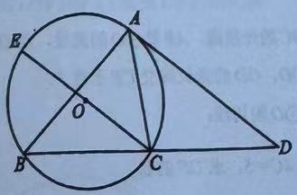
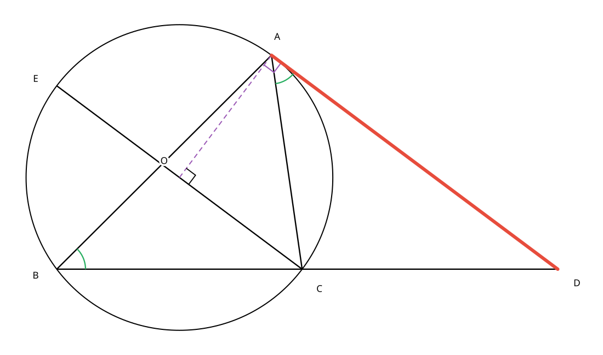

如图，$\triangle ABC$ 内接于 $\odot O$，$\angle ABC=45^{\circ}$，过点 $A$ 作 $\odot O$ 的切线交 $BC$ 延长线于点 $D$，$CE$ 是 $\odot O$ 的直径.

(1) 求证：$CE \parallel AD$;

(2) 若 $BC=\frac{32}{5}$，$\cos D=\frac{4}{5}$，求 $AD$ 的长。

> [!question]- 点击查看答案与解析
> 【答案】(1) 证明见解析；(2) $AD=\dfrac{28}{3}$
> 
> 【考点】切线的性质、圆周角定理（同弧所对圆周角与圆心角）、平行线判定、锐角三角函数与解直角三角形、相似三角形 → [[【初中数学知识点体系-人教版】#30-1 直线和圆的位置关系]]、[[【初中数学知识点体系-人教版】#29-1 圆的基本性质]]、[[【初中数学知识点体系-人教版】#32-1 锐角三角函数]]、[[【初中数学知识点体系-人教版】#31-2 相似三角形]]
> 
> 【解析】
> (1) 证明 $CE\parallel AD$：
> 连接 $OA$。
> $\because \angle ABC=45^\circ$ 是弧 $AC$ 所对的圆周角，$\therefore \angle AOC=2\angle ABC=90^\circ$（圆周角定理），即 $OA\perp CE$（$E$、$O$、$C$ 共线）。
> $\because AD$ 是 $⊙O$ 的切线，$A$ 是切点，$\therefore OA\perp AD$。
> $\because CE$ 与 $AD$ 都垂直于 $OA$，$\therefore CE\parallel AD$。
> 
> (2) 求 $AD$ 的长：
> $\because CE\parallel AD$，$\therefore \angle BCE=\angle ADC=\angle D$（同位角，截线为 $BD$），$\cos\angle BCE=\dfrac{4}{5}$。
> $\because CE$ 是直径，$\therefore \angle CBE=90^\circ$。
> 在 $\mathrm{Rt}△CBE$ 中，$\cos\angle BCE=\dfrac{BC}{CE}$，$\therefore CE=BC\div\cos\angle BCE=\dfrac{32}{5}\div\dfrac{4}{5}=8$，半径 $r=OA=OC=4$。
> $\because \angle AOC=90^\circ$，$OA=OC=4$，$\therefore △AOC$ 是等腰直角三角形：$AC=4\sqrt{2}$，$\angle OAC=45^\circ$。
> $\because OA\perp AD$，$\therefore \angle CAD=\angle OAD-\angle OAC=90^\circ-45^\circ=45^\circ$。
> $\therefore \angle DAC=\angle ABC=\angle DBA$（射线 $BD$ 与射线 $BC$ 相同）。
> 在 $△DAC$ 与 $△DBA$ 中：$\angle ADC=\angle BDA$（公共角），$\angle DAC=\angle DBA$，$\therefore △DAC\sim△DBA$，
> $\therefore \dfrac{DC}{DA}=\dfrac{DA}{DB}=\dfrac{AC}{BA}$。
> 求 $AB$：过 $C$ 作 $CH\perp AB$ 于 $H$。在 $\mathrm{Rt}△BCH$ 中，$\angle ABC=45^\circ$，$BH=CH=BC\cdot\sin 45^\circ=\dfrac{32}{5}\times\dfrac{\sqrt{2}}{2}=\dfrac{16\sqrt{2}}{5}$；
> 在 $\mathrm{Rt}△ACH$ 中，$AH=\sqrt{AC^2-CH^2}=\sqrt{32-\dfrac{512}{25}}=\dfrac{12\sqrt{2}}{5}$，$\therefore AB=BH+AH=\dfrac{28\sqrt{2}}{5}$。
> $\therefore \dfrac{AC}{AB}=4\sqrt{2}\div\dfrac{28\sqrt{2}}{5}=\dfrac{5}{7}$，$\therefore DC=\dfrac{5}{7}DA$，$DB=\dfrac{7}{5}DA$。
> $\because BC=DB-DC$（顺序 $B$、$C$、$D$）：$\dfrac{7}{5}DA-\dfrac{5}{7}DA=\dfrac{32}{5}$，即 $\dfrac{24}{35}DA=\dfrac{32}{5}$，$\therefore DA=\dfrac{32}{5}\times\dfrac{35}{24}=\dfrac{28}{3}$。
> 
> 验证（数值自校验 29 项全部通过）：建系 $O(0,0)$、$A(2.4,3.2)$、$B(-3.2,-2.4)$、$C(3.2,-2.4)$、$D\left(\dfrac{148}{15},-2.4\right)$、$E(-3.2,2.4)$，$r=4$。逐项成立：$A$、$B$、$C$、$E$ 在圆上、$CE$ 是直径、$\angle ABC=45^\circ$、$\angle AOC=90^\circ$、$OA\perp AD$（切线）、$CE\parallel AD$、$B$、$C$、$D$ 共线且顺序 $B$-$C$-$D$、$BC=\dfrac{32}{5}$、$CD=\dfrac{20}{3}$、$\cos\angle ADC=\dfrac45$、$\angle CBE=90^\circ$、$CE=8$、$\cos\angle BCE=\dfrac45$、$AC=4\sqrt2$、$\angle OAC=45^\circ$、$\angle CAD=45^\circ$、$\angle DAC=\angle DBA$、$AB=\dfrac{28\sqrt2}{5}$、$\dfrac{AC}{AB}=\dfrac57$、$\dfrac{DC}{DA}=\dfrac{DA}{DB}=\dfrac57$、$AD=\dfrac{28}{3}$、$BD=\dfrac{196}{15}$、$BD-CD=BC$、$AD\neq8$（原答案错误）。原答案 $AD=8$ 错误：$8$ 恰是**直径 $CE$** 的长（$CE=BC\div\cos\angle BCE=8$），原解求出 $CE$ 后误把它当作 $AD$（$CE\parallel AD$ 并不意味着 $AD=CE$）；且原解析 (2) 整段文字乱码不可读，(1) 中"结合角度关系可证 $\angle D=\angle E$"也是跳步——$\angle D\approx36.87^\circ$ 而 $\angle AEC=45^\circ$，两角并不相等，正确推理是"$CE$、$AD$ 同垂直于 $OA$"。配图中 $AD$ 红色加粗为所求线段，$OA$ 紫色虚线为辅助线，$A$ 处紫色直角标记为 $\angle OAD=90^\circ$，$O$ 处黑色小方块为 $\angle AOC=90^\circ$，$A$、$B$ 处绿色同半径角弧表示 $\angle DAC=\angle DBA=45^\circ$。
> 
> 
> 
> 【易错点】一是 (1) 的正确路线是"圆心角 $\angle AOC=2\angle ABC=90^\circ\Rightarrow OA\perp CE$，$OA\perp AD$，同垂直即平行"，不要证"$\angle D=\angle E$"（两角实际不等）；二是 $\cos\angle BCE=\dfrac{BC}{CE}$ 中直角在 $B$ 处（$\angle CBE=90^\circ$），$CE$ 是斜边，$BC$ 是 $\angle BCE$ 的邻边，别把比值写反；三是 $△DAC\sim△DBA$ 的顶点对应是 $A\leftrightarrow B$、$C\leftrightarrow A$，比例式 $\dfrac{DC}{DA}=\dfrac{DA}{DB}=\dfrac{AC}{BA}$，最后要用 $BC=DB-DC$ 列方程；四是原答案 $8$ 是直径 $CE$ 而非 $AD$，$AD=\dfrac{28}{3}\approx9.33$，平行线段之间不能直接划等号。
