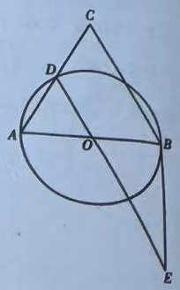
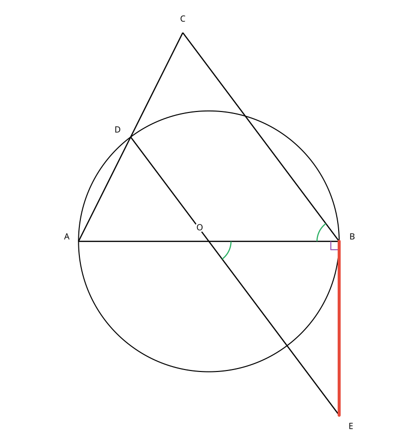

如图，$AB$ 为 $⊙O$ 的直径，点 $C$ 为 $⊙O$ 外一点，$AB = BC$，连接 $AC$ 交 $⊙O$ 于点 $D$，连接 $OD$，过 $B$ 作 $⊙O$ 的切线交 $DO$ 的延长线于点 $E$。

(1) 求证：$OD \parallel BC$;

(2) 若 $BC = 10$, $AC = 4 \sqrt{5}$, 求 $BE$ 的长.

> [!question]- 点击查看答案与解析
> 【答案】(1) 证明见解析；(2) $BE=\dfrac{20}{3}$
> 
> 【考点】等腰三角形性质与三线合一、平行线判定（同位角）、切线的性质、锐角三角函数、勾股定理 → [[【初中数学知识点体系-人教版】#15-3 等腰三角形]]、[[【初中数学知识点体系-人教版】#30-1 直线和圆的位置关系]]、[[【初中数学知识点体系-人教版】#32-1 锐角三角函数]]
> 
> 【解析】
> (1) 证明 $OD\parallel BC$：
> $\because AB=BC$，$\therefore \angle BAC=\angle BCA$。
> $\because OA=OD$，$\therefore \angle OAD=\angle ODA$。
> $\because D$ 在线段 $AC$ 上，$\angle OAD$ 即 $\angle BAC$，$\therefore \angle ODA=\angle BCA$。
> $\therefore OD\parallel BC$（同位角相等，两直线平行，截线为 $AC$）。
> 
> (2) 求 $BE$ 的长：
> $\because BC=10$，$\therefore AB=10$，半径 $OB=5$。
> 作 $BH\perp AC$ 于 $H$。$\because BA=BC$，$\therefore H$ 是 $AC$ 的中点（三线合一），$AH=\dfrac{1}{2}AC=2\sqrt{5}$。
> 在 $\mathrm{Rt}△ABH$ 中，$\cos\angle BAC=\dfrac{AH}{AB}=\dfrac{2\sqrt{5}}{10}=\dfrac{\sqrt{5}}{5}$。
> 作 $AN\perp BC$ 于 $N$。$\because \angle ACN=\angle BCA=\angle BAC$，
> 在 $\mathrm{Rt}△ACN$ 中，$CN=AC\cdot\cos\angle ACN=4\sqrt{5}\times\dfrac{\sqrt{5}}{5}=4$，$AN=\sqrt{AC^2-CN^2}=\sqrt{80-16}=8$。
> $\therefore BN=BC-CN=10-4=6$；在 $\mathrm{Rt}△ABN$ 中，$\tan\angle ABC=\dfrac{AN}{BN}=\dfrac{8}{6}=\dfrac{4}{3}$（旁证：$AB=\sqrt{AN^2+BN^2}=\sqrt{64+36}=10$ ✓）。
> $\because BE$ 切 $⊙O$ 于 $B$，$\therefore OB\perp BE$，即 $\angle OBE=90^\circ$。
> $\because D$、$O$、$E$ 共线且 $OD\parallel BC$，$\therefore \angle DOB+\angle OBC=180^\circ$（同旁内角）；
> 又 $\angle EOB=180^\circ-\angle DOB$（邻补角），$\therefore \angle EOB=\angle OBC=\angle ABC$，$\tan\angle EOB=\dfrac{4}{3}$。
> 在 $\mathrm{Rt}△OBE$ 中，$\tan\angle EOB=\dfrac{BE}{OB}$，$\therefore BE=OB\cdot\tan\angle EOB=5\times\dfrac{4}{3}=\dfrac{20}{3}$。
> 
> 验证（数值自校验 27 项全部通过）：建系 $O(0,0)$、$A(-5,0)$、$B(5,0)$、$C(-1,8)$、$D(-3,4)$、$E\left(5,-\dfrac{20}{3}\right)$，$r=5$。逐项成立：$A$、$B$、$D$ 在圆上、$AB$ 是直径、$AB=BC=10$、$AC=4\sqrt5$、$C$ 在圆外、$D$ 在线段 $AC$ 上、$OD\parallel BC$、$OA=OD$、$\angle OAD=\angle ODA$、$\angle BAC=\angle BCA$、$\angle ODA=\angle BCA$（同位角）、$BE\perp OB$（切线）、$E$ 在直线 $DO$ 上且在 $DO$ 延长线（$O$ 外侧）、$\angle OBE=90^\circ$、$\cos\angle ABC=\dfrac{3}{5}$（余弦定理旁证）、$\cos\angle EOB=\dfrac{3}{5}$、$\angle EOB=\angle OBC$（内错角）、$\tan\angle EOB=\dfrac{4}{3}$、$BE=\dfrac{20}{3}$、$OE=\dfrac{25}{3}$、$\mathrm{Rt}△OBE$ 勾股成立、$BE\neq 5\sqrt5$（原答案错误）。原答案 $BE=5\sqrt5$ 错误（$5\sqrt5\approx11.18$，正确值 $\dfrac{20}{3}\approx6.67$）：原解析 (2) 后半段仅写"利用相似和三角函数，可求得"而无任何过程，结论无依据；且其中" $\because OD\parallel BC$，$\therefore \angle DOE=\angle OBC$"一步本身错误——$D$、$O$、$E$ 共线，$\angle DOE$ 是平角，不能作内错角用，正确的角转化是 $\angle EOB=\angle OBC$。配图中 $BE$ 红色加粗为所求线段，$B$ 处紫色直角标记为 $\angle OBE=90^\circ$，$O$、$B$ 处绿色同半径角弧表示 $\angle EOB=\angle OBC$。
> 
> 
> 
> 【易错点】一是 $E$ 在 $DO$ 的延长线上（越过 $O$），$\angle DOE$ 是平角，不能写成"$\angle DOE=\angle OBC$"；正确转化链是"同旁内角 $\angle DOB+\angle OBC=180^\circ$ $+$ 邻补角 $\angle EOB=180^\circ-\angle DOB$ $\Rightarrow\angle EOB=\angle OBC$"；二是 $\mathrm{Rt}△OBE$ 的直角在 $B$ 处，$\angle EOB$ 的对边是 $BE$、邻边是 $OB$，$\tan\angle EOB=\dfrac{BE}{OB}$，不要写反得 $BE=\dfrac{15}{4}$；三是求 $\tan\angle ABC$ 需作两条垂线（等腰底边上的高 $BH$ 定 $\cos\angle BAC$，再作 $AN\perp BC$ 解出 $\tan\angle ABC$），余弦定理超出初中考纲，考试应走作高构造直角三角形的路线；四是 $D$ 是 $AC$ 与圆的交点这一条件要同时用于 (1) 的"同角"代换与图形位置判断。
