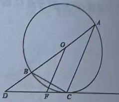
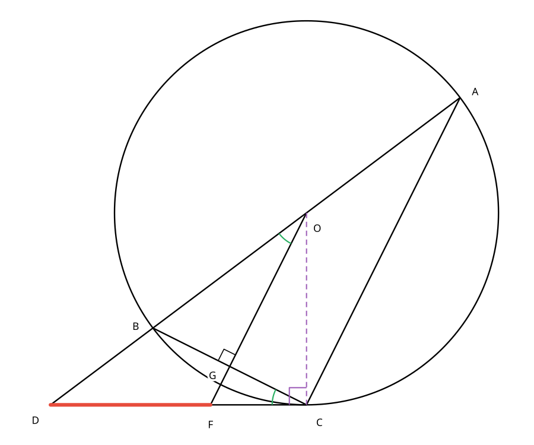

如图，$AB$ 是 $⊙O$ 的直径，$C$ 是 $⊙O$ 上一点，过 $C$ 作 $⊙O$ 的切线交 $AB$ 的延长线于点 $D$，连接 $AC、BC$，过 $O$ 作 $OF∥AC$，交 $BC$ 于 $G$，交 $DC$ 于 $F$.

(1) 求证：$\angle DCB = \angle DOF$;

(2) 若 $\tan\angle A=\frac{1}{2}$，$BC = 4$，求 $OF、DF$ 的长.

> [!question]- 点击查看答案与解析
> 【答案】(1) 证明见解析；(2) $OF=5$，$DF=\dfrac{5\sqrt{5}}{3}$
> 
> 【考点】切线的性质、圆周角定理（直径所对圆周角为直角）、平行线性质与三角形中位线、锐角三角函数、相似三角形 → [[【初中数学知识点体系-人教版】#30-1 直线和圆的位置关系]]、[[【初中数学知识点体系-人教版】#29-1 圆的基本性质]]、[[【初中数学知识点体系-人教版】#31-2 相似三角形]]、[[【初中数学知识点体系-人教版】#32-1 锐角三角函数]]
> 
> 【解析】
> (1) 证明 $\angle DCB=\angle DOF$：
> 连接 $OC$。
> $\because CD$ 是 $⊙O$ 的切线，$\therefore OC\perp CD$，即 $\angle OCD=90^\circ$，$\therefore \angle DCB=90^\circ-\angle OCB$。
> $\because AB$ 是直径，$\therefore \angle ACB=90^\circ$，即 $\angle OCA+\angle OCB=90^\circ$，$\therefore \angle OCA=90^\circ-\angle OCB$。
> $\therefore \angle DCB=\angle OCA$。
> $\because OA=OC$，$\therefore \angle OAC=\angle OCA$。
> $\because OF\parallel AC$，$\therefore \angle DOF=\angle OAC$（同位角）。
> $\therefore \angle DCB=\angle DOF$。
> 
> (2) 求 $OF$、$DF$ 的长：
> 在 $\mathrm{Rt}△ABC$ 中，$\tan A=\dfrac{BC}{AC}=\dfrac{1}{2}$，$BC=4$，$\therefore AC=8$，$AB=\sqrt{AC^2+BC^2}=4\sqrt{5}$，半径 $r=OC=2\sqrt{5}$。
> $\because OF\parallel AC$ 且 $O$ 是 $AB$ 中点，$\therefore OG$ 是 $△ABC$ 的中位线：$OG=\dfrac{1}{2}AC=4$，$CG=\dfrac{1}{2}BC=2$，且 $\angle OGC=\angle ACB=90^\circ$（同位角），即 $OF\perp BC$。
> 由 (1)，$\angle GCF=\angle DCB=\angle DOF=\angle A$（末步用 $OF\parallel AC$ 的同位角）。
> 在 $\mathrm{Rt}△CGF$ 中，$\tan\angle GCF=\dfrac{GF}{CG}$，$\therefore GF=CG\cdot\tan A=2\times\dfrac{1}{2}=1$，
> $\therefore OF=OG+GF=4+1=5$，$CF=\sqrt{CG^2+GF^2}=\sqrt{5}$。
> 在 $△DCB$ 与 $△DAC$ 中：$\angle D$ 公共，$\angle DCB=\angle DAC$（即 $\angle A$），$\therefore △DCB\sim△DAC$，
> $\therefore \dfrac{DC}{DA}=\dfrac{DB}{DC}=\dfrac{CB}{AC}=\dfrac{1}{2}$，$\therefore DA=2DC$，$DB=\dfrac{1}{2}DC$。
> 又 $DA=DB+AB$：$2DC=\dfrac{1}{2}DC+4\sqrt{5}$，$\dfrac{3}{2}DC=4\sqrt{5}$，$\therefore DC=\dfrac{8\sqrt{5}}{3}$。
> $\because F$ 在线段 $DC$ 上，$\therefore DF=DC-CF=\dfrac{8\sqrt{5}}{3}-\sqrt{5}=\dfrac{5\sqrt{5}}{3}$。
> 
> 验证（数值自校验 22 项全部通过）：建系 $O(0,0)$、$C(0,-2\sqrt5)$、$D\left(-\dfrac{8\sqrt5}{3},-2\sqrt5\right)$、$F(-\sqrt5,-2\sqrt5)$、$A\left(\dfrac{8\sqrt5}{5},\dfrac{6\sqrt5}{5}\right)$、$B\left(-\dfrac{8\sqrt5}{5},-\dfrac{6\sqrt5}{5}\right)$、$G\left(-\dfrac{4\sqrt5}{5},-\dfrac{8\sqrt5}{5}\right)$。逐项成立：$A$、$B$、$C$ 在圆上、$AB$ 是直径、$\angle ACB=90^\circ$、$BC=4$、$AC=8$、$\tan A=\dfrac12$、$OC\perp CD$（切线）、$D$ 在 $AB$ 延长线上（$B$ 外侧）、$OF\parallel AC$、$G$ 在 $BC$ 上且 $O$、$G$、$F$ 共线、$\angle DCB=\angle DOF=\angle A$、$OG=4$、$GF=1$、$OF=5$、$CF=\sqrt5$、$CD=\dfrac{8\sqrt5}{3}$、$DF=DC-CF=\dfrac{5\sqrt5}{3}$、$OD=\dfrac{10\sqrt5}{3}$、$\mathrm{Rt}△OCD$ 勾股成立、$\overrightarrow{FO}\cdot\overrightarrow{FD}\neq0$（$△ODF$ 非直角三角形）。原答案 $DF=\dfrac{5}{2}$ 错误（$OF=5$ 正确）：原解析末句"在 $\mathrm{Rt}△ODF$ 中，$DF=\sqrt{OF^2-OD^2}=\sqrt{25-20}=\dfrac{5}{2}$"有三重错误——一是 $△ODF$ 根本不是直角三角形（直角在 $C$ 处而非 $F$ 处，$OF$ 与 $DF$ 不垂直）；二是把 $OD^2$ 错写成 $20$（$20$ 是 $OC^2$，实际 $OD^2=\dfrac{500}{9}$）；三是算术也不对，$\sqrt{25-20}=\sqrt{5}\neq\dfrac{5}{2}$。正确做法是 $DF=DC-CF=\dfrac{8\sqrt5}{3}-\sqrt5=\dfrac{5\sqrt5}{3}$。配图中 $DF$ 红色加粗为所求线段，$OC$ 紫色虚线为辅助线，$C$ 处紫色直角标记为 $\angle OCD=90^\circ$，$G$ 处黑色小方块为 $OF\perp BC$，$C$、$O$ 处绿色同半径角弧表示 $\angle DCB=\angle DOF$。
> 
> 
> 
> 【易错点】一是不要臆造直角：本题的直角在 $\angle OCD$ 与 $\angle OGC$，$△ODF$ 不是直角三角形，求 $DF$ 只能走线段差 $DF=DC-CF$；二是 $△DCB\sim△DAC$ 的对应顶点（$C\leftrightarrow A$、$B\leftrightarrow C$）来自 $\angle DCB=\angle A$，比例式 $\dfrac{DC}{DA}=\dfrac{DB}{DC}=\dfrac12$ 要整体代入 $DA=DB+AB$ 解出 $DC$；三是中位线 $OG=4$ 的前提是 $O$ 为中点且 $OF\parallel AC$，同时得到 $OF\perp BC$ 才能用 $\mathrm{Rt}△CGF$；四是 $\sqrt{25-20}=\sqrt5$，开方结果别随手写成分数。
