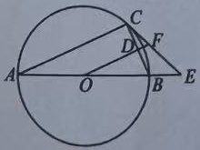
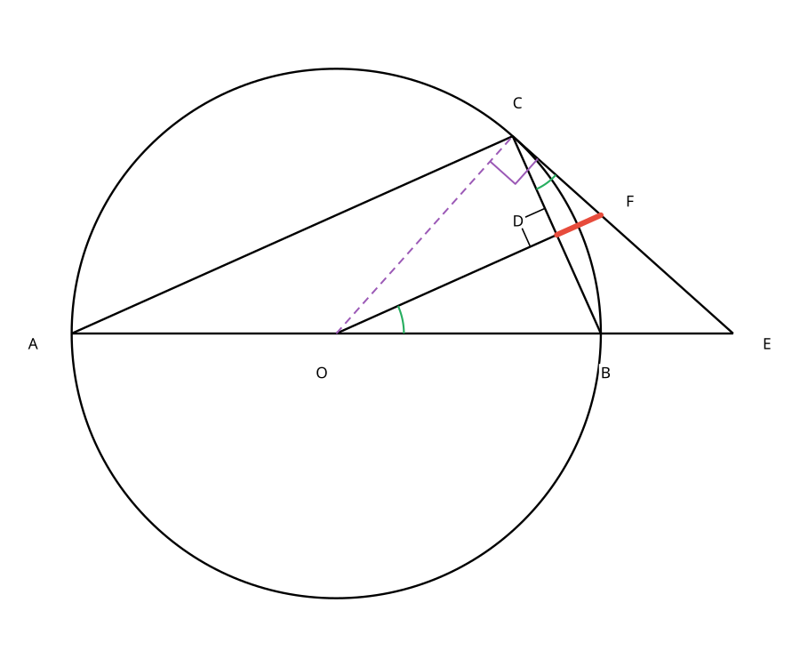

如图，$⊙O$ 是 $△ABC$ 的外接圆，$AB$ 是 $⊙O$ 的直径，点 $D$ 是 $BC$ 的中点，点 $E$ 是 $AB$ 的延长线上的一点，$\angle BCE = \angle BOD$，$OD$ 的延长线交 $CE$ 于点 $F$.

(1) 求证：$CE$ 是 $⊙O$ 的切线；

(2) 若 $\sin E = \frac{2}{3}$，$AC = 5$，求 $DF$ 的长.

> [!question]- 点击查看答案与解析
> 【答案】(1) 证明见解析；(2) $DF=\dfrac{1}{2}$
> 
> 【考点】切线的判定、等腰三角形三线合一、垂径定理、圆周角定理、锐角三角函数、相似三角形、勾股定理 → [[【初中数学知识点体系-人教版】#30-1 直线和圆的位置关系]]、[[【初中数学知识点体系-人教版】#29-1 圆的基本性质]]、[[【初中数学知识点体系-人教版】#31-2 相似三角形]]、[[【初中数学知识点体系-人教版】#32-1 锐角三角函数]]
> 
> 【解析】
> (1) 证明 $CE$ 是 $⊙O$ 的切线：
> 连接 $OC$。
> $\because OB=OC$，$D$ 是 $BC$ 的中点，$\therefore OD\perp BC$，且 $OD$ 平分 $\angle BOC$（等腰三角形三线合一）。
> 设 $\angle BOD=\psi$，则 $\angle BOC=2\psi$。
> 在等腰 $△OBC$ 中，$\angle OCB=\dfrac{180^\circ-2\psi}{2}=90^\circ-\psi$。
> $\because \angle BCE=\angle BOD=\psi$，
> $\therefore \angle OCE=\angle OCB+\angle BCE=(90^\circ-\psi)+\psi=90^\circ$。
> $\therefore OC\perp CE$，又 $C$ 在 $⊙O$ 上，$\therefore CE$ 是 $⊙O$ 的切线（切线的判定）。
> 
> (2) 求 $DF$ 的长：
> $\because CE$ 切 $⊙O$ 于 $C$，$\therefore \angle OCE=90^\circ$。
> 在 $\mathrm{Rt}△OCE$ 中，$\sin E=\dfrac{OC}{OE}=\dfrac{2}{3}$，设 $OC=2k$，$OE=3k$（$k>0$），则 $CE=\sqrt{OE^2-OC^2}=\sqrt{5}\,k$，半径 $r=2k$，$AB=4k$。
> 过 $C$ 作 $CH\perp OE$ 于 $H$：由面积法 $CH=\dfrac{OC\cdot CE}{OE}=\dfrac{2\sqrt{5}}{3}k$；在 $\mathrm{Rt}△OCH$ 中，$OH=\sqrt{OC^2-CH^2}=\sqrt{4k^2-\dfrac{20}{9}k^2}=\dfrac{4}{3}k$。
> $\therefore AH=AO+OH=2k+\dfrac{4}{3}k=\dfrac{10}{3}k$。在 $\mathrm{Rt}△ACH$ 中，$AC^2=AH^2+CH^2=\dfrac{100}{9}k^2+\dfrac{20}{9}k^2=\dfrac{120}{9}k^2$，
> $\therefore AC=\dfrac{2\sqrt{30}}{3}k=5$，解得 $k=\dfrac{\sqrt{30}}{4}$，$\therefore r=2k=\dfrac{\sqrt{30}}{2}$，$AB=\sqrt{30}$。
> 在 $\mathrm{Rt}△ABC$ 中（$\angle ACB=90^\circ$），$BC=\sqrt{AB^2-AC^2}=\sqrt{30-25}=\sqrt{5}$，$\therefore CD=\dfrac{1}{2}BC=\dfrac{\sqrt{5}}{2}$。
> 在 $\mathrm{Rt}△OCD$ 中，$OD=\sqrt{OC^2-CD^2}=\sqrt{\dfrac{15}{2}-\dfrac{5}{4}}=\dfrac{5}{2}$。
> $\because$ 射线 $DF$ 与射线 $DO$ 相反，$\therefore \angle CDF=180^\circ-\angle CDO=90^\circ=\angle ODC$；
> 又 $\angle DCF=\angle BCE=\angle BOD=\angle COD$，$\therefore △CDF\sim△ODC$，
> $\therefore \dfrac{DF}{CD}=\dfrac{CD}{OD}$，$\therefore DF=\dfrac{CD^2}{OD}=\dfrac{5/4}{5/2}=\dfrac{1}{2}$。
> 
> 验证（数值自校验 19 项全部通过）：建系 $O(0,0)$、$A\left(-\dfrac{\sqrt{30}}{2},0\right)$、$B\left(\dfrac{\sqrt{30}}{2},0\right)$、$C\left(\dfrac{\sqrt{30}}{3},\dfrac{5\sqrt{6}}{6}\right)$、$E\left(\dfrac{3\sqrt{30}}{4},0\right)$、$D\left(\dfrac{5\sqrt{30}}{12},\dfrac{5\sqrt{6}}{12}\right)$、$F\left(\dfrac{\sqrt{30}}{2},\dfrac{\sqrt{6}}{2}\right)$。逐项成立：$A$、$B$、$C$ 在圆上、$AB$ 是直径、$\angle ACB=90^\circ$、$AC=5$、$BC=\sqrt5$、$E$ 在 $AB$ 延长线上、$OC\perp CE$（切线）、$\sin E=\dfrac{OC}{OE}=\dfrac23$、$D$ 是 $BC$ 中点、$OD\perp BC$、$OD=\dfrac52$、$CD=\dfrac{\sqrt5}{2}$、$\angle BCE=\angle BOD$、$F$ 在射线 $OD$ 上（$D$ 外侧）且在线段 $CE$ 上、$DF=\dfrac{CD^2}{OD}=\dfrac12$、$\angle BAC=\dfrac12\angle BOC$、相似比 $\dfrac{CF}{OC}=\dfrac{CD}{OD}$。原答案 $DF=\dfrac{5}{2}$ 错误：$\dfrac{5}{2}$ 恰是 $OD$ 的长，原解析 (1) 中"利用角度关系可证 $\angle OCE=90°$"与 (2) 中"利用相似三角形和三角函数关系，可求得"均为跳步，最后漏掉 $DF=\dfrac{CD^2}{OD}=\dfrac12$ 这一步，把中间量 $OD$ 误作结论。配图中 $DF$ 红色加粗为所求线段，$OC$ 紫色虚线为辅助线，$C$ 处紫色直角标记为 $\angle OCE=90^\circ$，$D$ 处黑色小方块为 $OD\perp BC$，$C$、$O$ 处绿色同半径角弧表示 $\angle BCE=\angle BOD$。
> 
> 
> 
> 【易错点】一是 (1) 的关键是等腰 $△OBC$ 三线合一：$OD$ 既垂直 $BC$ 又平分 $\angle BOC$，再经 $\angle OCE=\angle OCB+\angle BCE=(90^\circ-\psi)+\psi$ 代换得垂直，不要笼统写"利用角度关系"；二是 $\sin E$ 在 $\mathrm{Rt}△OCE$ 中是 $\dfrac{OC}{OE}$（$\angle E$ 的对边是 $OC$、斜边是 $OE$），不要错用 $\dfrac{CE}{OE}$；三是 $△CDF\sim△ODC$ 的对应边：$DF$ 与 $CD$ 对应、$CD$ 与 $OD$ 对应，得 $DF=\dfrac{CD^2}{OD}$，若把 $OD$ 当结论就错得 $\dfrac52$；四是 $F$ 是射线 $OD$ 延长线与线段 $CE$ 的交点，$\angle CDF=90^\circ$ 需由邻补角说明。
