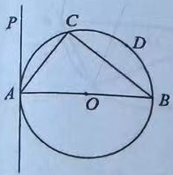
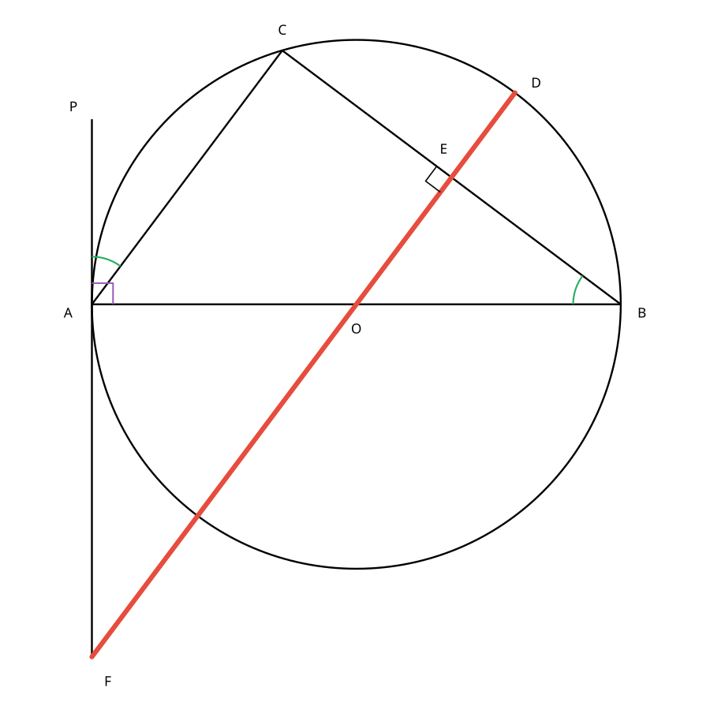

如图，$AB$ 是 $⊙O$ 直径，$C$ 是 $⊙O$ 上一点，过点 $A$ 作直线 $PA$，使 $\angle PAC=\angle ABC$。

(1) 求证：$PA$ 是 $⊙O$ 的切线；

(2) 点 $D$ 是弧 $BC$ 中点，连接 $DO$ 并延长，分别交 $BC$，$PA$ 于点 $E$，$F$，若 $BC=8$，$\cos\angle PAC=\frac{4}{5}$，求线段 $DF$ 的长。

> [!question]- 点击查看答案与解析
> 【答案】(1) 证明见解析；(2) $DF=\dfrac{40}{3}$
> 
> 【考点】切线的判定、圆周角定理（直径所对圆周角为直角）、垂径定理与弧中点、锐角三角函数、相似三角形 → [[【初中数学知识点体系-人教版】#30-1 直线和圆的位置关系]]、[[【初中数学知识点体系-人教版】#29-1 圆的基本性质]]、[[【初中数学知识点体系-人教版】#32-1 锐角三角函数]]、[[【初中数学知识点体系-人教版】#31-2 相似三角形]]
> 
> 【解析】
> (1) 证明 $PA$ 是 $⊙O$ 的切线：
> $\because AB$ 是直径，$\therefore \angle ACB=90^\circ$（直径所对的圆周角是直角）。
> $\therefore \angle ABC+\angle BAC=90^\circ$。
> $\because \angle PAC=\angle ABC$，$\therefore \angle PAC+\angle BAC=90^\circ$，即 $\angle PAB=90^\circ$。
> $\therefore PA\perp AB$，又 $A$ 在 $⊙O$ 上，$AB$ 是直径，$\therefore PA$ 是 $⊙O$ 的切线（切线的判定）。
> 
> (2) 求 $DF$ 的长：
> $\because \angle PAC=\angle ABC$，$\cos\angle PAC=\dfrac{4}{5}$，$\therefore \cos\angle ABC=\dfrac{4}{5}$。
> 在 $\mathrm{Rt}△ABC$ 中，$\cos\angle ABC=\dfrac{BC}{AB}$，$\therefore AB=\dfrac{BC}{\cos\angle ABC}=8\div\dfrac{4}{5}=10$，半径 $r=OA=OB=OD=5$。
> $\because D$ 是弧 $BC$ 的中点，$O$ 是圆心，$\therefore OD\perp BC$ 且 $OD$ 平分 $BC$（垂径定理的推论），
> $\therefore BE=CE=4$，$\angle OEB=90^\circ$。
> 在 $\mathrm{Rt}△OBE$ 中，$OE=\sqrt{OB^2-BE^2}=\sqrt{25-16}=3$。
> $\because PA$ 切 $⊙O$ 于 $A$，$\therefore \angle OAF=90^\circ=\angle OEB$；又 $\angle AOF=\angle EOB$（对顶角），
> $\therefore △OAF\sim△OEB$，$\therefore \dfrac{OF}{OB}=\dfrac{OA}{OE}$，
> $\therefore OF=\dfrac{OB\cdot OA}{OE}=\dfrac{5\times 5}{3}=\dfrac{25}{3}$。
> $\because O$ 在线段 $DF$ 上（$D$、$O$、$F$ 依次共线），$\therefore DF=DO+OF=5+\dfrac{25}{3}=\dfrac{40}{3}$。
> 
> 验证（数值自校验 23 项全部通过）：建系 $O(0,0)$、$A(-5,0)$、$B(5,0)$、$C(-1.4,4.8)$、$D(3,4)$、$E(1.8,2.4)$、$F\left(-5,-\dfrac{20}{3}\right)$，$r=5$。逐项成立：$A$、$B$、$C$、$D$ 在圆上、$AB$ 是直径、$\angle ACB=90^\circ$、$BC=8$、$AC=6$、$\cos\angle PAC=\dfrac45$、$\angle PAC=\angle ABC$、$PA\perp AB$（切线）、$DB=DC$（$D$ 为弧 $BC$ 中点）、$OD\perp BC$、$E$ 为 $BC$ 中点且在线段 $OD$ 上、$F$ 在直线 $DO$ 与切线 $PA$ 上、$OE=3$、$OF=\dfrac{25}{3}$、$AF=\dfrac{20}{3}$、$\angle AOF=\angle BOE$、$\cos\angle BOE=\dfrac35$、$DF=DO+OF=\dfrac{40}{3}$。原答案 $DF=\dfrac{25}{2}$ 错误：原解析 (2) 后半段仅写"利用相似三角形，可求得"而无任何过程，结论 $\dfrac{25}{2}$ 与正确值 $\dfrac{40}{3}\approx13.33$ 不符；正确相似为 $△OAF\sim△OEB$（斜边比斜边 $\dfrac{OF}{OB}=\dfrac{OA}{OE}$），得 $OF=\dfrac{25}{3}$，再加半径 $DO=5$ 才是 $DF$。配图中 $DF$ 红色加粗为所求线段，$A$ 处紫色直角标记为 $PA\perp AB$，$E$ 处黑色小方块为 $DF\perp BC$，$A$、$B$ 处绿色同半径角弧表示 $\angle PAC=\angle ABC$。
> 
> 
> 
> 【易错点】一是弧中点条件要用足：$D$ 是弧 $BC$ 中点意味着 $OD$ 所在直线垂直平分弦 $BC$，得 $BE=4$、$OE=3$，漏掉垂径推论就无从下手；二是相似对应边：$△OAF\sim△OEB$ 中 $OF$ 与 $OB$ 分别是两个直角三角形的斜边，比例式是 $\dfrac{OF}{OB}=\dfrac{OA}{OE}$，不要错写成 $\dfrac{OF}{OB}=\dfrac{OA}{BE}$；三是 $DF=DO+OF$ 要补上半径段 $DO$，只求 $OF$ 会少一段；四是 $F$ 是直线 $PA$ 与直线 $DO$ 的交点，位置在 $A$ 下方（$PA$ 的延长方向），画图时不要只画线段 $PA$ 而漏掉交点。
