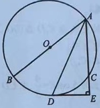
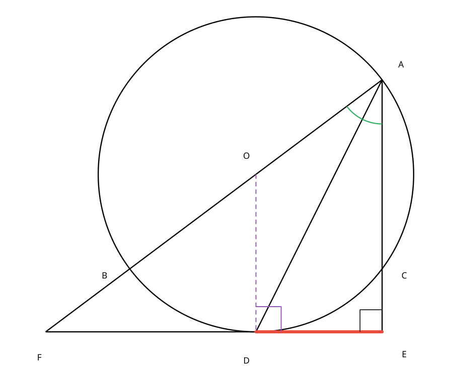

如图，$AB$ 是 $⊙O$ 的直径，点 $C$ 是 $⊙O$ 上一点，$AD$ 平分 $\angle CAB$ 交 $⊙O$ 于点 $D$，过点 $D$ 作 $DE⊥AC$ 交 $AC$ 的延长线于点 $E$。

(1) 求证：直线 $DE$ 是 $⊙O$ 的切线；

(2) 延长 $AB$ 与直线 $DE$ 交于点 $F$，若 $AB=5$，$\cos\angle AFD=\frac{4}{5}$，求 $DE$ 的长。

> [!question]- 点击查看答案与解析
> 【答案】(1) 证明见解析；(2) $DE=2$
> 
> 【考点】切线的判定、角平分线与等腰三角形推出平行、圆的半径性质、锐角三角函数与解直角三角形 → [[【初中数学知识点体系-人教版】#30-1 直线和圆的位置关系]]、[[【初中数学知识点体系-人教版】#14-3 角的平分线]]、[[【初中数学知识点体系-人教版】#32-2 解直角三角形及其应用]]
> 
> 【解析】
> (1) 证明 $DE$ 是 $⊙O$ 的切线：
> 连接 $OD$。
> $\because AD$ 平分 $\angle CAB$，$\therefore \angle CAD=\angle BAD$。
> $\because OA=OD$，$\therefore \angle OAD=\angle ODA$。
> $\therefore \angle CAD=\angle ODA$，$\therefore OD\parallel AE$（内错角相等，两直线平行）。
> $\because DE\perp AC$ 于 $E$，$\therefore DE\perp OD$。
> 又 $D$ 在 $⊙O$ 上，$OD$ 是半径，$\therefore DE$ 是 $⊙O$ 的切线（切线的判定）。
> 
> (2) 求 $DE$ 的长：
> $\because AB=5$，$\therefore r=OA=OD=\dfrac{5}{2}$。
> $\because DE$ 切 $⊙O$ 于 $D$，$\therefore OD\perp DF$，即 $\angle ODF=90^\circ$。
> 设 $\angle AFD=\alpha$，$\because \cos\alpha=\dfrac{4}{5}$，$\therefore \sin\alpha=\dfrac{3}{5}$，$\tan\alpha=\dfrac{3}{4}$。
> 在 $\mathrm{Rt}△ODF$ 中，$\sin\alpha=\dfrac{OD}{OF}$，$\therefore OF=\dfrac{OD}{\sin\alpha}=\dfrac{5}{2}\div\dfrac{3}{5}=\dfrac{25}{6}$；
> $\tan\alpha=\dfrac{OD}{DF}$，$\therefore DF=\dfrac{OD}{\tan\alpha}=\dfrac{5}{2}\div\dfrac{3}{4}=\dfrac{10}{3}$。
> $\because O$ 在 $A$、$F$ 之间，$\therefore AF=AO+OF=\dfrac{5}{2}+\dfrac{25}{6}=\dfrac{20}{3}$。
> 在 $\mathrm{Rt}△AEF$ 中，$\angle AEF=90^\circ$，$\cos\alpha=\dfrac{EF}{AF}$，$\therefore EF=AF\cos\alpha=\dfrac{20}{3}\times\dfrac{4}{5}=\dfrac{16}{3}$。
> $\because D$ 在 $E$、$F$ 之间，$\therefore DE=EF-DF=\dfrac{16}{3}-\dfrac{10}{3}=2$。
> 
> 验证（数值自校验 19 项全部通过）：建系 $C(0,0)$、$A(0,3)$、$B(-4,0)$、$O(-2,\dfrac32)$、$D(-2,-1)$、$E(0,-1)$、$F(-\dfrac{16}{3},-1)$，$r=\dfrac52$。逐项成立：$A$、$B$、$C$、$D$ 在圆上、$AB$ 是直径且 $AB=5$、$AD$ 平分 $\angle CAB$、$E$ 在 $AC$ 延长线上（$C$ 外侧）、$DE\perp AE$、$OD\perp DE$（切线）、$F$ 在 $AB$ 延长线上（$B$ 外侧）、$F$ 在直线 $DE$ 上、$\cos\angle AFD=\dfrac45$、$OF=\dfrac{25}{6}$、$DF=\dfrac{10}{3}$、$AF=AO+OF=\dfrac{20}{3}$、$EF=\dfrac{16}{3}$、$DE=EF-DF=2$、$DE=\dfrac12 BC=2$（中位线旁证：$BC=4$、$AC=3$）。原答案 $DE=\dfrac{15}{8}$ 错误，根因：原解析写"利用相似三角形 $△ODE\sim△ODF$"，但 $F$ 就在直线 $DE$ 上，$E$、$D$、$F$ 三点共线，这两个三角形不构成相似关系，比例式无依据，结论 $\dfrac{15}{8}$ 与正确值 $2$ 不符。配图中 $DE$ 红色加粗为所求线段，$OD$ 紫色虚线为辅助线，$D$ 处紫色直角标记为切线角 $\angle ODE=90^\circ$，$E$ 处黑色小方块为 $DE\perp AE$，$A$ 处绿色同半径角弧表示 $\angle CAD=\angle DAB$。
> 
> 
> 
> 【易错点】一是 $E$、$D$、$F$ 三点共线（$F$ 在直线 $DE$ 上），不能对 $△ODE$ 与 $△ODF$ 构造相似，正确思路是在 $\mathrm{Rt}△ODF$ 与 $\mathrm{Rt}△AEF$ 两个直角三角形中分别解出 $DF$、$EF$ 再相减；二是 $\mathrm{Rt}△ODF$ 中 $\angle ODF=90^\circ$，$\alpha$ 的对边是 $OD$、邻边是 $DF$，$\sin$、$\tan$ 不要写反；三是线段和差的位置关系：$AF=AO+OF$（$O$ 在中间）、$DE=EF-DF$（$D$ 在 $E$、$F$ 之间），需对照图形确认；四是 (1) 的关键链条是"角平分线 $+$ 半径等腰 $\Rightarrow$ 内错角相等 $\Rightarrow OD\parallel AC$"，漏掉平行直接写垂直是常见跳步错误。
