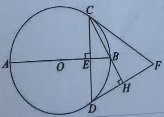
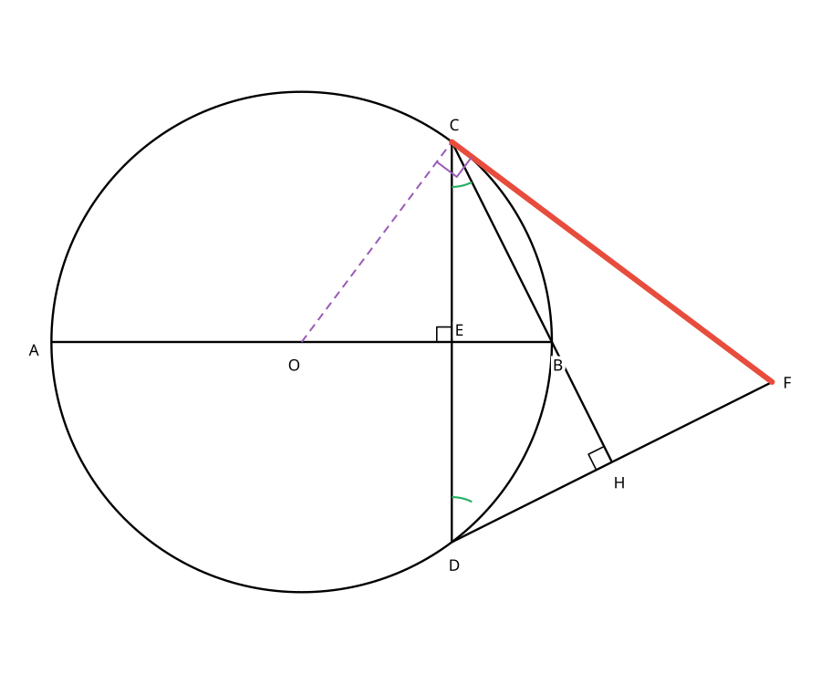

如图，$AB$ 是 $⊙O$ 的直径，弦 $CD⊥AB$ 于点 $E$，过点 $D$ 作 $DH⊥CB$ 交 $CB$ 的延长线于点 $H$，点 $F$ 是 $DH$ 延长线上一点，$CF=CD$。

(1) 求证：$CF$ 是 $⊙O$ 的切线；

(2) 若 $\tan\angle DCB=\frac{1}{2}$，$CF=8$，求 $⊙O$ 半径的长。

> [!question]- 点击查看答案与解析
> 【答案】(1) 证明见解析；(2) 半径 $=5$
> 
> 【考点】垂径定理、圆周角定理与圆心角、等腰三角形性质、直角三角形两锐角互余、切线的判定、勾股定理与方程 → [[【初中数学知识点体系-人教版】#29-1 圆的基本性质]]、[[【初中数学知识点体系-人教版】#30-1 直线和圆的位置关系]]
> 
> 【解析】
> (1) 证明 $CF$ 是 $⊙O$ 的切线：
> 设 $\angle DCB=\theta$，连接 $OC$。
> $\because AB$ 是直径且 $AB\perp CD$，$\therefore$ 弧 $BC=$ 弧 $BD$（垂径定理）。
> $\therefore \angle BDC=\angle DCB=\theta$（同圆中等弧所对的圆周角相等）。
> $\because DH\perp CH$，$\therefore$ 在 $\mathrm{Rt}△CDH$ 中，$\angle CDH=90^\circ-\angle DCH=90^\circ-\theta$，即 $\angle CDF=90^\circ-\theta$。
> $\because CF=CD$，$\therefore \angle CFD=\angle CDF=90^\circ-\theta$，$\therefore \angle DCF=180^\circ-2(90^\circ-\theta)=2\theta$。
> 又弧 $BD$ 所对圆心角 $\angle BOD=2\angle BCD=2\theta$；由 $CD\perp AB$ 的对称性，$\angle BOC=\angle BOD=2\theta$。
> 在 $\mathrm{Rt}△OEC$ 中，$\angle OCE=90^\circ-\angle EOC=90^\circ-2\theta$，即 $\angle OCD=90^\circ-2\theta$。
> $\therefore \angle OCF=\angle OCD+\angle DCF=(90^\circ-2\theta)+2\theta=90^\circ$。
> $\therefore OC\perp CF$，又 $C$ 在 $⊙O$ 上，$\therefore CF$ 是 $⊙O$ 的切线（切线的判定）。
> 
> (2) 求 $⊙O$ 半径的长：
> $\because CF=8$ 且 $CF=CD$，$\therefore CD=8$。
> $\because AB\perp CD$ 于 $E$，$AB$ 是直径，$\therefore CE=DE=\dfrac{1}{2}CD=4$（垂径定理）。
> 在 $\mathrm{Rt}△CEB$ 中，$\angle CEB=90^\circ$，$\tan\angle DCB=\dfrac{EB}{CE}=\dfrac{1}{2}$，$\therefore EB=4\times\dfrac{1}{2}=2$。
> 设半径为 $r$。$\because$ 点 $E$ 在 $O$、$B$ 之间，$\therefore OE=OB-EB=r-2$。
> 在 $\mathrm{Rt}△OEC$ 中，$OC^2=OE^2+CE^2$，即 $r^2=(r-2)^2+4^2$，
> 展开得 $r^2=r^2-4r+4+16$，$4r=20$，$\therefore r=5$。
> 
> 验证（数值自校验 16 项全部通过）：建系 $O(0,0)$、$A(-5,0)$、$B(5,0)$、$C(3,4)$、$D(3,-4)$、$E(3,0)$、$H(6.2,-2.4)$、$F(9.4,-0.8)$，$r=5$。逐项成立：$C$、$D$ 在圆上、$CD\perp AB$、$E$ 为 $CD$ 中点、$CE=DE=4$、$EB=2$、$\tan\angle DCB=\dfrac{EB}{CE}=\dfrac{1}{2}$、$DH\perp CB$、$H$ 在 $CB$ 延长线上（$B$ 外侧）、$CD=8$、$CF=CD=8$、$F$ 在 $DH$ 延长线上（$H$ 外侧）、$\overrightarrow{CO}\cdot\overrightarrow{CF}=0$ 即 $OC\perp CF$（切线成立）、$\angle DCB=\angle BDC$、$\angle OCD+\angle DCF=\angle OCF=90^\circ$、$r^2=(r-2)^2+16$。原答案 $r=2\sqrt{5}$ 错误，根因有二：一是原解析把 $\tan\angle DCB$ 写成 $\dfrac{CE}{EB}$，对边与邻边颠倒（在 $\mathrm{Rt}△CEB$ 中 $\angle DCB$ 的对边是 $EB$、邻边是 $CE$），错得 $EB=8$；二是据此列 $EB=r+OE$，把 $E$ 的位置放到了 $O$ 外侧，与图不符。且其方程组 $r+x=8$、$r^2=x^2+16$ 解得 $r=5$，与所写 $2\sqrt{5}\approx4.47$ 自相矛盾。正确结果 $r=5$。配图中 $CF$ 红色加粗为所证切线（$CF=8$），$OC$ 紫色虚线为辅助线，$C$ 处紫色直角标记为 $\angle OCF=90^\circ$，$E$、$H$ 处黑色小方块为 $CD\perp AB$、$DH\perp CB$，$C$、$D$ 处绿色同半径角弧表示 $\angle DCB=\angle BDC$。
> 
> 
> 
> 【易错点】一是 $\tan\angle DCB$ 的对应边：在 $\mathrm{Rt}△CEB$ 中 $\angle DCB$（即 $\angle ECB$）的对边是 $EB$、邻边是 $CE$，别写成 $\dfrac{CE}{EB}$；二是 $E$ 在 $O$、$B$ 之间，$OE=r-EB$，不要列成 $EB=r+OE$；三是 (1) 中角度链要完整：$\angle BDC=\angle DCB$ 来自垂径定理的等弧，$\angle DCF=2\theta$ 来自等腰三角形与 $\mathrm{Rt}△CDH$，$\angle OCD=90^\circ-2\theta$ 来自圆心角是圆周角的 $2$ 倍，三者合并才得 $\angle OCF=90^\circ$；四是切线判定必须"经过半径外端且垂直于这条半径"，$C$ 在圆上这一前提不能漏。
