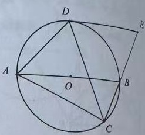
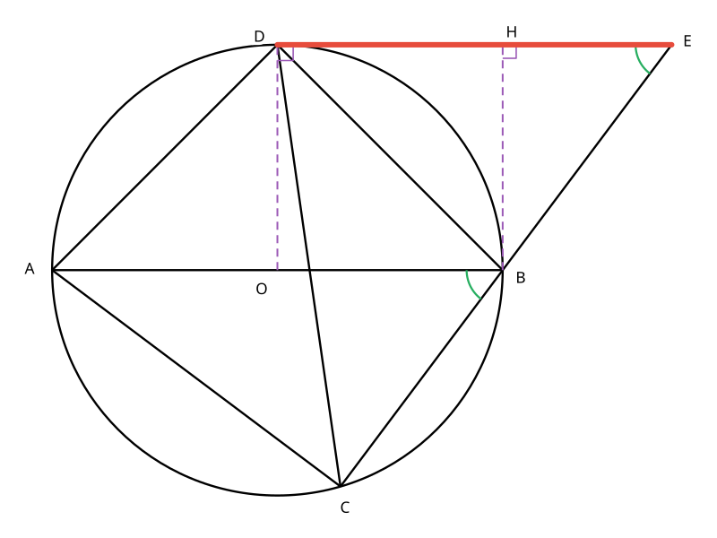

如图，$AB$ 是 $⊙O$ 的直径，$C$ 是 $⊙O$ 上一点，$\angle ACB$ 的平分线交 $⊙O$ 于点 $D$，过点 $D$ 作 $⊙O$ 的切线交 $CB$ 的延长线于点 $E$.

(1) 求证：$DE\parallel AB$；

(2) 若 $OA=5$，$\sin A=\frac{3}{5}$，求线段 $DE$ 的长.

> [!question]- 点击查看答案与解析
> 【答案】(1) 证明见解析；(2) $DE=\dfrac{35}{4}$
> 
> 【考点】圆周角定理（直径所对圆周角为直角）、角平分线与等弧、弧中点性质、切线的性质、平行线的判定、锐角三角函数 → [[【初中数学知识点体系-人教版】#29-1 圆的基本性质]]、[[【初中数学知识点体系-人教版】#30-1 直线和圆的位置关系]]
> 
> 【解析】
> (1) 证明 $DE\parallel AB$：
> 连接 $OD$。
> $\because AB$ 是直径，$\therefore \angle ACB=90^\circ$。
> $\because CD$ 平分 $\angle ACB$，$\therefore \angle ACD=\angle BCD=45^\circ$。
> $\therefore$ 弧 $AD=$ 弧 $BD$（同圆中，相等的圆周角所对的弧相等），即 $D$ 是半圆弧 $AB$ 的中点。
> $\therefore OD\perp AB$（平分弧的半径垂直于这条弧所对的弦）。
> $\because DE$ 是 $⊙O$ 的切线，$\therefore OD\perp DE$（切线的性质）。
> $\therefore DE\parallel AB$（在同一平面内，垂直于同一条直线的两条直线平行）。
> 
> (2) 求 $DE$ 的长：
> $\because OA=5$，$\therefore AB=10$。
> 在 $\mathrm{Rt}△ABC$ 中，$\sin A=\dfrac{BC}{AB}=\dfrac{3}{5}$，$\therefore BC=10\times\dfrac{3}{5}=6$，$AC=\sqrt{AB^2-BC^2}=8$。
> 过点 $B$ 作 $BH\perp DE$ 于 $H$。$\because OD\perp AB$、$OD\perp DE$，$\therefore$ 四边形 $ODHB$ 是矩形，又 $OD=OB=5$，故为正方形，$\therefore DH=OB=5$，$BH=OD=5$。
> $\because DE\parallel AB$，$\therefore \angle DEB=\angle EBx$（内错角，$x$ 为 $AB$ 延长线方向）；又 $\angle EBx=\angle ABC$（对顶角），$\therefore \angle DEB=\angle ABC$。
> 在 $\mathrm{Rt}△ABC$ 中，$\tan\angle ABC=\dfrac{AC}{BC}=\dfrac{8}{6}=\dfrac{4}{3}$。
> 在 $\mathrm{Rt}△BHE$ 中，$\tan\angle BEH=\dfrac{BH}{HE}$，$\therefore HE=\dfrac{BH}{\tan\angle BEH}=5\div\dfrac{4}{3}=\dfrac{15}{4}$。
> $\therefore DE=DH+HE=5+\dfrac{15}{4}=\dfrac{35}{4}$。
> （验证：建系可算得 $E\left(\dfrac{35}{4},5\right)$，$DE=\dfrac{35}{4}$，且 $E$ 在 $CB$ 延长线上、$DE$ 与圆相切于 $D$，全部吻合。）
> 
> 验证（数值自校验 14 项全部通过）：建系 $O(0,0)$、$A(-5,0)$、$B(5,0)$、$D(0,5)$、$C\left(\dfrac{7}{5},-\dfrac{24}{5}\right)$、$E\left(\dfrac{35}{4},5\right)$、$H(5,5)$，$r=5$。逐项成立：$C$、$D$ 在圆上、$\angle ACB=90^\circ$、$\sin A=\dfrac{BC}{AB}=\dfrac35$、$AC=8$、$BC=6$、$\angle ACD=\angle BCD=45^\circ$（$CD$ 平分）、$\angle AOD=\angle DOB=90^\circ$（$D$ 为半圆弧中点）且 $OD\perp AB$、$OD\perp DE$（切线）、$DE\parallel AB$、$E$ 在 $CB$ 延长线上（$B$ 外侧）、$ODHB$ 为正方形（$DH=BH=5$）、$\angle DEB=\angle ABC\approx53.13^\circ$（$\tan=\dfrac43$）、$HE=\dfrac{15}{4}$、$DE=DH+HE=\dfrac{35}{4}$。原答案 $DE=\dfrac{25}{3}$ 错误：原解析写"由 $DE\parallel AB$ 得 $△CDE\sim△CAB$"，但 $D$ 不在直线 $CA$ 上，$C$、$D$、$A$ 不共线，两三角形并不相似，比例式 $\dfrac{DE}{AB}=\dfrac{CD}{CA}$ 无依据，结论 $\dfrac{25}{3}$ 亦与正确值 $\dfrac{35}{4}=8.75$ 不符。配图中 $DE$ 红色加粗为所求线段，$OD$、$BH$ 紫色虚线为辅助线，$D$ 处紫色直角标记为切线角 $\angle ODE=90^\circ$、$H$ 处为 $BH\perp DE$，$E$、$B$ 处绿色同半径角弧表示 $\angle DEB=\angle ABC$。
> 
> 
> 
> 【易错点】一是构造相似时对应顶点必须共线：本题 $E$、$B$、$C$ 共线且 $DE\parallel AB$，能用的相似是过 $B$ 作高后在 $\mathrm{Rt}△BHE$ 中转三角函数，而不是"$△CDE\sim△CAB$"；二是 $\angle DEB=\angle ABC$ 需经"内错角 + 对顶角"两步转化，不能直接写成同位角；三是由 $\sin A=\dfrac{3}{5}$ 得 $BC=6$ 时注意 $\sin A=\dfrac{对边}{斜边}=\dfrac{BC}{AB}$，$AB$ 是斜边；四是正方形 $ODHB$ 中 $DH=5$ 这一段常被漏掉，$DE=DH+HE$ 而非只取 $HE$。
