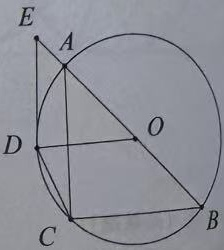
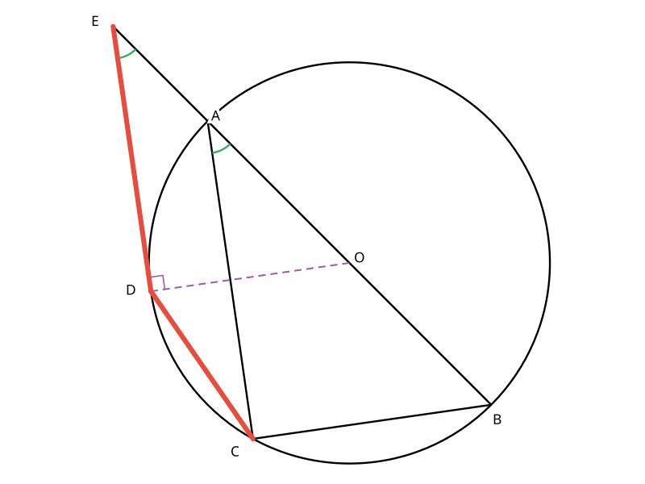

如图，$AB$ 是 $⊙O$ 的直径，点 $C,D$ 在 $⊙O$ 上，点 $D$ 为弧 $AC$ 的中点，$⊙O$ 的切线 $DE$ 交 $BA$ 的延长线于点 $E$，连接 $AC,BC,CD$.

(1) 求证：$\angle E = \angle BAC$；

(2) 若 $⊙O$ 的半径长为 5，$\cos E=\frac{4}{5}$，求 $CD$ 和 $DE$ 的长.

> [!question]- 点击查看答案与解析
> 【答案】(1) 证明见解析；(2) $CD=2\sqrt{5}$，$DE=\dfrac{20}{3}$
> 
> 【考点】弧中点与垂径定理、圆周角定理（直径所对圆周角为直角）、切线的性质、平行线的判定与同位角、锐角三角函数 → [[【初中数学知识点体系-人教版】#29-1 圆的基本性质]]、[[【初中数学知识点体系-人教版】#30-1 直线和圆的位置关系]]
> 
> 【解析】
> (1) 证明 $\angle E=\angle BAC$：
> 连接 $OD$。
> $\because DE$ 是 $⊙O$ 的切线，$\therefore OD\perp DE$（切线的性质），即 $\angle ODE=90^\circ$。
> $\because D$ 是弧 $AC$ 的中点，$\therefore OD\perp AC$（平分弧的半径垂直于这条弧所对的弦，垂径定理的推论）。
> $\therefore AC\parallel DE$（在同一平面内，垂直于同一条直线的两条直线平行）。
> $\because$ 点 $E$ 在直线 $AB$ 上，$\therefore \angle E=\angle BAC$（两直线平行，同位角相等）。
> 
> (2) 求 $CD$ 和 $DE$ 的长：
> $\because AB$ 是直径，$\therefore \angle ACB=90^\circ$。
> $\because \angle E=\angle BAC$，$\cos E=\dfrac{4}{5}$，$\therefore \cos\angle BAC=\dfrac{4}{5}$。
> 在 $\mathrm{Rt}△ABC$ 中，$AB=2\times5=10$，$AC=AB\cdot\cos\angle BAC=10\times\dfrac{4}{5}=8$，$BC=\sqrt{AB^2-AC^2}=6$。
> 设 $OD$ 与 $AC$ 交于点 $M$。由 $OD\perp AC$ 及垂径定理，$AM=MC=\dfrac{1}{2}AC=4$。
> 在 $\mathrm{Rt}△OMC$ 中，$OM=\sqrt{OC^2-MC^2}=\sqrt{25-16}=3$，$\therefore DM=OD-OM=5-3=2$。
> 在 $\mathrm{Rt}△DMC$ 中，$CD=\sqrt{MC^2+DM^2}=\sqrt{16+4}=2\sqrt{5}$。
> 在 $\mathrm{Rt}△ODE$ 中，$\angle ODE=90^\circ$，$\because \cos E=\dfrac{4}{5}$，$\therefore \sin E=\dfrac{3}{5}$，$\tan E=\dfrac{3}{4}$。
> 由 $\tan E=\dfrac{OD}{DE}$，得 $DE=\dfrac{OD}{\tan E}=5\div\dfrac{3}{4}=\dfrac{20}{3}$。
> （验证：$OE=\sqrt{OD^2+DE^2}=\sqrt{25+\dfrac{400}{9}}=\dfrac{25}{3}$，$\cos E=\dfrac{DE}{OE}=\dfrac{20}{3}\div\dfrac{25}{3}=\dfrac{4}{5}$，与题设吻合。）
> 
> 验证（数值自校验 15 项全部通过）：建系 $O(0,0)$、$A(-5,0)$、$B(5,0)$、$C\left(\dfrac{7}{5},-\dfrac{24}{5}\right)$、$D(-3,-4)$、$E\left(-\dfrac{25}{3},0\right)$，$r=5$（配图整体旋转 $45^\circ$ 后与原卷方位一致：$A$ 左上、$B$ 右下、$C$ 左下、$D$ 左侧、$E$ 左上圆外）。逐项成立：$C$、$D$ 在圆上、$AB$ 是直径、$\angle AOD=\angle DOC$（$D$ 为弧 $AC$ 中点）、$OD\perp DE$（切线）、$E$ 在 $BA$ 延长线上、$AC\parallel DE$、$\angle E=\angle BAC\approx36.87^\circ$、$\angle ACB=90^\circ$、$\cos E=\dfrac45$、$AC=8$、$BC=6$、垂径 $OM=3$、$DM=2$、$CD=AD=2\sqrt5$、$OE=\dfrac{25}{3}$、$DE=\dfrac{20}{3}$ 且 $OD^2+DE^2=OE^2$。原答案两处错误：其一，$CD=5\sqrt2$ 错——该值相当于误把弧 $DC$ 当成 $90^\circ$ 弧取弦 $2r\sin45^\circ$，实际弧 $DC$ 所对圆心角 $\angle DOC=\angle AOD\approx53.13^\circ$，正确值 $CD=2\sqrt5\approx4.47$；其二，$DE=\dfrac{15}{4}$ 错——原解析在 $\mathrm{Rt}△ODE$ 中把正切写反，误用 $DE=OD\cdot\tan E=5\times\dfrac34=\dfrac{15}{4}$，而 $\angle E$ 的对边是 $OD$、邻边是 $DE$，应为 $DE=\dfrac{OD}{\tan E}=\dfrac{20}{3}$。配图中 $CD$、$DE$ 红色加粗为所求线段，$OD$ 紫色虚线为辅助线，$D$ 处紫色直角标记为切线角 $\angle ODE=90^\circ$，$E$、$A$ 处绿色同半径角弧表示 $\angle E=\angle BAC$。
> 
> 
> 
> 【易错点】一是 $\tan E$ 的分子分母易写反：在 $\mathrm{Rt}△ODE$ 中 $\angle ODE=90^\circ$，$\angle E$ 的对边是 $OD$ 而非 $DE$，故 $\tan E=\dfrac{OD}{DE}$；二是求 $CD$ 不能凭"弧中点"直接猜特殊弧，弧 $AC$ 的度数由 $\angle AOC$ 决定（$\cos\angle BAC=\dfrac45$ 时 $\angle AOC\approx106.26^\circ$，并非 $180^\circ$ 或 $90^\circ$），应经垂径定理构造 $\mathrm{Rt}△DMC$ 计算；三是由 $D$ 是弧 $AC$ 中点得 $OD\perp AC$ 用的是垂径定理的推论，需明确 $OD$ 所在直线过圆心；四是 (1) 中 $\angle E$ 与 $\angle BAC$ 是直线 $AC$、$DE$ 被直线 $EB$ 所截形成的同位角，截线要认准 $EB$。
