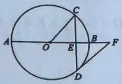
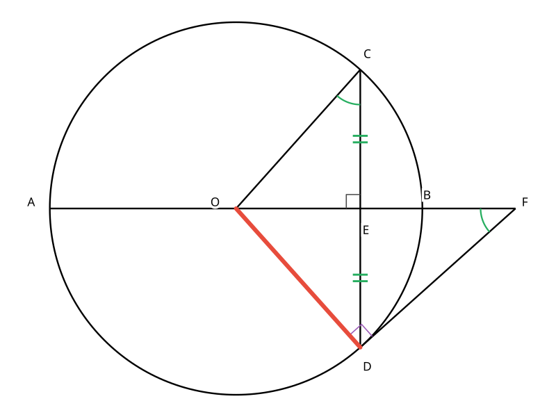

如图，$⊙O$ 的直径 $AB$ 与弦 $CD$ 相交于点 $E$，且 $CE=DE$，点 $F$ 在 $AB$ 的延长线上，连接 $OC, DF$，$\angle F = \angle C$.

(1) 求证：$DF$ 是 $⊙O$ 的切线;

(2) 若 $OE = 2BE, BF = 2$, 求 $\odot O$ 半径的长.

> [!question]- 点击查看答案与解析
> 【答案】(1) 证明见解析；(2) 半径 $=4$
> 
> 【考点】垂径定理及其逆定理、切线的判定、全等三角形、直角三角形射影定理（或勾股定理）、方程思想 → [[【初中数学知识点体系-人教版】#29-1 圆的基本性质]]、[[【初中数学知识点体系-人教版】#30-1 直线和圆的位置关系]]
> 
> 【解析】
> (1) 证明 $DF$ 是 $⊙O$ 的切线：
> 连接 $OD$。
> $\because AB$ 是直径，$CE=DE$（$CD$ 为非直径的弦），$\therefore AB\perp CD$（垂径定理的逆定理：平分弦（非直径）的直径垂直于弦），即 $\angle OEC=\angle OED=90^\circ$。
> 在 $△OCE$ 和 $△ODE$ 中，$OC=OD$（半径）、$CE=DE$、$OE=OE$，$\therefore △OCE\cong△ODE$（SSS），$\therefore \angle ODE=\angle OCE$。
> $\because \angle F=\angle C$（题设，即 $\angle DFE=\angle OCE$），$\therefore \angle ODE=\angle DFE$。
> 在 $\mathrm{Rt}△DEF$ 中，$\angle DFE+\angle EDF=90^\circ$，$\therefore \angle ODE+\angle EDF=90^\circ$，即 $\angle ODF=90^\circ$。
> $\therefore OD\perp DF$，又 $OD$ 是半径且 $D$ 在 $⊙O$ 上，$\therefore DF$ 是 $⊙O$ 的切线（切线的判定）。
> 
> (2) 求 $⊙O$ 半径的长：
> 设 $BE=x$，则 $OE=2x$，半径 $r=OB=OE+BE=3x$。
> $\because F$ 在 $AB$ 延长线上，$BF=2$，$\therefore OF=OB+BF=3x+2$。
> 由 (1) 知 $OD\perp DF$，$\therefore △ODF$ 是直角三角形（$\angle ODF=90^\circ$）；
> 又 $DE\perp OF$（即 $CD\perp AB$，$E$ 在 $OF$ 上），$\therefore DE$ 是斜边 $OF$ 上的高，
> 由射影定理：$OD^2=OE\cdot OF$，即 $(3x)^2=2x\cdot(3x+2)$。
> 展开：$9x^2=6x^2+4x$，得 $3x^2=4x$，$\because x\neq 0$，$\therefore x=\dfrac{4}{3}$。
> $\therefore r=3x=3\times\dfrac{4}{3}=4$。
> （另解：用勾股。在 $\mathrm{Rt}△OCE$ 中 $CE^2=OC^2-OE^2=9x^2-4x^2=5x^2$，故 $DE^2=5x^2$；
> $EF=EB+BF=x+2$，在 $\mathrm{Rt}△DEF$ 中 $DF^2=DE^2+EF^2=5x^2+(x+2)^2$；
> 代入 $\mathrm{Rt}△ODF$ 的 $OD^2+DF^2=OF^2$：$(3x)^2+5x^2+(x+2)^2=(3x+2)^2$，
> 化简得 $6x^2-8x=0$，$x=\dfrac{4}{3}$，$r=4$。）
> 
> 验证（数值自校验 15 项全部通过）：建系 $O(0,0)$、$A(-4,0)$、$B(4,0)$、$E\left(\dfrac{8}{3},0\right)$、$F(6,0)$、$C\left(\dfrac{8}{3},\dfrac{4\sqrt5}{3}\right)$、$D\left(\dfrac{8}{3},-\dfrac{4\sqrt5}{3}\right)$，$r=4$。逐项成立：$A$、$B$、$C$、$D$ 在圆上、$CE=DE$（题设）、$AB\perp CD$ 于 $E$、$OE=2BE$（$OE=\dfrac83$、$BE=\dfrac43$）、$F$ 在 $AB$ 延长线上且 $BF=2$、$\angle DFE=\angle OCE$（题设）、$OD\perp DF$（(1) 切线得证）、$△OCE\cong△ODE$ 得 $\angle ODE=\angle OCE$、$\angle ODF=\angle ODE+\angle EDF=90^\circ$、$OF=6=\dfrac{3r}{2}$、射影关系 $r^2=OE\cdot OF$（$16=\dfrac83\times6$）、$DF=2\sqrt5$ 且 $DE^2+EF^2=DF^2$（$\dfrac{80}{9}+\dfrac{100}{9}=20$）、$r=3x=4$；原答案 $r=3$ 错误：原解析把 $EF$ 误写成 $2x+2$（应为 $x+2$），即便按其错误式子 $(3x)^2+5x^2+(2x+2)^2=(3x+2)^2$ 解得也是 $x=\dfrac49$、$r=\dfrac43$，与 $3$ 不符，可见原结论无依据。配图方位与原卷一致：$A$ 左、$O$ 中、$E$ 偏右、$B$ 右、$F$ 远右、$C$ 上、$D$ 下；$OD$ 红色加粗为所求半径，$E$ 处直角标记为 $AB\perp CD$，$D$ 处紫色直角标记为切线角 $\angle ODF=90^\circ$，$C$、$F$ 处绿色同半径角弧表示 $\angle C=\angle F$，$CE$、$DE$ 绿色双刻线表示相等。
> 
> 
> 
> 【易错点】一是本题原解析 (2) 有两处错：把 $EF=EB+BF$ 算成 $2x+2$（漏了 $BE=x$ 与系数混淆，正确是 $x+2$），且最终"解得 $r=3$"与其列出的方程并不吻合——正确方程 $(3x)^2=2x(3x+2)$ 解得 $x=\dfrac43$、$r=4$；二是 (1) 用垂径定理逆定理前须说明 $CD$ 不是直径（题中 $CD$ 与直径 $AB$ 相交且被平分，故 $CD$ 非直径），才能由 $CE=DE$ 得 $AB\perp CD$；三是证切线时 $\angle ODF=\angle ODE+\angle EDF$ 依赖射线 $DE$ 在 $\angle ODF$ 内部，且要用 $△OCE\cong△ODE$ 把 $\angle ODE$ 转成 $\angle OCE$ 再结合 $\angle F=\angle C$，不能想当然"等量代换"；四是 (2) 用射影定理 $OD^2=OE\cdot OF$ 最简捷，若用勾股则需两次（$\mathrm{Rt}△DEF$ 与 $\mathrm{Rt}△ODF$），线段和差 $OF=3x+2$、$EF=x+2$ 易错。
