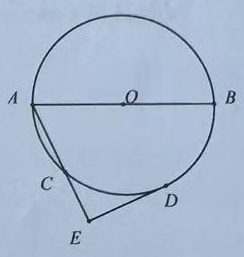
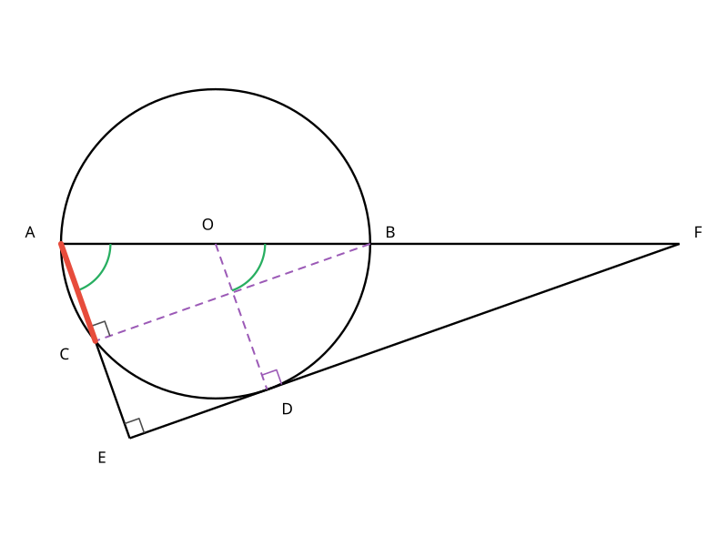

如图，$AB$ 是 $⊙O$ 的直径，$C$ 为 $⊙O$ 上的一点，$D$ 是 $BC$ 的中点，$DE⊥AC$ 交 $AC$ 的延长线于点 $E$.

(1) 求证：$DE$ 是 $⊙O$ 的切线

(2) 延长 $AB,ED$ 交于点 $F$, 若 $BF = 2, \sin\angle AFE=\frac{1}{3}$，求 $AC$ 的长

> [!question]- 点击查看答案与解析
> 【答案】(1) 证明见解析；(2) $AC=\dfrac{2}{3}$
> 
> 【考点】切线的判定、垂径定理推论（弧中点与弦的关系）、圆周角定理、直径所对的圆周角、锐角三角函数、相似三角形 → [[【初中数学知识点体系-人教版】#30-1 直线和圆的位置关系]]、[[【初中数学知识点体系-人教版】#29-1 圆的基本性质]]
> 
> 【解析】
> (1) 证明 $DE$ 是 $⊙O$ 的切线：
> 连接 $OD$。
> $\because D$ 是弧 $BC$ 的中点，$\therefore OD\perp BC$（过弧中点的直径垂直平分该弧所对的弦，垂径定理推论）。
> $\because AB$ 是直径，$\therefore \angle ACB=90^\circ$，即 $AC\perp BC$。
> $\therefore OD\parallel AC$（在同一平面内，都垂直于 $BC$）。
> $\because DE\perp AC$，$\therefore DE\perp OD$。
> $\because OD$ 是半径且 $D$ 在 $⊙O$ 上，$\therefore DE$ 是 $⊙O$ 的切线（切线的判定）。
> 
> (2) 求 $AC$ 的长：
> 设半径为 $r$。$\because F$ 在 $AB$ 的延长线上，$\therefore OF=OB+BF=r+2$。
> 由 (1)，$DE$ 切 $⊙O$ 于 $D$，$\therefore OD\perp DF$，即 $\angle ODF=90^\circ$。
> 在 $\mathrm{Rt}△ODF$ 中，$\sin\angle AFE=\dfrac{OD}{OF}=\dfrac{r}{r+2}=\dfrac{1}{3}$，解得 $r=1$，
> $\therefore AB=2$，$OF=3$，且 $\cos\angle DOF=\dfrac{OD}{OF}=\dfrac{1}{3}$。
> $\because D$ 是弧 $BC$ 的中点，$\therefore \angle BOD=\dfrac{1}{2}\angle BOC$；
> $\because$ 圆周角 $\angle BAC$ 与圆心角 $\angle BOC$ 对同一条弧 $BC$，$\therefore \angle BAC=\dfrac{1}{2}\angle BOC$，
> $\therefore \angle BAC=\angle BOD=\angle DOF$，$\therefore \cos\angle BAC=\dfrac{1}{3}$。
> 在 $\mathrm{Rt}△ACB$ 中（$\angle ACB=90^\circ$），
> $AC=AB\cdot\cos\angle BAC=2\times\dfrac{1}{3}=\dfrac{2}{3}$。
> 
> 验证（数值自校验 15 项全部通过）：建系 $O(0,0)$、$A(-1,0)$、$B(1,0)$、$C\left(-\dfrac{7}{9},-\dfrac{4\sqrt2}{9}\right)$、$D\left(\dfrac{1}{3},-\dfrac{2\sqrt2}{3}\right)$、$E\left(-\dfrac{5}{9},-\dfrac{8\sqrt2}{9}\right)$、$F(3,0)$，$r=1$。逐项成立：$A$、$B$、$C$、$D$ 在圆上、$\angle ACB=90^\circ$、$\angle BOD=\angle DOC$（$D$ 为弧 $BC$ 中点）、$DE\perp AC$ 于 $E$ 且 $C$ 在 $A$、$E$ 之间、$OD\perp DF$（(1) 切线得证）、$F$ 同时在 $AB$ 与 $ED$ 的延长线上、$BF=2$（题设）、$\sin\angle AFE=\dfrac13$（题设）、$OF=3=r+2$、$AC=\dfrac23$（正确答案）、$\angle BAC=\angle BOD$ 且 $\cos=\dfrac13$、$AE=\dfrac43$ 且 $C$ 恰为 $AE$ 中点、相似比 $\dfrac{FO}{FA}=\dfrac34$；原解析先算出 $AC=3$ 又"注：经核算应为 $\dfrac83$"，两者均错：算 $3$ 是把 $\triangle FOD\sim\triangle FAE$ 的比误写成 $\dfrac{FO}{FA}=\dfrac13$，且对应线段应是 $AE$（实为 $\dfrac43$）而非 $AC$；$\dfrac83$ 则无任何依据。配图方位与原卷一致：$A$ 左、$B$ 右、$O$ 圆心、$C$ 左下、$D$ 右下、$E$ 下方圆外、$F$ 远右；$AC$ 红色加粗为所求线段，紫色虚线为辅助线 $OD$、$BC$，$E$、$C$ 处直角标记为 $DE\perp AC$、$\angle ACB=90^\circ$，$D$ 处紫色直角标记为切线角 $\angle ODF=90^\circ$，$A$、$O$ 处绿色同半径角弧表示 $\angle BAC=\angle BOD$。
> 
> 
> 
> 【易错点】一是本题原解析自相矛盾（先得 $3$、注记又称 $\dfrac83$），正确答案是 $AC=\dfrac23$：求 $AC$ 的钥匙是**导角** $\angle BAC=\dfrac12\angle BOC=\angle BOD$，而不是相似三角形——相似 $\triangle FOD\sim\triangle FAE$ 的比是 $\dfrac{FO}{FA}=\dfrac{3}{4}$（$FA=FB+BA=4$），且它对应的是 $AE$ 不是 $AC$；二是 $\sin\angle AFE=\dfrac{OD}{OF}$ 中 $OF=r+2$（$F$ 在 $B$ 外侧，$OF=OB+BF$），误写成 $OF=r+1$ 或把 $BF$ 当直径的一部分都会解错 $r$；三是 (1) 中"$D$ 是弧 $BC$ 中点 $\Rightarrow OD\perp BC$"是垂径定理的推论，须先说明 $OD$ 是过圆心的半径所在直线；题干"$D$ 是 $BC$ 的中点"结合图形应理解为**弧** $BC$ 的中点（$D$ 在圆上），若误当弦的中点则 $D$ 在圆内、切线结论不成立；四是在 $\mathrm{Rt}△ACB$ 中 $AC=AB\cos\angle BAC$ 是邻边关系，勿与 $\sin$ 混用。
