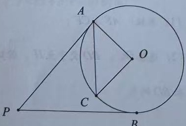
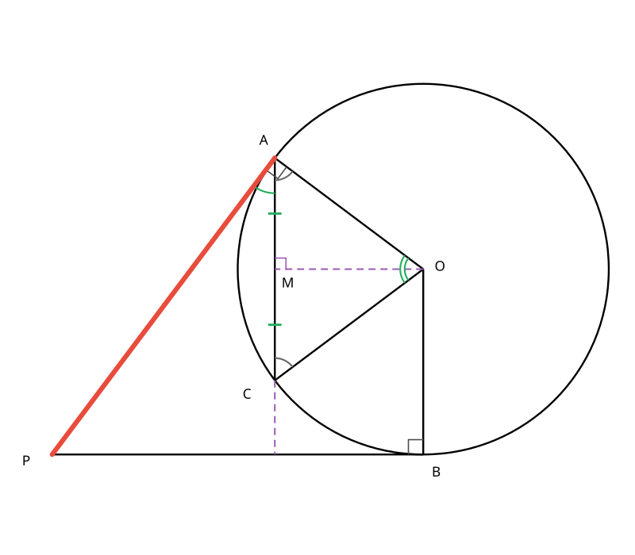

如图，$P$ 为 $⊙O$ 外一点，$PA, PB$ 是 $⊙O$ 的切线，$A, B$ 为切点，点 $C$ 在 $⊙O$ 上，连接 $OA, OC, AC$.

(1) 求证：$\angle AOC = 2 \angle PAC$;

(2) 连接 $OB$, 若 $AC∥OB$, $⊙O$ 的半径为 5, $AC=6$，求 $AP$ 的长.

> [!question]- 点击查看答案与解析
> 【答案】(1) 证明见解析；(2) $AP=10$
> 
> 【考点】切线的性质、切线长定理、等腰三角形性质、垂径定理、平行线的性质（同旁内角）、矩形的判定与性质、勾股定理 → [[【初中数学知识点体系-人教版】#30-1 直线和圆的位置关系]]、[[【初中数学知识点体系-人教版】#29-1 圆的基本性质]]
> 
> 【解析】
> (1) 证明 $\angle AOC=2\angle PAC$：
> $\because PA$ 是 $⊙O$ 的切线，$\therefore OA\perp PA$（切线的性质），即 $\angle OAP=90^\circ$，
> $\therefore \angle PAC=90^\circ-\angle OAC$。
> $\because OA=OC$（半径），$\therefore \angle OAC=\angle OCA$（等边对等角）。
> 在 $△AOC$ 中，$\angle AOC=180^\circ-2\angle OAC=2(90^\circ-\angle OAC)=2\angle PAC$。
> 
> (2) 求 $AP$ 的长：
> 过 $O$ 作 $OM\perp AC$ 于 $M$，则 $AM=MC=\dfrac{1}{2}AC=3$（垂径定理），
> 在 $\mathrm{Rt}△OAM$ 中，$OM=\sqrt{OA^2-AM^2}=\sqrt{25-9}=4$。
> $\because PB$ 切 $⊙O$ 于 $B$，$\therefore PB\perp OB$；又 $\because AC\parallel OB$，$\therefore PB\perp AC$。
> 延长 $AC$ 交直线 $PB$ 于点 $Q$，则 $\angle AQP=90^\circ$。
> $\because OM\perp AC$、$BQ\perp AC$，$\therefore OM\parallel BQ$；又 $MQ\parallel OB$，
> $\therefore$ 四边形 $OMQB$ 是平行四边形，且 $\angle OMQ=90^\circ$，$\therefore$ 是矩形，
> $\therefore BQ=OM=4$，$MQ=OB=5$。
> $\therefore AQ=AM+MQ=3+5=8$。
> 设 $AP=x$，$\because PA$、$PB$ 都是切线，$\therefore PB=AP=x$（切线长定理），
> $\therefore PQ=PB-BQ=x-4$。
> 在 $\mathrm{Rt}△AQP$ 中，$AP^2=AQ^2+PQ^2$，即 $x^2=8^2+(x-4)^2$，
> 展开得 $x^2=64+x^2-8x+16$，解得 $8x=80$，$x=10$。
> $\therefore AP=10$。
> 
> 验证（数值自校验 16 项全部通过）：建系 $O(0,0)$、$B(0,-5)$、$A(-4,3)$、$C(-4,-3)$、$P(-10,-5)$、$M(-4,0)$、$Q(-4,-5)$，$r=5$。逐项成立：$A$、$C$、$B$ 在圆上、$AC=6$（题设）、$AC\parallel OB$ 且射线 $A\to C$ 与 $O\to B$ 同向（原卷构型）、$OA\perp PA$、$OB\perp PB$（两切线）、$PA=PB=10$（切线长）、$\angle AOC=2\angle PAC$（(1) 得证）、$AM=MC=3$、$OM=4$、$\cos\angle OAC=\dfrac{3}{5}$、$\angle OAC+\angle AOB=180^\circ$（同旁内角互补）、矩形 $OMQB$ 得 $BQ=4$、$MQ=5$、$\mathrm{Rt}△AQP$ 中 $AQ=8$、$PQ=6$、$AP=\sqrt{64+36}=10$、$OP$ 平分 $\angle AOB$；原答案 $\dfrac{20}{3}$ 不成立——其根因是原解析把 $\angle OAC$ 与 $\angle AOB$ 误当内错角相等（实际两射线同向，是同旁内角，和为 $180^\circ$），随后又无依据地用 $AP=OA\cdot\tan\angle OAC=5\times\dfrac{4}{3}=\dfrac{20}{3}$。配图方位与原卷一致：$A$ 左上、$C$ 左下、$B$ 底部、$P$ 远左下、$O$ 圆心；$AP$ 红色加粗为所求线段，紫色虚线为辅助线 $OM$ 与延长线 $CQ$，$A$、$C$ 处灰色同半径角弧表示 $\angle OAC=\angle OCA$，$A$ 处绿色单弧 $\angle PAC$ 与 $O$ 处绿色双弧 $\angle AOC$ 表示二倍关系，$AM$、$MC$ 绿色单刻线，$A$、$B$、$M$ 处直角标记分别为 $\angle OAP=\angle OBP=\angle OMA=90^\circ$。
> 
> 
> 
> 【易错点】一是 $AC\parallel OB$ 时 $\angle OAC$ 与 $\angle AOB$ 的关系要看射线方向：本卷构型中射线 $A\to C$ 与 $O\to B$ 同向，两角是**同旁内角**（和为 $180^\circ$），原解析误用"内错角相等"导致答案 $\dfrac{20}{3}$ 错误，正确为 $AP=10$；二是 (2) 的关键辅助线是延长 $AC$ 交切线 $PB$ 于 $Q$，由 $OM\parallel BQ$、$MQ\parallel OB$ 得矩形 $OMQB$，从而 $BQ=OM=4$、$MQ=OB=5$，不要试图直接"用相似"跳步；三是 (1) 中 $\angle PAC=90^\circ-\angle OAC$ 依赖射线 $AC$ 在 $\angle OAP$ 内部（结合图形判断），且 $\angle AOC=180^\circ-2\angle OAC$ 用的是等腰三角形内角和，$\angle PAC$ 不是圆周角、不能直接用圆周角定理；四是切线长定理给出的是 $PA=PB$，设未知数后在直角三角形里用勾股列方程，比硬算角度更稳妥。
