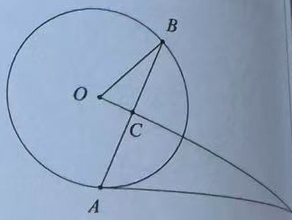
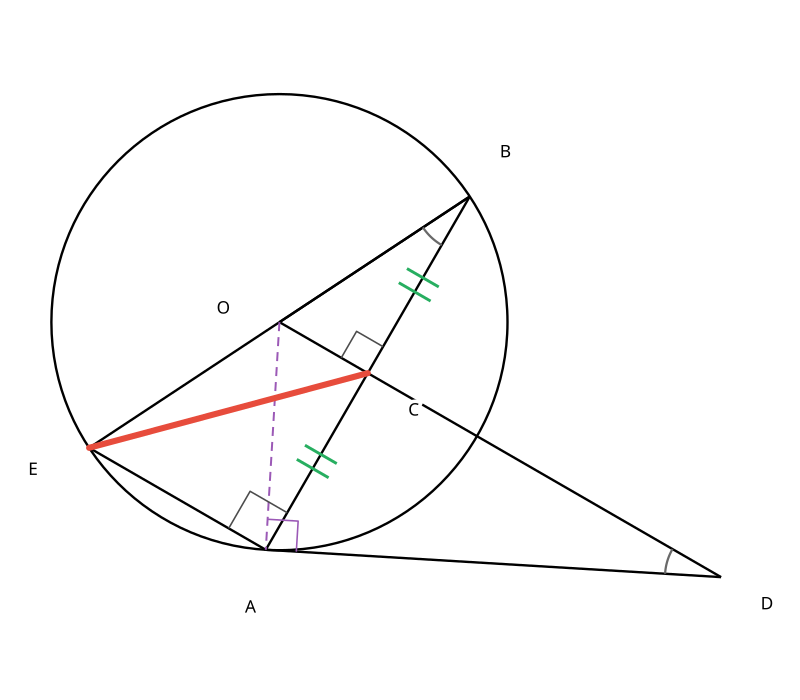

如图，$AB$ 是 $⊙O$ 的弦，过点 $O$ 作 $OC⊥AB$，垂足为 $C$，过点 $A$ 作 $⊙O$ 的切线，交 $OC$ 的延长线于点 $D$，连接 $OB$.

(1) 求证：$\angle B = \angle D$.

(2) 延长 $BO$ 交 $⊙O$ 于点 $E$, 连接 $AE,CE$, 若 $AD=2\sqrt{5}, \sin B=\frac{\sqrt{5}}{5}$，求 $CE$ 的长，

> [!question]- 点击查看答案与解析
> 【答案】(1) 证明见解析；(2) $CE=2\sqrt{2}$
> 
> 【考点】切线的性质、垂径定理、等腰三角形三线合一、直角三角形中的锐角三角函数、直径所对的圆周角、三角形中位线定理、勾股定理 → [[【初中数学知识点体系-人教版】#29-1 圆的基本性质]]、[[【初中数学知识点体系-人教版】#30-1 直线和圆的位置关系]]
> 
> 【解析】
> (1) 证明 $\angle B=\angle D$：
> $\because AD$ 是 $⊙O$ 的切线，$\therefore OA\perp AD$（切线的性质），即 $\angle OAD=90^\circ$，
> $\therefore \angle D=90^\circ-\angle AOD$。
> $\because OA=OB$（半径），$\therefore △OAB$ 是等腰三角形；
> 又 $\because OC\perp AB$，$\therefore OC$ 平分 $\angle AOB$（等腰三角形三线合一），即 $\angle AOC=\angle BOC$。
> $\because$ 点 $D$ 在 $OC$ 的延长线上，$\therefore \angle AOD=\angle AOC=\angle BOC$。
> 在 $\mathrm{Rt}△OCB$ 中（$\angle OCB=90^\circ$），$\angle B=90^\circ-\angle BOC$，
> $\therefore \angle D=90^\circ-\angle AOD=90^\circ-\angle BOC=\angle B$。
> 
> (2) 求 $CE$ 的长：
> $\because \angle D=\angle B$，$\therefore \sin D=\sin B=\dfrac{\sqrt{5}}{5}$。
> 在 $\mathrm{Rt}△OAD$ 中，$\sin D=\dfrac{OA}{OD}=\dfrac{r}{OD}=\dfrac{\sqrt{5}}{5}$，$\therefore OD=\sqrt{5}\,r$。
> 由勾股定理 $OA^2+AD^2=OD^2$，即 $r^2+(2\sqrt{5})^2=5r^2$，解得 $r=\sqrt{5}$，
> $\therefore OA=\sqrt{5}$，$OD=5$。
> $\because OC\perp AB$ 于 $C$，且 $O$、$C$、$D$ 共线，$\therefore AC$ 是 $\mathrm{Rt}△OAD$ 斜边 $OD$ 上的高，
> $\therefore AC=\dfrac{OA\cdot AD}{OD}=\dfrac{\sqrt{5}\times 2\sqrt{5}}{5}=2$，
> $OC=\sqrt{OA^2-AC^2}=\sqrt{5-4}=1$。
> $\because OC\perp AB$ 过圆心，$\therefore BC=AC=2$（垂径定理）。
> $\because$ 延长 $BO$ 交 $⊙O$ 于 $E$，$\therefore BE$ 是直径，$\angle EAB=90^\circ$（直径所对的圆周角是直角）。
> 在 $△ABE$ 中，$O$ 是 $BE$ 的中点，$C$ 是 $AB$ 的中点，
> $\therefore OC$ 是 $△ABE$ 的中位线，$\therefore AE=2OC=2$。
> 在 $\mathrm{Rt}△EAC$ 中（$\angle EAC=90^\circ$），
> $CE=\sqrt{AE^2+AC^2}=\sqrt{4+4}=2\sqrt{2}$。
> 
> 验证（数值自校验 16 项全部通过）：建系 $O(0,0)$、$D(5,0)$、$C(1,0)$、$A(1,-2)$、$B(1,2)$、$E(-1,-2)$，$r=\sqrt{5}$。逐项成立：$|OA|=|OB|=|OE|=\sqrt{5}$（$A$、$B$、$E$ 在圆上）、$OC\perp AB$、$OA\perp AD$（切线）、$D$ 在 $OC$ 延长线上、$AD=2\sqrt5$（题设）、$\sin\angle OBC=\dfrac{\sqrt5}{5}$（题设）、$\angle OBC=\angle ADO$（(1) 得证）、$OD=5=\sqrt5 r$、$OC=1$、$AC=BC=2$、$CD=4$、$AE=2OC=2$（中位线）、$CE=2\sqrt2$；原答案 $2\sqrt5$ 不成立——其根因是误用圆周角定理：$|OC|=1<\sqrt5$，垂足 $C$ 不在圆上，$BE$ 是直径只能推出圆上点（如 $A$）对 $BE$ 的张角为 $90^\circ$，不能得 $\angle BCE=90^\circ$。配图方位与原卷一致：$O$ 为圆心、$B$ 右上、$A$ 下偏左、$C$ 在弦 $AB$ 上、$D$ 右下、$E$ 左下；$CE$ 红色加粗为所求线段，紫色虚线为辅助半径 $OA$，$B$、$D$ 处两枚同半径角弧表示 $\angle B=\angle D$，$AC$、$BC$ 绿色双刻线表示相等，$C$ 处与 $A$ 处直角标记分别为 $OC\perp AB$、$\angle EAB=90^\circ$。
> 
> 
> 
> 【易错点】一是 $C$ 是弦 $AB$ 的垂足、**不在圆上**，"直径所对圆周角为直角"只对圆上的点成立，切勿由"$BE$ 是直径"得 $\angle BCE=90^\circ$（原解析正是因此错得 $CE=2\sqrt5$）；二是原解析 (1) 中"弧 $AC=$ 弧 $BC$"记号错误——$C$ 不在圆上，不存在弧 $AC$，应由 $OA=OB$ 且 $OC\perp AB$ 用等腰三角形三线合一得 $\angle AOC=\angle BOC$；三是在 $\mathrm{Rt}△OAD$ 中 $\sin D$ 是**对边 $OA$ 比斜边 $OD$**，勿与 $\cos$ 混用导致 $OD$ 与 $AD$ 关系写反；四是求 $CE$ 的关键链条"中位线 $AE=2OC$"不可跳过，$AE$ 也可直接由 $AE\parallel OD$ 且 $AE\perp AB$ 在 $\mathrm{Rt}△EAB$ 中验证，最后务必在 $\mathrm{Rt}△EAC$ 中用勾股定理求斜边 $CE$。
