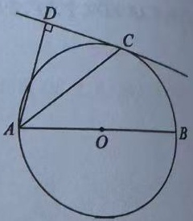
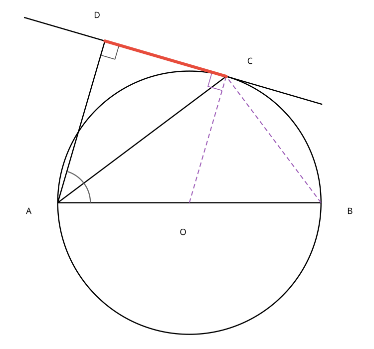

如图，$AB$ 为 $\odot O$ 的直径，$C$ 为 $\odot O$ 上一点，$AD$ 和过点 $C$ 的切线互相垂直，垂足为 $D$.

(1) 求证：$AC$ 平分 $\angle DAB$；

(2) 若 $\cos \angle CAD = \frac{4}{5}$，$AB = 5$，求 $CD$ 的长.

> [!question]- 点击查看答案与解析
> 【答案】(1) 证明见解析；(2) $CD=\dfrac{12}{5}$
> 
> 【考点】切线的性质、平行线的性质与判定、等腰三角形与角平分线、直径所对圆周角、相似三角形、锐角三角函数 → [[【初中数学知识点体系-人教版】#30-1 直线和圆的位置关系]]、[[【初中数学知识点体系-人教版】#14-3 角的平分线]]
> 
> 【解析】
> (1) 证明 $AC$ 平分 $\angle DAB$：
> 连接 $OC$。
> $\because$ 过点 $C$ 的切线为 $CD$，$\therefore OC\perp CD$（切线的性质）。
> 又 $\because AD\perp CD$，$\therefore AD\parallel OC$（在同一平面内，垂直于同一条直线的两条直线平行）。
> $\therefore \angle DAC=\angle OCA$（两直线平行，内错角相等）。
> $\because OA=OC$（半径），$\therefore \angle OCA=\angle OAC$（等边对等角）。
> $\therefore \angle DAC=\angle OAC$，即 $\angle DAC=\angle CAB$，$AC$ 平分 $\angle DAB$。
> 
> (2) 求 $CD$ 的长：
> $\because AC$ 平分 $\angle DAB$，$\therefore \angle CAB=\angle CAD$，$\cos\angle CAB=\cos\angle CAD=\dfrac{4}{5}$。
> $\because AB$ 为直径，$\therefore \angle ACB=90^\circ$（直径所对的圆周角是直角）。
> 在 $\mathrm{Rt}\triangle ACB$ 中，$\cos\angle CAB=\dfrac{AC}{AB}$，$\therefore AC=5\times\dfrac{4}{5}=4$，
> $BC=\sqrt{AB^2-AC^2}=\sqrt{25-16}=3$，$\sin\angle CAB=\dfrac{BC}{AB}=\dfrac{3}{5}$。
> 在 $\mathrm{Rt}\triangle ADC$ 中（$\angle ADC=90^\circ$），$\angle DAC=\angle CAB$，
> $\therefore CD=AC\cdot\sin\angle DAC=4\times\dfrac{3}{5}=\dfrac{12}{5}$。
> （也可由 $\angle ADC=\angle ACB=90^\circ$、$\angle DAC=\angle CAB$ 得 $\triangle ADC\sim\triangle ACB$，
> 对应边成比例 $\dfrac{CD}{BC}=\dfrac{AC}{AB}$，$CD=3\times\dfrac{4}{5}=\dfrac{12}{5}$。）
> 
> 验证（数值自校验 15 项全部通过）：建系 $O(0,0)$、$A(-2.5,0)$、$B(2.5,0)$，由 $AC=4$ 解得 $C(0.7,2.4)$（$|OC|=2.5$ 在圆上），$A$ 到切线的垂足 $D(-1.604,3.072)$。逐项成立：$\angle ACB=\angle ADC=90^\circ$、$OC\perp CD$、$OC\parallel AD$、$\angle DAC=\angle CAB$（(1) 得证）、$\cos\angle CAD=0.8$（题设）、$AC=4$、$BC=3$、$AD=3.2$、$CD=2.4=\dfrac{12}{5}$、相似比 $\dfrac{DC}{CB}=\dfrac{AC}{AB}=\dfrac{AD}{AC}=0.8$ 严格一致；$CD=3$ 不成立（那要求切线段 $CD$ 等于弦 $BC$，数值上 $2.4\neq 3$）。配图方位与原卷一致：$A$ 左、$B$ 右、$O$ 中、$C$ 在右上圆上、$D$ 在左上圆外；紫色虚线为辅助线 $OC$、$BC$，$CD$ 红色加粗为所求线段，$A$ 处两枚同半径角弧表示 $\angle DAC=\angle CAB$。
> 
> 
> 
> 【易错点】一是原解析"注：经核算 $CD=3$"是错误更正——相似路线得出的 $\dfrac{12}{5}$ 才正确，$CD$ 是切线段、$BC$ 是弦，二者不等，切勿见 $BC=3$ 就猜 $CD=3$；二是 $\sin$、$\cos$ 勿混用：$\cos\angle CAD=\dfrac{4}{5}$ 是邻边比斜边（在 $\mathrm{Rt}\triangle ADC$ 中对应 $\dfrac{AD}{AC}$），求对边 $CD$ 要用 $\sin=\dfrac{3}{5}$；三是相似对应顶点须按 $\triangle ADC\sim\triangle ACB$（$D\leftrightarrow C$、$C\leftrightarrow B$）写比例，错配会得 $\dfrac{CD}{BC}=\dfrac{AB}{AC}$ 等错误式；四是 (1) 必须先连 $OC$ 用切线性质得 $OC\perp CD$，再与 $AD\perp CD$ 合出平行，不能默认 $OC\parallel AD$。
