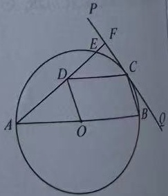
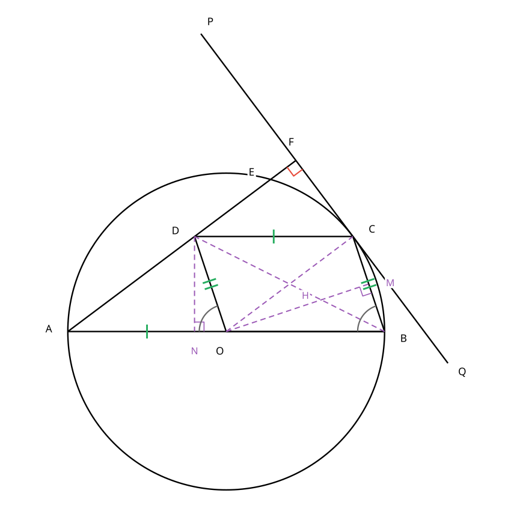

如图，$AB$ 是 $⊙O$ 的直径，直线 $PQ$ 与 $⊙O$ 相切于点 $C$，以 $OB，BC$ 为边作 $□OBCD$，连接 $AD$ 并延长交 $⊙O$ 于点 $E$，交直线 $PQ$ 于点 $F$。

(1) 求证：$AF ⊥ CF$；

(2) 连接 $OC，BD$ 交于点 $H$，若 $\tan \angle OCB = 3$，$⊙O$ 的半径是 5，求 $BD$ 的长.

> [!question]- 点击查看答案与解析
> 【答案】(1) 证明见解析；(2) $BD=3\sqrt{5}$
> 
> 【考点】切线的性质（切线垂直于过切点的半径）、平行四边形的性质与判定、平行线的同位角、锐角三角函数、勾股定理 → [[【初中数学知识点体系-人教版】#30-1 直线和圆的位置关系]]、[[【初中数学知识点体系-人教版】#21-1 平行四边形]]
> 
> 【解析】
> (1) 证明 $AF\perp CF$：
> $\because AB$ 是 $⊙O$ 的直径，$\therefore O$ 是 $AB$ 的中点，$OA=OB$。
> $\because$ 四边形 $OBCD$ 是平行四边形，$\therefore DC\parallel OB$ 且 $DC=OB$（平行四边形对边平行且相等）。
> 又 $A$、$O$、$B$ 共线，$\therefore DC\parallel OA$ 且 $DC=OA$，
> $\therefore$ 四边形 $ADCO$ 是平行四边形（一组对边平行且相等的四边形是平行四边形），
> $\therefore AD\parallel OC$，即 $AF\parallel OC$。
> $\because PQ$ 与 $⊙O$ 相切于点 $C$，$\therefore OC\perp PQ$（切线的性质）。
> $\therefore AF\perp PQ$ 于点 $F$，即 $\angle AFC=90^\circ$，$\therefore AF\perp CF$。
> 
> (2) $\because OC=OB=5$，$\therefore \angle OBC=\angle OCB$，$\tan\angle OBC=3$。
> 过 $O$ 作 $OM\perp BC$ 于 $M$，则 $BM=CM=\dfrac{1}{2}BC$（三线合一）。
> 在 $\mathrm{Rt}\triangle OCM$ 中，$\tan\angle OCB=\dfrac{OM}{CM}=3$，设 $CM=x$，则 $OM=3x$，
> 由勾股定理 $OC^2=OM^2+CM^2$：$25=10x^2$，$x=\dfrac{\sqrt{10}}{2}$，
> $\therefore BC=2x=\sqrt{10}$，$OM=3x=\dfrac{3\sqrt{10}}{2}$。
> $\because$ 四边形 $OBCD$ 是平行四边形，$\therefore OD\parallel BC$ 且 $OD=BC=\sqrt{10}$。
> 过 $D$ 作 $DN\perp AB$ 于 $N$（$N$ 在 $OA$ 上）。$\because OD\parallel BC$，$\therefore \angle DON=\angle CBO$（两直线平行，同位角相等）。
> 在 $\mathrm{Rt}\triangle OBM$ 中，$\sin\angle CBO=\dfrac{OM}{OB}=\dfrac{3}{\sqrt{10}}$，$\cos\angle CBO=\dfrac{BM}{OB}=\dfrac{1}{\sqrt{10}}$，
> $\therefore DN=OD\cdot\sin\angle DON=\sqrt{10}\times\dfrac{3}{\sqrt{10}}=3$，$ON=OD\cdot\cos\angle DON=\sqrt{10}\times\dfrac{1}{\sqrt{10}}=1$。
> $\therefore NB=ON+OB=1+5=6$，
> 在 $\mathrm{Rt}\triangle DNB$ 中，$BD=\sqrt{DN^2+NB^2}=\sqrt{9+36}=3\sqrt{5}$。
> 
> 验证（数值自校验 18 项全部通过）：建系 $O(0,0)$、$A(-5,0)$、$B(5,0)$，题设条件 $\tan\angle OCB=3$ 精确给出 $C(4,3)$（$|OC|=5$ 且 $\angle OCB\approx 71.565^\circ$），菱形顶点 $D=O+C-B(-1,3)$。逐项成立：$DC\parallel=OA$、$AD\parallel OC$、$OC\perp CF$、$\angle AFC=90^\circ$（(1) 得证）；直线 $AD$ 与圆的第二交点 $E(1.4,4.8)$、与切线的交点 $F(2.2,5.4)$，顺序 $A$、$D$、$E$、$F$ 与原卷一致；$BC=\sqrt{10}$、$OM=\dfrac{3\sqrt{10}}{2}$、$CM=\dfrac{\sqrt{10}}{2}$、$DN=3$、$ON=1$、$NB=6$，$BD=3\sqrt{5}\approx 6.708$。注意 $BC=\sqrt{10}\neq OB=5$，$□OBCD$ 不是菱形，$OC$ 与 $BD$ 不垂直（原解析"菱形"判定及其对角线公式均不成立，$2\sqrt{10}\approx 6.325$ 为错误答案）。配图方位与原卷一致：$A$ 左、$O$ 中、$B$ 右、$C$ 在右上圆上、$D$ 在圆内、$E$、$F$ 在 $C$ 左上方切线上；紫色虚线为辅助线 $OC$、$BD$、$OM$、$DN$，绿色单刻线表示 $DC=OA$、双刻线表示 $OD=BC$，$F$ 处红色直角标记表示 $AF\perp CF$。
> 
> 
> 
> 【易错点】一是勿把 $□OBCD$ 当菱形：$OB=OC$ 只说明 $\triangle OBC$ 等腰，而平行四边形的邻边是 $OB$ 与 $BC$，$BC$ 是弦（本题 $BC=\sqrt{10}\neq 5$），故对角线 $OC$、$BD$ 不垂直，"菱形对角线公式"不可用；二是 (1) 的关键是构造平行四边形 $ADCO$ 把 $AF$ 与半径 $OC$ 挂上平行关系，再借切线性质转移垂直，而不是直接证 $\angle AFC=90^\circ$；三是 $\tan\angle OCB$ 要放进以 $OM$ 为直角边的 $\mathrm{Rt}\triangle OCM$（$OM$ 与 $CM$ 之比为 3），不要误写成 $\dfrac{BC}{OM}$ 等；四是求 $BD$ 时垂足 $N$ 落在 $OA$ 上，$NB=ON+OB=6$ 是"相加"而非"相减"。
