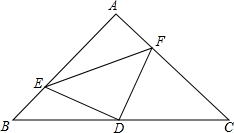
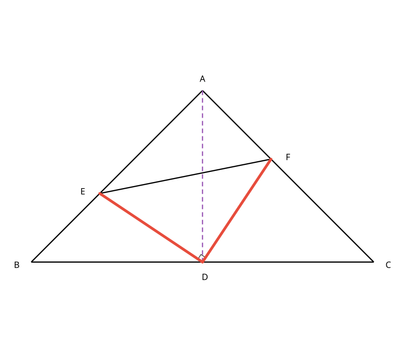

1. （2021秋•松山区期中）已知：如图 $\triangle ABC$ 中，$\angle A=90^{\circ}$，$AB=AC$，$D$ 是斜边 $BC$ 的中点，$E$，$F$ 分别在线段 $AB$，$AC$ 上，且 $\angle EDF=90^{\circ}$。

（1）求证：$\triangle DEF$ 为等腰直角三角形；

（2）求证：$S_{\text{四边形}AEDF}=S_{\triangle BDE}+S_{\triangle CDF}$；

（3）如果点 $E$ 运动到 $AB$ 的延长线上，$F$ 在射线 $CA$ 上且保持 $\angle EDF=90^{\circ}$，$\triangle DEF$ 还仍然是等腰直角三角形吗？请画图说明理由。

> [!question]- 点击查看答案与解析
> 【答案】(1)(2) 证明见解析；(3) 是，$\triangle DEF$ 仍为等腰直角三角形。
>
> 【考点】等腰直角三角形斜边中线（三线合一）、全等三角形判定（ASA）、全等三角形面积相等 → [[【初中数学知识点体系-人教版】#14-2 三角形全等的判定]]、[[【初中数学知识点体系-人教版】#15-3 等腰三角形]]
>
> 【解析】
> 连接 $AD$。
> $\because \angle BAC=90^{\circ}$，$AB=AC$，$D$ 为 $BC$ 中点，$\therefore AD\perp BC$，$AD=BD=CD$，$\angle BAD=\angle CAD=\angle B=\angle C=45^{\circ}$。
>
> (1) $\because \angle EDF=90^{\circ}=\angle ADB$，即 $\angle BDE+\angle EDA=90^{\circ}$，$\angle ADF+\angle EDA=90^{\circ}$，$\therefore \angle BDE=\angle ADF$。
> 在 $\triangle BDE$ 与 $\triangle ADF$ 中：$BD=AD$，$\angle B=\angle DAF=45^{\circ}$，$\angle BDE=\angle ADF$，$\therefore \triangle BDE\cong\triangle ADF$（ASA），$\therefore DE=DF$。又 $\angle EDF=90^{\circ}$，$\therefore \triangle DEF$ 为等腰直角三角形。
>
> (2) 由 $\triangle BDE\cong\triangle ADF$ 得 $S_{\triangle BDE}=S_{\triangle ADF}$。
> 又 $\angle EDF=90^{\circ}=\angle ADC$，$\therefore \angle CDF=\angle ADE$；在 $\triangle CDF$ 与 $\triangle ADE$ 中：$CD=AD$，$\angle C=\angle DAE=45^{\circ}$，$\angle CDF=\angle ADE$，$\therefore \triangle CDF\cong\triangle ADE$（ASA），$\therefore S_{\triangle CDF}=S_{\triangle ADE}$。
> $\therefore S_{\triangle BDE}+S_{\triangle CDF}=S_{\triangle ADF}+S_{\triangle ADE}=S_{\text{四边形}AEDF}$。
>
> (3) 仍然是等腰直角三角形。连接 $AD$，当 $E$ 在 $AB$ 延长线上、$F$ 在射线 $CA$ 上时，$\angle DBE=\angle DAF=135^{\circ}$（等腰直角三角形底角的外角），其余角度关系不变，仍有 $\triangle BDE\cong\triangle ADF$（ASA），$DE=DF$，且 $\angle EDF=90^{\circ}$，故 $\triangle DEF$ 仍为等腰直角三角形。
> 
>
> 【易错点】辅助线 $AD$ 是等腰直角三角形斜边中线，同时具备垂直、平分、$AD=BD=CD$ 三重性质，证明全等时三个条件缺一不可；(2) 的面积相等来自全等，不要用面积公式硬算；(3) 找等角时注意此时是 $135^{\circ}$ 外角，不能仍按 $45^{\circ}$ 处理。
