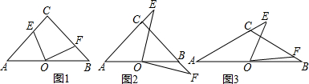
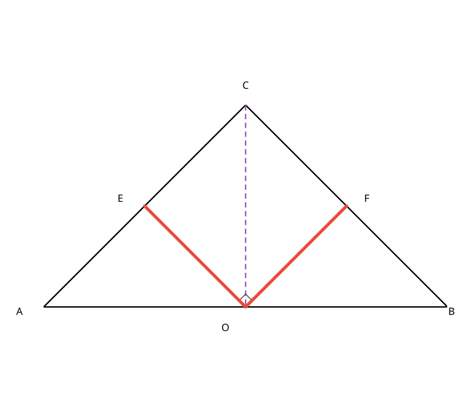

2. （2016秋•蔡甸区校级期中）已知：$\triangle ABC$ 中，$CA=CB$，$O$ 为 $AB$ 的中点，$E$、$F$ 分别在直线 $AC$、$BC$ 上，且 $\angle EOF=2\angle A$。

（1）如图 1，若 $\angle A=45^{\circ}$，则 $①$ $\frac{OE}{OF}=1$；$②$ $\frac{CE+CF}{AC}=1$；

（2）如图 2，若 $\angle A=45^{\circ}$，求证：$①$ $OE=OF$；$②$ $CF-CE=AC$；

（3）如图 3，若 $\angle A=30^{\circ}$，探究 $CF-CE$ 与 $AC$ 之间的数量关系。

> [!question]- 点击查看答案与解析
> 【答案】(1)$①$ $\frac{OE}{OF}=1$；$②$ $\frac{CE+CF}{AC}=1$；(2) 证明见解析；(3) $CF-CE=\dfrac12 AC$。
>
> 【考点】全等三角形判定（ASA/SAS）、等腰三角形三线合一、等边三角形判定、含 $30^{\circ}$ 角的直角三角形性质（第(3)问等边判定借助九上四点共圆，供拓展） → [[【初中数学知识点体系-人教版】#14-2 三角形全等的判定]]、[[【初中数学知识点体系-人教版】#15-3 等腰三角形]]
>
> 【解析】
> 连接 $OC$。
>
> (1)$①$ $\because CA=CB$，$\angle A=45^{\circ}$，$\therefore \angle B=45^{\circ}$，$\angle ACB=90^{\circ}$。$\because O$ 为 $AB$ 中点，$\therefore OC=OA=OB$，$CO\perp AB$，$\angle ACO=\angle BCO=45^{\circ}$。$\because \angle EOF=2\angle A=90^{\circ}=\angle COB$，$\therefore \angle EOC=\angle BOF$。在 $\triangle EOC$ 与 $\triangle FOB$ 中：$\angle ECO=\angle B=45^{\circ}$，$CO=OB$，$\angle EOC=\angle FOB$，$\therefore \triangle EOC\cong\triangle FOB$（ASA），$\therefore OE=OF$，$\frac{OE}{OF}=1$。
>
> $②$ 由全等 $CE=BF$。图 1 中 $E$、$F$ 在线段 $AC$、$BC$ 上，$CF=BC-BF=AC-CE$，$\therefore CE+CF=AC$，$\frac{CE+CF}{AC}=1$。
>
> (2)$①$ 同理连接 $OC$，此时 $\angle ECO=\angle OBF=135^{\circ}$，$\angle COB=\angle EOF=90^{\circ}$，$\therefore \angle COE=\angle BOF$，$\triangle COE\cong\triangle BOF$（ASA），$\therefore OE=OF$。
>
> $②$ 由全等 $CE=BF$。$\because CF=CB+BF$，$CB=AC$，$\therefore CF=AC+CE$，即 $CF-CE=AC$。
>
> (3) $CF-CE=\dfrac12 AC$。证明：在 $CF$ 上截取 $CM=CO$，连接 $OM$。$\because \angle A=\angle B=30^{\circ}$，$\therefore \angle ACB=120^{\circ}$；$\because O$ 为 $AB$ 中点，$\therefore \angle ACO=\angle BCO=60^{\circ}$。$\because \angle EOF=2\angle A=60^{\circ}=\angle ECF$，由四点共圆（九上拓展内容）得 $\angle OEF=\angle OCB=60^{\circ}$，$\therefore \triangle OEF$ 为等边三角形，$OE=OF$。又 $OC=CM$，$\angle OCM=60^{\circ}$，$\therefore \triangle COM$ 为等边三角形，$\angle COM=60^{\circ}=\angle EOF$，$OC=OM=CM$，$\therefore \angle COE=\angle MOF$。$\triangle COE\cong\triangle MOF$（SAS），$\therefore CE=MF$。$\therefore CF-CE=CM+MF-CE=CM=CO$。在 $\mathrm{Rt}\triangle ACO$ 中 $\angle A=30^{\circ}$，$CO=\dfrac12 AC$，$\therefore CF-CE=\dfrac12 AC$。
> 
>
> 【易错点】(2) 找等角时此时是 $135^{\circ}$ 外角，不能仍按 $45^{\circ}$ 处理；(3) 截取 $CM=CO$ 后 $\triangle COM$ 是等边三角形，全等对应边 $CE$ 对 $MF$，最后 $CF-CE=CM=CO$，不要误写成 $CF-CE=CO+CE$。
