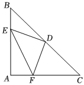
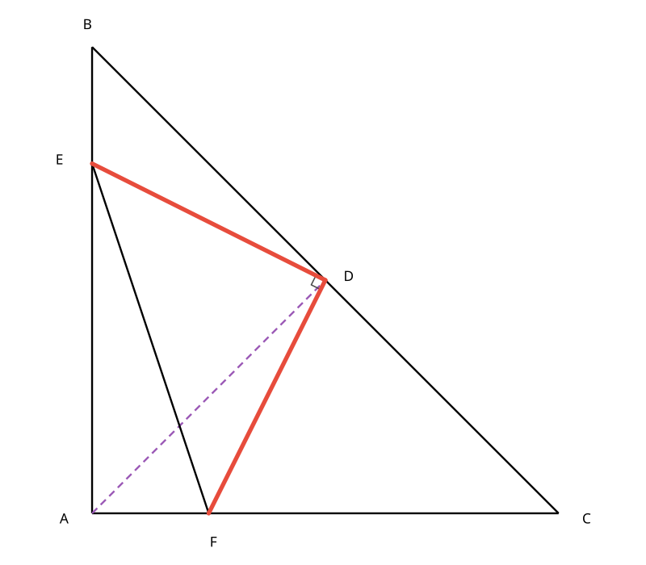

3. （2021秋•新吴区期中）如图，在等腰直角 $\triangle ABC$ 中，$AB=AC$，$D$ 是斜边 $BC$ 的中点，$E$，$F$ 分别是线段 $AB$，$AC$ 上的点，且 $DE\perp DF$。

（1）求证：$DE=DF$；

（2）求证：$BE^{2}+CF^{2}=EF^{2}$；

（3）若 $BE=6$，$CF=8$，求 $\triangle DEF$ 的面积。

> [!question]- 点击查看答案与解析
> 【答案】(1)(2) 证明见解析；(3) $S_{\triangle DEF}=25$。
>
> 【考点】全等三角形判定（ASA）、等腰直角三角形斜边中线性质、勾股定理 → [[【初中数学知识点体系-人教版】#14-2 三角形全等的判定]]、[[【初中数学知识点体系-人教版】#15-3 等腰三角形]]、[[【初中数学知识点体系-人教版】#20-1 勾股定理]]
>
> 【解析】
> 连接 $AD$。$\because AB=AC$，$\angle BAC=90^{\circ}$，$D$ 为 $BC$ 中点，$\therefore AD\perp BC$，$AD=BD=CD$，$\angle B=\angle DAF=45^{\circ}$。
>
> (1) $\because DE\perp DF$，$\therefore \angle EDF=90^{\circ}=\angle ADB$，$\therefore \angle BDE=\angle ADF$。在 $\triangle BDE$ 与 $\triangle ADF$ 中：$BD=AD$，$\angle B=\angle DAF=45^{\circ}$，$\angle BDE=\angle ADF$，$\therefore \triangle BDE\cong\triangle ADF$（ASA），$\therefore DE=DF$。
>
> (2) 由全等得 $BE=AF$。$\because AB=AC$，$\therefore AB-BE=AC-AF$，即 $AE=CF$。在 $\mathrm{Rt}\triangle AEF$ 中，$\angle EAF=90^{\circ}$，$\therefore EF^{2}=AE^{2}+AF^{2}=CF^{2}+BE^{2}$，即 $BE^{2}+CF^{2}=EF^{2}$。
>
> (3) 由 $BE=AF=6$，$CF=AE=8$，在 $\mathrm{Rt}\triangle AEF$ 中 $EF=\sqrt{AE^{2}+AF^{2}}=\sqrt{8^{2}+6^{2}}=10$。由 (1) $DE=DF$ 且 $DE\perp DF$，$\triangle DEF$ 为等腰直角三角形，$EF$ 为斜边，$\therefore DE=DF=\dfrac{EF}{\sqrt{2}}=5\sqrt{2}$，$S_{\triangle DEF}=\dfrac12\cdot DE\cdot DF=\dfrac12\cdot(5\sqrt{2})^{2}=25$。
> 
>
> 【易错点】(2) 的等量替换是 $AE=CF$、$AF=BE$，不要把 $BE$、$CF$ 直接当作 $\mathrm{Rt}\triangle AEF$ 的两条直角边；(3) 等腰直角三角形已知斜边 $EF=10$ 求面积，可直接用 $S=\dfrac14 EF^{2}=25$，不要误把 $EF$ 当直角边。
