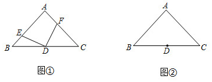
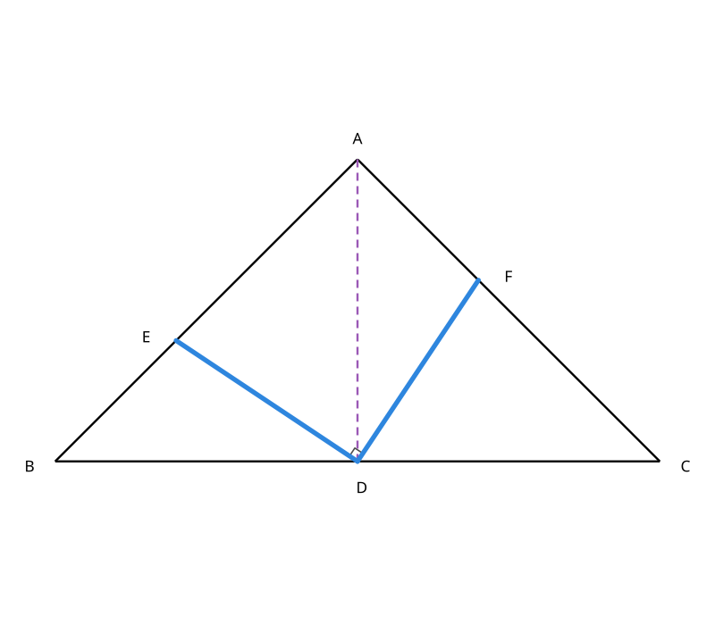

4. （2019秋•长兴县期中）已知，在 $\triangle ABC$ 中，$\angle A=90^{\circ}$，$AB=AC$，点 $D$ 为 $BC$ 的中点。

（1）如图 $①$，若点 $E$、$F$ 分别为 $AB$、$AC$ 上的点，且 $DE\perp DF$。

$①$ 求证：$BE=AF$；

$②$ 若 $S_{\triangle BDE}=\frac{1}{6}S_{\triangle ABC}=2$，求 $S_{\triangle CDF}$；

（2）若点 $E$、$F$ 分别为 $AB$、$CA$ 延长线上的点，且 $DE\perp DF$。

$①$ $BE=AF$ 还成立吗？请利用图 $②$ 说明理由；

$②$ 若 $S_{\triangle BDE}=\frac{1}{4}S_{\triangle ABC}=8$，直接写出 $DF$ 的长。

> [!question]- 点击查看答案与解析
> 【答案】(1)$①$ 证明见解析；$②$ $S_{\triangle CDF}=4$；(2)$①$ 成立，$BE=AF$；$②$ $DF=4\sqrt{5}$。
>
> 【考点】全等三角形判定（ASA）、等腰直角三角形斜边中线性质、勾股定理、面积转化 → [[【初中数学知识点体系-人教版】#14-2 三角形全等的判定]]、[[【初中数学知识点体系-人教版】#15-3 等腰三角形]]、[[【初中数学知识点体系-人教版】#20-1 勾股定理]]
>
> 【解析】
> 连接 $AD$。$\because \angle BAC=90^{\circ}$，$AB=AC$，$D$ 为 $BC$ 中点，$\therefore AD\perp BC$，$AD=BD=CD$，$\angle B=\angle DAF=45^{\circ}$。
>
> (1)$①$ $\because DE\perp DF$，$\therefore \angle EDF=90^{\circ}=\angle ADB$，$\therefore \angle BDE=\angle ADF$。在 $\triangle BDE$ 与 $\triangle ADF$ 中：$BD=AD$，$\angle B=\angle DAF=45^{\circ}$，$\angle BDE=\angle ADF$，$\therefore \triangle BDE\cong\triangle ADF$（ASA），$\therefore BE=AF$。
>
> $②$ 设 $AB=AC=a$。由 $S_{\triangle BDE}=\dfrac16 S_{\triangle ABC}=2$，得 $S_{\triangle ABC}=12$，$\dfrac12 a^{2}=12$，$a^{2}=24$。由全等 $BE=AF$，故 $AE=CF$。$S_{\triangle BDE}=\dfrac12\cdot BE\cdot\dfrac a2=\dfrac{a\cdot BE}{4}=2$，$\therefore a\cdot BE=8$。$S_{\triangle CDF}=\dfrac12\cdot CF\cdot\dfrac a2=\dfrac{a\cdot AE}{4}=\dfrac{a(a-BE)}{4}=\dfrac{a^{2}-a\cdot BE}{4}=\dfrac{24-8}{4}=4$。
>
> (2)$①$ $BE=AF$ 仍成立。连接 $AD$，$E$、$F$ 分别在 $AB$、$CA$ 延长线上时，$\angle DBE=\angle DAF=135^{\circ}$，其余角度关系不变，仍有 $\triangle BDE\cong\triangle ADF$（ASA），故 $BE=AF$。
>
> $②$ 由 $S_{\triangle BDE}=\dfrac14 S_{\triangle ABC}=8$，得 $S_{\triangle ABC}=32$，$a^{2}=64$，$a=8$。又 $S_{\triangle BDE}=\dfrac{a\cdot BE}{4}=8$，$\therefore BE=4$，由全等 $AF=BE=4$。
> 连接 $AD$，过 $D$ 作 $DG\perp AC$ 于 $G$。$\because \angle BAC=90^{\circ}$，$D$ 为 $BC$ 中点，$\therefore AD=BD=CD$，$\angle DAG=45^{\circ}$，$\mathrm{Rt}\triangle ADG$ 为等腰直角三角形。$BC=\sqrt2\,a=8\sqrt2$，$AD=\dfrac12 BC=4\sqrt2$，$\therefore DG=AG=4$。$F$ 在 $CA$ 延长线上，$\therefore GF=AG+AF=4+4=8$。在 $\mathrm{Rt}\triangle DGF$ 中，$DF=\sqrt{DG^{2}+GF^{2}}=\sqrt{4^{2}+8^{2}}=4\sqrt{5}$。
> 
>
> 【易错点】(1)$②$ 面积转化依赖全等得到的 $AE=CF$，不要把两个小三角形的底和高混用；(2)$②$ 注意 $F$ 在 $CA$ 延长线上，$GF=AG+AF=8$，不要只取 $AG=4$。
