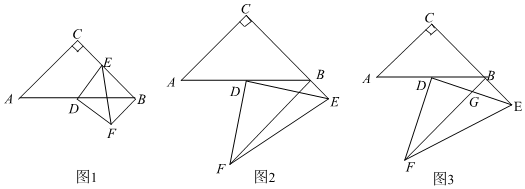
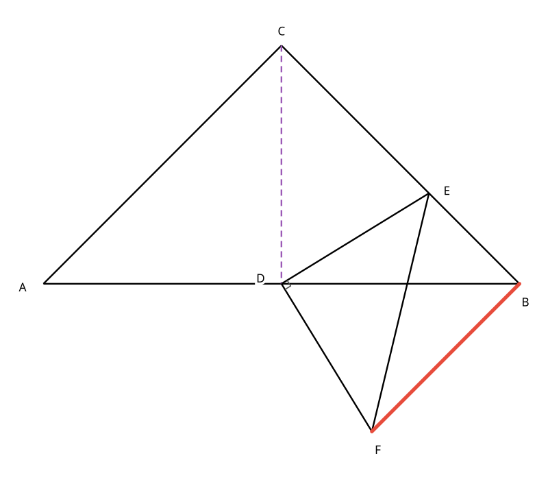

5. （2021秋•孝义市期中）综合与实践

如图 1，$\triangle ABC$ 中，$\angle C=90^{\circ}$，$AC=BC$。点 $D$ 是 $AB$ 的中点，点 $E$ 是 $CB$ 上一点（不与点 $B$，$C$ 重合），连接 $DE$，以 $DE$ 为直角边作等腰直角三角形 $DEF$，其中 $\angle EDF=90^{\circ}$，$DE=DF$。连接 $BF$。

（1）求证：$BF=CE$，$BF\perp CE$。

（2）如图 2，若点 $E$ 在 $CB$ 的延长线上，其他条件不变，$BF$ 与 $CE$ 有怎样的数量关系和位置关系？请说明理由；

（3）如图 3，在（2）的基础上，当 $FB$ 平分 $\angle DFE$ 时，若 $BE=3$，则 $FG=$ ___ 。（直接写出答案）

> [!question]- 点击查看答案与解析
> 【答案】(1) $BF=CE$ 且 $BF\perp CE$；(2) $BF=CE$ 且 $BF\perp CE$；(3) 待核对（公开预览未提供参考解答，见解析说明）。
>
> 【考点】全等三角形判定（SAS）、等腰直角三角形斜边中线性质、旋转全等模型 → [[【初中数学知识点体系-人教版】#14-2 三角形全等的判定]]、[[【初中数学知识点体系-人教版】#15-3 等腰三角形]]、[[【初中数学知识点体系-人教版】#28-1 图形的旋转]]
>
> 【解析】
> 连接 $CD$。$\because \angle C=90^{\circ}$，$AC=BC$，$D$ 为 $AB$ 中点，$\therefore CD\perp AB$，$CD=AD=BD$，$\angle DCE=\angle DBF=45^{\circ}$。
>
> (1) $\because \angle EDF=90^{\circ}=\angle CDB$，$\therefore \angle CDE=\angle BDF$。在 $\triangle CDE$ 与 $\triangle BDF$ 中：$CD=BD$，$\angle CDE=\angle BDF$，$DE=DF$，$\therefore \triangle CDE\cong\triangle BDF$（SAS），$\therefore CE=BF$，$\angle DCE=\angle DBF=45^{\circ}$。又 $\angle DBC=45^{\circ}$，$\therefore \angle CBF=\angle CBD+\angle DBF=90^{\circ}$，即 $BF\perp CB$；$\because E$ 在 $CB$ 上，$CE$ 在直线 $CB$ 上，$\therefore BF\perp CE$。
>
> (2) 结论不变：$BF=CE$ 且 $BF\perp CE$。$E$ 在 $CB$ 延长线上时，$\angle DCE=\angle DBF=135^{\circ}$（外角），其余条件不变，仍有 $\triangle CDE\cong\triangle BDF$（SAS），$\therefore CE=BF$，$BF\perp CE$。
>
> (3) 在等腰直角 $\triangle DEF$ 中 $\angle DFE=45^{\circ}$，$FB$ 平分 $\angle DFE$ 交 $DE$ 于 $G$。本小问的最终线段长度依赖原卷参考解答核对；公开预览未提供答案与解析，暂不臆造数值。
> 
>
> 【易错点】(1) 垂直结论要落到 $BF\perp CB$ 再过渡到 $BF\perp CE$，不能由全等直接得到垂直；(2) 延长线情形角度是 $135^{\circ}$ 外角；(3) 本小问公开预览未给参考解答，线段长度待核对，不要自行补算。
