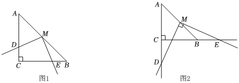
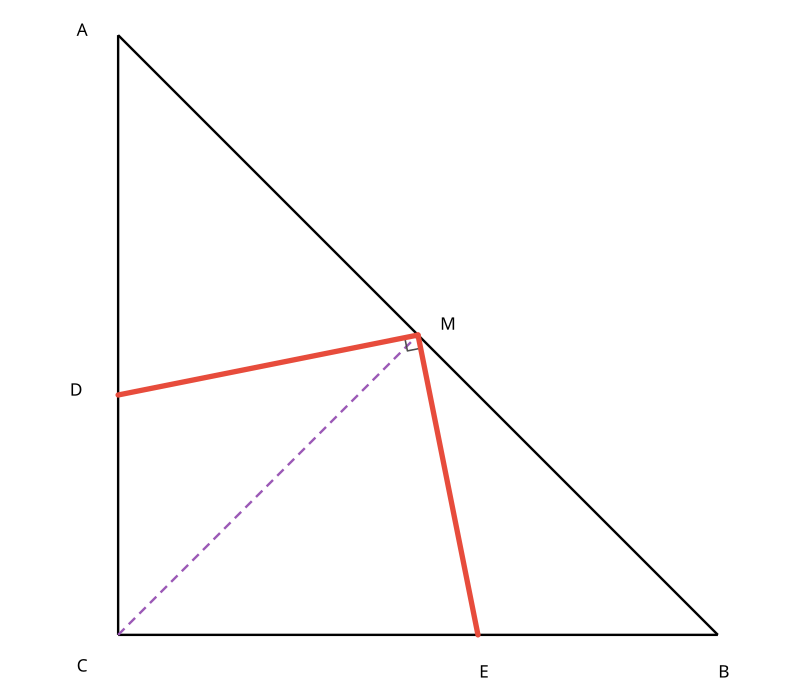

6. （2022秋•大兴区期末）已知，在 $\triangle ABC$ 中，$\angle ACB=90^{\circ}$，$AC=BC$，点 $M$ 是 $AB$ 的中点，作 $\angle DME=90^{\circ}$，使得射线 $MD$ 与射线 $ME$ 分别交射线 $AC$，$CB$ 于点 $D$，$E$。

（1）如图 1，当点 $D$ 在线段 $AC$ 上时，线段 $MD$ 与线段 $ME$ 的数量关系是 ___ ；

（2）如图 2，当点 $D$ 在线段 $AC$ 的延长线上时，用等式表示线段 $CD$，$CE$ 和 $BC$ 之间的数量关系并加以证明。

> [!question]- 点击查看答案与解析
> 【答案】(1) $MD=ME$；(2) $CE-CD=BC$。
>
> 【考点】全等三角形判定（ASA）、等腰直角三角形斜边中线性质 → [[【初中数学知识点体系-人教版】#14-2 三角形全等的判定]]、[[【初中数学知识点体系-人教版】#15-3 等腰三角形]]
>
> 【解析】
> 连接 $CM$。$\because \angle ACB=90^{\circ}$，$AC=BC$，$M$ 为 $AB$ 中点，$\therefore CM\perp AB$，$CM=AM=BM$，$\angle MCA=\angle MCB=45^{\circ}$。
>
> (1) $\because \angle DME=90^{\circ}=\angle CMA$，$\therefore \angle CMD=\angle AME$。在 $\triangle CMD$ 与 $\triangle AME$ 中：$CM=AM$，$\angle MCD=\angle MAE=45^{\circ}$，$\angle CMD=\angle AME$，$\therefore \triangle CMD\cong\triangle AME$（ASA），$\therefore MD=ME$。
>
> (2) $CE-CD=BC$。证明：连接 $CM$。$\because \angle DME=90^{\circ}=\angle CMB$，$\therefore \angle CMD=\angle BME$。$D$ 在 $AC$ 延长线上，$E$ 在 $CB$ 延长线上，$\angle MCD=\angle MBE=135^{\circ}$；又 $CM=BM$，$\therefore \triangle CMD\cong\triangle BME$（ASA），$\therefore CD=BE$。$\because CE=CB+BE$，$\therefore CE=BC+CD$，即 $CE-CD=BC$。
> 
>
> 【易错点】(2) 找等角时注意此时是 $135^{\circ}$ 外角，不能仍按 $45^{\circ}$ 处理；线段关系是 $CE=BC+CD$，不要写成 $CE=BC-CD$。
