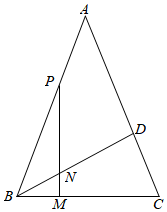
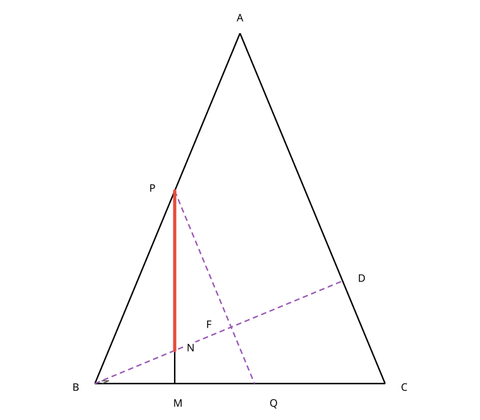

7. （2021秋•海丰县期中）如图，在等腰 $\triangle ABC$ 中，$AB=AC$，$\angle BAC=45^{\circ}$，$BD\perp AC$，点 $P$ 为边 $AB$ 上一点（不与点 $A$、点 $B$ 重合），$PM\perp BC$，垂足为 $M$，交 $BD$ 于点 $N$。请猜想 $PN$ 与 $BM$ 之间的数量关系，并证明。

> [!question]- 点击查看答案与解析
> 【答案】猜想：$PN=2BM$。
>
> 【考点】等腰三角形等边对等角与三线合一、平行线构造等腰三角形、全等三角形判定（ASA） → [[【初中数学知识点体系-人教版】#15-3 等腰三角形]]、[[【初中数学知识点体系-人教版】#14-2 三角形全等的判定]]
>
> 【解析】
> $\because \angle BAC=45^{\circ}$，$BD\perp AC$，$\therefore \triangle ABD$ 为等腰直角三角形，$AD=BD$，$\angle ABD=45^{\circ}$。
> $\because AB=AC$，$\therefore \angle ABC=\angle ACB=\dfrac{180^{\circ}-45^{\circ}}2=67.5^{\circ}$，$\therefore \angle DBC=67.5^{\circ}-45^{\circ}=22.5^{\circ}$。
> $\because PM\perp BC$，在 $\mathrm{Rt}\triangle BMP$ 中 $\angle BPM=90^{\circ}-67.5^{\circ}=22.5^{\circ}$。
> 过 $P$ 作 $PQ\parallel AC$，交 $BC$ 于 $Q$，交 $BD$ 于 $F$。
> $\because PQ\parallel AC$，$\therefore \angle PQB=\angle C=67.5^{\circ}=\angle PBQ$，$\therefore BP=PQ$，$\triangle BPQ$ 为等腰三角形。又 $PM\perp BQ$，由三线合一得 $M$ 为 $BQ$ 中点，$\therefore BQ=2BM$。
> $\because PF\parallel AC$，$\therefore \angle BPF=\angle BAC=45^{\circ}$；又 $\angle PBF=\angle ABD=45^{\circ}$，$\therefore \triangle BPF$ 为等腰直角三角形，$PF=BF$。
> 在 $\triangle PFN$ 与 $\triangle BFQ$ 中：$\angle FPN=\angle BPM=22.5^{\circ}=\angle FBQ$，$PF=BF$，$\angle PFN=\angle BFQ$（对顶角），$\therefore \triangle PFN\cong\triangle BFQ$（ASA），$\therefore PN=BQ=2BM$。
> 
>
> 【易错点】辅助线 $PQ\parallel AC$ 同时造出等腰 $\triangle BPQ$ 与等腰直角 $\triangle BPF$；$\angle PBF$ 是 $\angle ABD=45^{\circ}$，不要把 $BD$ 与 $BC$ 的夹角 $22.5^{\circ}$ 当成 $\angle PBF$；全等对应边 $PN$ 对 $BQ$，最终 $BQ=2BM$。
