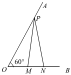
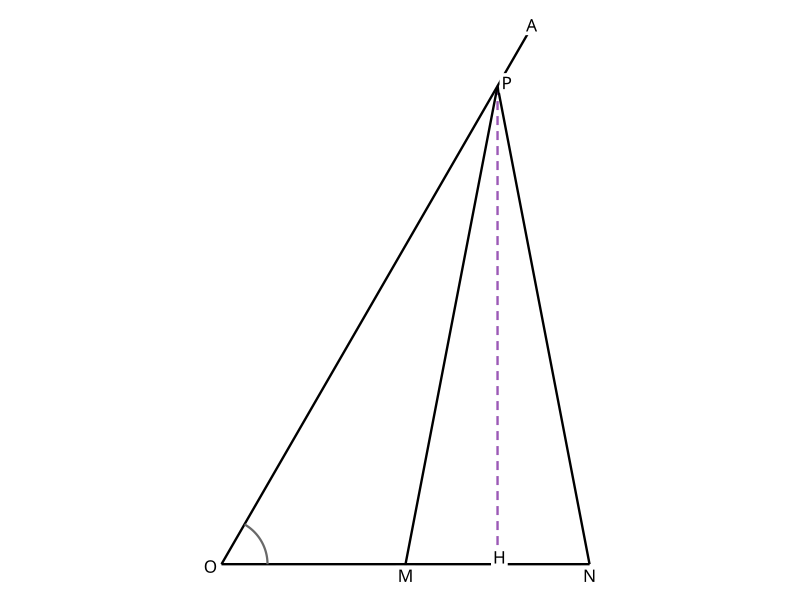

8. （2023秋•高安市期末）如图，$\angle AOB=60^{\circ}$，点 $P$ 在射线 $OA$ 上，$OP=12$，点 $M$，$N$ 在射线 $OB$ 上，且 $PM=PN$，$MN=4$，则 $OM=$ ___ 。

> [!question]- 点击查看答案与解析
> 【答案】$OM=4$。
>
> 【考点】等腰三角形三线合一、含 $30^{\circ}$ 角的直角三角形性质 → [[【初中数学知识点体系-人教版】#15-3 等腰三角形]]
>
> 【解析】
> 过 $P$ 作 $PH\perp OB$ 于 $H$。
> $\because PM=PN$，$\triangle PMN$ 为等腰三角形，由三线合一得 $H$ 为 $MN$ 中点，$\therefore MH=HN=\dfrac12 MN=2$。
> 在 $\mathrm{Rt}\triangle OPH$ 中，$\angle POH=60^{\circ}$，$\therefore \angle OPH=30^{\circ}$，$OH=\dfrac12 OP=\dfrac12\times12=6$。
> $\therefore OM=OH-MH=6-2=4$。
> 
>
> 【易错点】三线合一的垂足 $H$ 才是 $MN$ 中点，不要把 $M$ 当成 $MN$ 中点；$M$、$N$ 在 $H$ 同侧，$OM=OH-MH$，不要写成 $OH+MH$。
