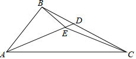
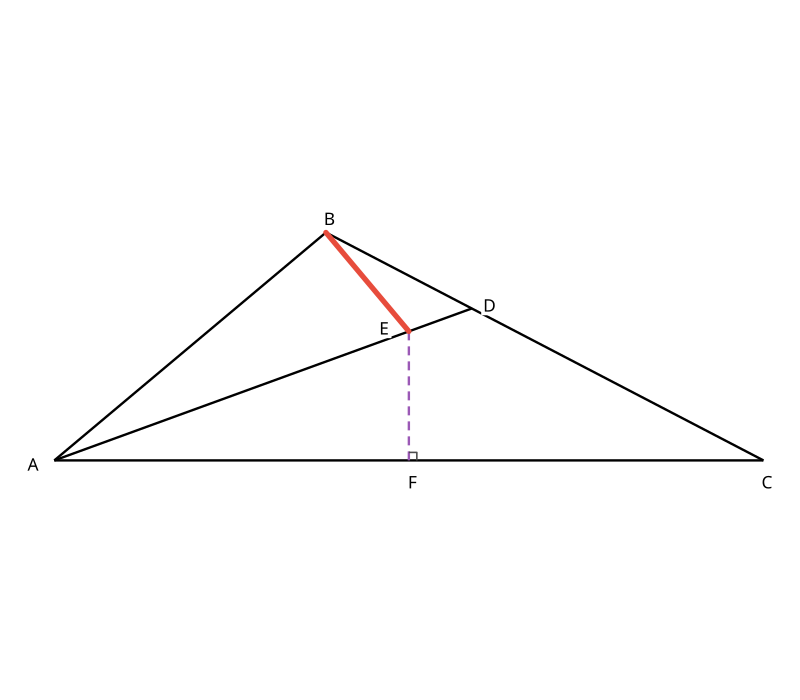

9. （2021秋•丰泽区校级期末）如图，在 $\triangle ABC$ 中，$AC=2AB$，$AD$ 平分 $\angle BAC$，$E$ 是 $AD$ 上一点，且 $EA=EC$。求证：$EB\perp AB$。

> [!question]- 点击查看答案与解析
> 【答案】证明见解析。
>
> 【考点】角平分线定义、等腰三角形三线合一、全等三角形判定（SAS） → [[【初中数学知识点体系-人教版】#14-3 角的平分线]]、[[【初中数学知识点体系-人教版】#14-2 三角形全等的判定]]、[[【初中数学知识点体系-人教版】#15-3 等腰三角形]]
>
> 【解析】
> 过 $E$ 作 $EF\perp AC$ 于 $F$。
> $\because EA=EC$，$\therefore F$ 为 $AC$ 中点（等腰三角形三线合一），$AF=\dfrac12 AC$。$\because AC=2AB$，$\therefore AF=AB$。
> $\because AD$ 平分 $\angle BAC$，$\therefore \angle BAE=\angle FAE$。
> 在 $\triangle ABE$ 与 $\triangle AFE$ 中：$AB=AF$，$\angle BAE=\angle FAE$，$AE=AE$，$\therefore \triangle ABE\cong\triangle AFE$（SAS），$\therefore \angle ABE=\angle AFE=90^{\circ}$，即 $EB\perp AB$。
> 
>
> 【易错点】辅助线是向 $AC$ 作垂线 $EF$，由 $EA=EC$ 三线合一得到 $F$ 是 $AC$ 中点，不要直接默认 $F$ 为中点而不写理由；全等对应边 $AB$ 对 $AF$、$BE$ 对 $FE$，对应顶点别写反。
