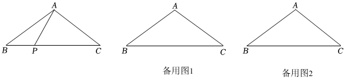
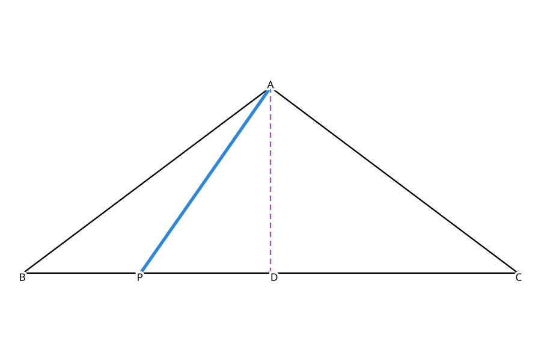

10. （2023秋•西湖区期末）如图，在 $\triangle ABC$ 中，$AB=AC$，$P$ 为边 $BC$ 上任意一点（$P$ 与 $B$，$C$ 不重合），连接 $AP$。

（1）若 $BC=16$，$AB=10$。

$①$ 求 $AP$ 的最小值；

$②$ 若 $AP=7$，求 $BP$ 的长；

（2）若 $AB=m$，$AP=n$，请用含 $m$，$n$ 的代数式表示 $BP\cdot PC$。

> [!question]- 点击查看答案与解析
> 【答案】(1)① $AP_{\min}=6$；② $BP=8-\sqrt{13}$ 或 $8+\sqrt{13}$；(2) $BP\cdot PC=m^{2}-n^{2}$。
>
> 【考点】等腰三角形三线合一、勾股定理、线段乘积的平方差转化 → [[【初中数学知识点体系-人教版】#15-3 等腰三角形]]、[[【初中数学知识点体系-人教版】#20-1 勾股定理]]
>
> 【解析】
> 作 $AD\perp BC$ 于 $D$。$\because AB=AC$，由三线合一 $D$ 为 $BC$ 中点，$BD=DC=\dfrac12 BC$。
>
> (1)① $BD=8$，在 $\mathrm{Rt}\triangle ABD$ 中 $AD=\sqrt{AB^{2}-BD^{2}}=\sqrt{10^{2}-8^{2}}=6$。$P$ 在 $BC$ 上，$AP\ge AD$，当 $P$ 与 $D$ 重合时取最小值，$\therefore AP_{\min}=6$。
>
> ② 在 $\mathrm{Rt}\triangle APD$ 中 $PD=\sqrt{AP^{2}-AD^{2}}=\sqrt{7^{2}-6^{2}}=\sqrt{13}$。$P$ 可在 $D$ 左侧或右侧，$\therefore BP=BD-PD=8-\sqrt{13}$，或 $BP=BD+PD=8+\sqrt{13}$。
>
> (2) 设 $BD=DC=a$，$PD=x$，则 $BP=a-x$，$PC=a+x$。
> $BP\cdot PC=a^{2}-x^{2}=(AB^{2}-AD^{2})-(AP^{2}-AD^{2})=AB^{2}-AP^{2}=m^{2}-n^{2}$。
> 
>
> 【易错点】② 中 $P$ 在 $D$ 两侧都要讨论，容易漏掉 $8+\sqrt{13}$ 一解；(2) 不要把 $BP\cdot PC$ 直接展开硬算，用 $BD^{2}-PD^{2}$ 平方差消去公共高 $AD$。
