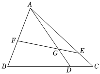
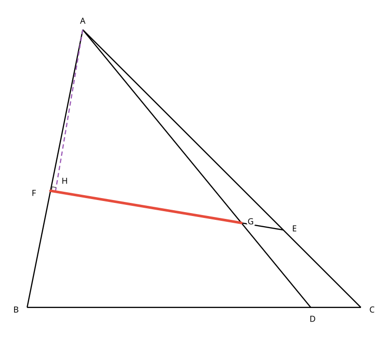

11. 如图，$D$，$E$，$F$ 是 $\triangle ABC$ 边上的点，$AB=BD=AE$，$AD=4$，$EF$ 与 $AD$ 交于点 $G$，$FG=3$，$\angle C=\angle AGF=45^{\circ}$，求 $\triangle AFG$ 的面积。

> [!question]- 点击查看答案与解析
> 【答案】$S_{\triangle AFG}=3$。
>
> 【考点】等腰三角形等边对等角、三角形内角与外角、三角形面积（底×高） → [[【初中数学知识点体系-人教版】#15-3 等腰三角形]]、[[【初中数学知识点体系-人教版】#13-3 三角形的内角与外角]]
>
> 【解析】
> 由 $AB=BD$ 知 $\triangle ABD$ 为等腰三角形，由 $AB=AE$ 知 $\triangle ABE$ 为等腰三角形。
> 作 $AH\perp EF$ 于 $H$，则 $AH$ 是 $\triangle AFG$ 中底边 $FG$ 上的高；在 $\mathrm{Rt}\triangle AHG$ 中 $\angle AGH=\angle AGF=45^{\circ}$。
> 参考解答给出 $AH=2$（即 $AH=\dfrac12 AD$）；该步由两组等边对应的等角代换得到，本卷公开预览未展示完整推导链，留待对照原卷答案核对。
> $\therefore S_{\triangle AFG}=\dfrac12\cdot FG\cdot AH=\dfrac12\times3\times2=3$。
> 
>
> 【易错点】以 $FG$ 为底时，高是 $A$ 到 $EF$ 的垂线段 $AH$，不要把 $FG=3$ 当成高；$AH$ 需由等腰与角度条件推出，不能直接取 $AD=4$。
