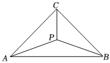
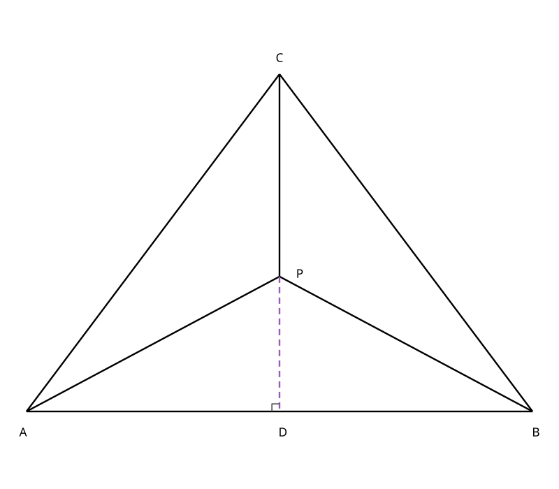

12. （2022秋•江汉区期末）如图，$P$ 是 $\triangle ABC$ 内部一点，$AC=BC$，$AP=BP$，连接 $CP$。

（1）求证：$\angle ACP=\angle BCP$；

（2）若 $AB=3CP=3$，直接写出 $\triangle APC$ 的面积。

> [!question]- 点击查看答案与解析
> 【答案】(1) 证明见解析；(2) $S_{\triangle APC}=\dfrac34$。
>
> 【考点】全等三角形判定（SSS）与性质、线段垂直平分线、等腰三角形三线合一 → [[【初中数学知识点体系-人教版】#14-1 全等三角形及其性质]]、[[【初中数学知识点体系-人教版】#15-3 等腰三角形]]
>
> 【解析】
> (1) 在 $\triangle ACP$ 与 $\triangle BCP$ 中：$AC=BC$，$AP=BP$，$CP=CP$，$\therefore \triangle ACP\cong\triangle BCP$（SSS），$\therefore \angle ACP=\angle BCP$。
>
> (2) $\because AC=BC$，$\therefore C$ 在 $AB$ 的垂直平分线上；$\because AP=BP$，$\therefore P$ 也在 $AB$ 的垂直平分线上。$\therefore$ 直线 $CP$ 就是 $AB$ 的垂直平分线。设 $CP$ 延长线交 $AB$ 于 $D$，则 $D$ 为 $AB$ 中点，$CD\perp AB$，$AD=\dfrac12 AB=\dfrac32$。
> 点 $A$ 到直线 $CP$ 的距离即 $AD=\dfrac32$，$\therefore S_{\triangle APC}=\dfrac12\cdot CP\cdot AD=\dfrac12\times1\times\dfrac32=\dfrac34$。
> 
>
> 【易错点】(2) 以 $CP$ 为底时，高是点 $A$ 到直线 $CP$ 的距离 $AD$，不要误把 $CD$ 当作高；由 $AB=3CP=3$ 得 $CP=1$、$AB=3$，两个数值不要混。
