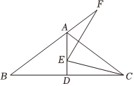
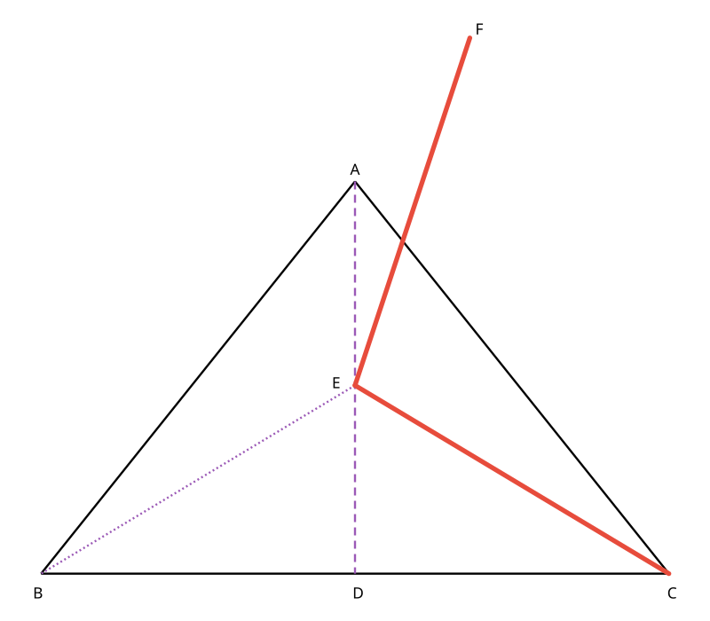

13. （2023秋•蔡甸区校级期中）如图，在 $\triangle ABC$ 中，$AB=AC$，$AD\perp BC$ 于点 $D$，点 $E$ 为 $AD$ 上一点，点 $F$ 为 $BA$ 延长线上一点，连接 $EF$，$CE$。

（1）若 $\angle F=\angle ACE$，直接写出图中与 $\angle CEF$ 相等的角；

（2）若 $EF=EC$，求证：$\angle F=\angle ACE$。

> [!question]- 点击查看答案与解析
> 【答案】(1) 与 $\angle CEF$ 相等的角是 $\angle BEF$；(2) 证明见解析。
>
> 【考点】线段垂直平分线性质、等腰三角形等边对等角、全等三角形对应角 → [[【初中数学知识点体系-人教版】#15-3 等腰三角形]]、[[【初中数学知识点体系-人教版】#14-2 三角形全等的判定]]
>
> 【解析】
> $\because AB=AC$，$AD\perp BC$，$\therefore AD$ 是 $BC$ 的垂直平分线。$\because E$ 在 $AD$ 上，$\therefore EB=EC$，$\therefore \angle EBC=\angle ECB$。
> 又 $\because AB=AC$，$\therefore \angle ABC=\angle ACB$，$\therefore \angle ABC-\angle EBC=\angle ACB-\angle ECB$，即 $\angle ABE=\angle ACE$。
>
> (2) $\because EF=EC$，又 $EC=EB$，$\therefore EF=EC=EB$。在 $\triangle EFB$ 中 $EF=EB$，$\therefore \angle EFB=\angle EBF$。$\because F$、$A$、$B$ 共线，$\therefore \angle EBF=\angle EBA=\angle ABE$。
> $\therefore \angle F=\angle EFB=\angle EBF=\angle ABE=\angle ACE$，即 $\angle F=\angle ACE$。
>
> (1) 由 $\angle F=\angle ACE$，结合 $\angle ACE=\angle ABE$ 得 $\angle F=\angle EBF$，$\therefore \triangle EFB$ 等腰，$EF=EB$；又 $EB=EC$，$\therefore EF=EC$，$\triangle EFC$ 等腰。于是 $\angle EFB=\angle EBF=\angle ECF=\angle EFC$，顶角 $\angle BEF=180^{\circ}-2\angle EFB$，$\angle CEF=180^{\circ}-2\angle EFC$，$\therefore \angle BEF=\angle CEF$。
> 
>
> 【易错点】$EB=EC$ 来自 $E$ 在 $BC$ 的垂直平分线 $AD$ 上，不要跳过这一步直接写；$F$、$A$、$B$ 共线时 $\angle EBF$ 与 $\angle EBA$ 是同一个角，代换时注意射线方向。
