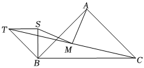
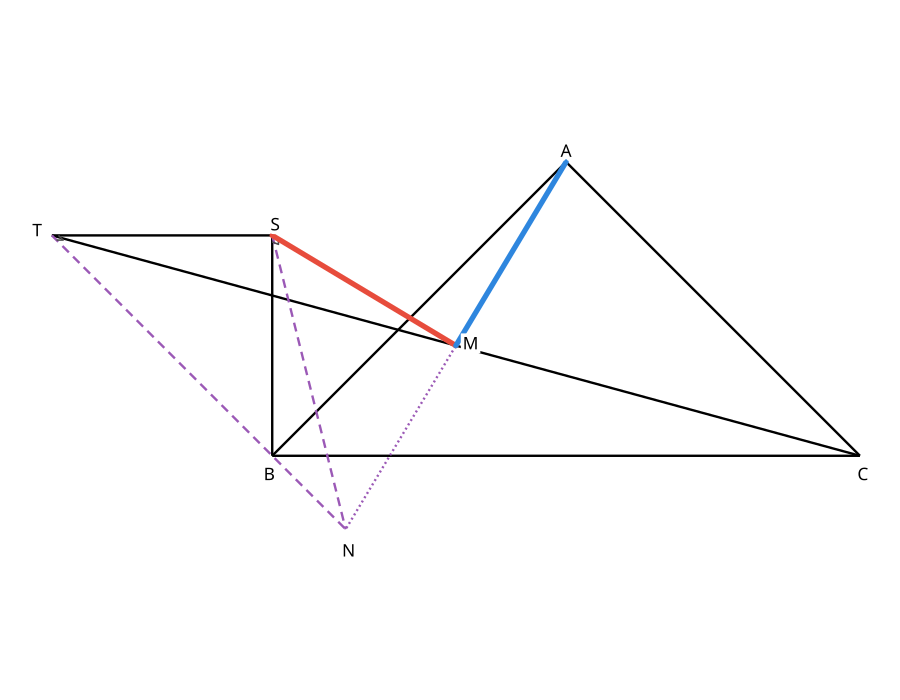

14. （2026春•同步）如图，$AB=AC$，$ST=SB$，$\angle TSB=\angle SBC=\angle BAC=90^{\circ}$，$M$ 为 $TC$ 的中点，求证：$SM\perp AM$，$SM=AM$。

> [!question]- 点击查看答案与解析
> 【答案】证明见解析，$SM\perp AM$ 且 $SM=AM$。
>
> 【考点】全等三角形判定（SAS）、等腰直角三角形性质、中点倍长与旋转构造 → [[【初中数学知识点体系-人教版】#14-2 三角形全等的判定]]、[[【初中数学知识点体系-人教版】#15-3 等腰三角形]]、[[【初中数学知识点体系-人教版】#28-1 图形的旋转]]
>
> 【解析】
> 延长 $AM$ 到 $N$，使 $MN=AM$，连接 $TN$、$SN$。
> $\because M$ 为 $TC$ 中点，$\therefore TM=CM$。在 $\triangle TMN$ 与 $\triangle CMA$ 中：$TM=CM$，$\angle TMN=\angle CMA$（对顶角），$MN=MA$，$\therefore \triangle TMN\cong\triangle CMA$（SAS），$\therefore TN=CA$，$\angle MTN=\angle MCA$，$\therefore TN\parallel AC$。又 $CA=AB$，$\therefore TN=AB$。
> $\because \angle SBC=90^{\circ}$，$SB\perp BC$；$\angle BAC=90^{\circ}$，$AB=AC$，$\therefore \angle ABC=\angle ACB=45^{\circ}$。由 $TN\parallel AC$、$ST\perp SB$ 可得 $\angle STN=\angle SBA=45^{\circ}$。
> 在 $\triangle TSN$ 与 $\triangle BSA$ 中：$TS=BS$，$\angle STN=\angle SBA$，$TN=BA$，$\therefore \triangle TSN\cong\triangle BSA$（SAS），$\therefore SN=SA$，$\angle TSN=\angle BSA$。
> $\therefore \angle NSA=\angle TSB=90^{\circ}$（$\angle TSN+\angle NSB=\angle BSA+\angle NSB$），$\triangle ASN$ 为等腰直角三角形。
> $\because MN=MA$，$M$ 为斜边 $AN$ 中点，由等腰三角形三线合一得 $SM\perp AM$，且 $SM=AM=MN$。
> 
>
> 【易错点】倍长中线后全等三角形的对应边是 $TN$ 对 $CA$、$TS$ 对 $BS$，对应顶点顺序要对齐；等腰直角三角形 $\triangle ASN$ 中，$M$ 是斜边 $AN$ 中点，三线合一同时给出垂直与相等两个结论。
