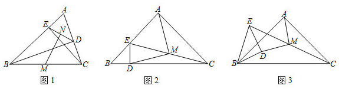
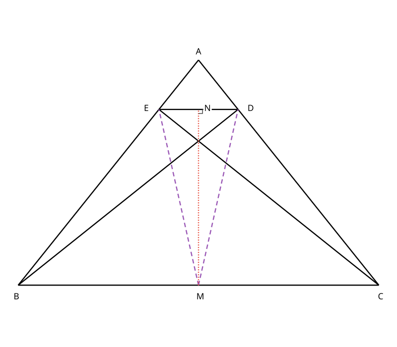

15. （2024春•东源县校级期中）（1）如图 1，$\triangle ABC$ 中，$BD$，$CE$ 分别是 $AC$，$AB$ 上的高，$M$，$N$ 分别是 $BC$，$DE$ 的中点，求证：$MN\perp DE$。

拓展：

（2）如图 2，$\triangle ABC$ 中，$\angle BAC=90^{\circ}$，$AB=AC$，点 $E$ 是 $AB$ 上的点，$ED\perp BC$ 于点 $D$，点 $M$ 是 $CE$ 的中点，探索 $AM$ 与 $DM$ 的数量关系与位置关系。

（3）如图 3，将（2）中的 $\triangle BDE$ 绕点 $B$ 逆时针转小于 $45^{\circ}$ 的角，（2）中的结论是否还成立？成立，请说明理由。

> [!question]- 点击查看答案与解析
> 【答案】(1) 证明见解析；(2) $AM=DM$ 且 $AM\perp DM$；(3) 成立，$AM=DM$ 且 $AM\perp DM$。
>
> 【考点】直角三角形斜边中线等于斜边的一半、等腰三角形三线合一、中点构造全等与旋转不变性 → [[【初中数学知识点体系-人教版】#13-2 与三角形有关的线段]]、[[【初中数学知识点体系-人教版】#15-3 等腰三角形]]、[[【初中数学知识点体系-人教版】#28-1 图形的旋转]]
>
> 【解析】
> (1) 连接 $MD$、$ME$。$\because BD\perp AC$，$CE\perp AB$，$\therefore \triangle BDC$、$\triangle BEC$ 均为直角三角形，$M$ 为斜边 $BC$ 中点，$\therefore MD=ME=\dfrac12 BC$。$\triangle MDE$ 为等腰三角形，$N$ 为 $DE$ 中点，由三线合一得 $MN\perp DE$。
>
> (2) $AM=DM$ 且 $AM\perp DM$。理由：$\because \angle BAC=90^{\circ}$，$\therefore \triangle ACE$ 是直角三角形，$M$ 为斜边 $CE$ 中点，$\therefore AM=CM=ME=\dfrac12 CE$。$\because ED\perp BC$，$\therefore \triangle CDE$ 是直角三角形，$M$ 为斜边 $CE$ 中点，$\therefore DM=CM=ME=\dfrac12 CE$。$\therefore AM=DM$。
> 再证垂直：$\because AM=CM$，$\therefore \angle MAC=\angle ACM$；$\because DM=CM$，$\therefore \angle MDC=\angle DCM$。在等腰 $\triangle AMC$ 中 $\angle AMC=180^{\circ}-2\angle ACM$；在等腰 $\triangle DMC$ 中 $\angle DMC=180^{\circ}-2\angle DCM$。围绕点 $M$，$\angle AMD=360^{\circ}-\angle AMC-\angle DMC=2(\angle ACM+\angle DCM)=2\angle ACD$。$\because \triangle ABC$ 为等腰直角三角形，$D$ 在 $BC$ 上，$\therefore \angle ACD=\angle ACB=45^{\circ}$，$\therefore \angle AMD=90^{\circ}$，即 $AM\perp DM$。
>
> (3) 成立。旋转只改变 $\triangle BDE$ 的位置，不改变线段与角的大小；连接相应中点线段，仍可由直角三角形斜边中线得到 $AM=DM=\dfrac12 CE$，再由等腰三角形底角相等与角度代换得到 $AM\perp DM$，故 (2) 的结论在旋转后仍然成立。
> 
>
> 【易错点】(1) 直角三角形斜边中线等于斜边一半，$MD$、$ME$ 都是斜边 $BC$ 上的中线，不要漏看 $\triangle BEC$；(2) 数量关系与位置关系要分别作答，只写 $AM=DM$ 会漏掉垂直结论；(3) 旋转后不要仍用原图中 $ED\perp BC$ 的位置关系，结论依据是中点与全等/等腰的不变性。
