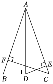
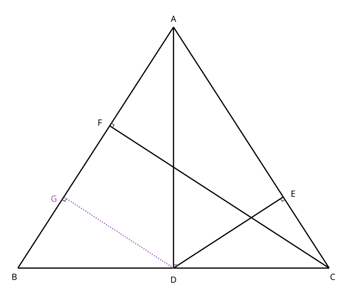

1. （2025•石景山区二模）如图，在 $\triangle ABC$ 中，$AD\perp BC$ 于点 $D$，$AD$ 平分 $\angle CAB$，$DE\perp AC$ 于点 $E$，$CF\perp AB$ 于点 $F$。若 $DE=3$，则 $CF$ 的长为 ___ 。

> [!question]- 点击查看答案与解析
> 【答案】$CF=6$。
>
> 【考点】角平分线的性质、等腰三角形三线合一、面积法求高 → [[【初中数学知识点体系-人教版】#14-3 角的平分线]]、[[【初中数学知识点体系-人教版】#15-3 等腰三角形]]
>
> 【解析】
> 过 $D$ 作 $DG\perp AB$ 于 $G$。
> $\because AD\perp BC$ 且 $AD$ 平分 $\angle CAB$，$\therefore \triangle ABC$ 为等腰三角形（角平分线与高重合，三线合一），$AB=AC$。
> $\because D$ 在角平分线 $AD$ 上，$DE\perp AC$，$DG\perp AB$，由角平分线性质得 $DG=DE=3$。
> 由面积拆分：$S_{\triangle ABC}=S_{\triangle ABD}+S_{\triangle ACD}=\dfrac12 AB\cdot DG+\dfrac12 AC\cdot DE=\dfrac12\cdot AB\cdot 3+\dfrac12\cdot AC\cdot 3$。
> 又 $S_{\triangle ABC}=\dfrac12 AB\cdot CF$，代入 $AB=AC$，得 $\dfrac12 AB\cdot CF=\dfrac12\cdot AB\cdot 3+\dfrac12\cdot AB\cdot 3$，$\therefore CF=6$。
> 
>
> 【易错点】$DE$ 是 $D$ 到 $AC$ 的距离，不是 $AB$ 边上的高；需先用角平分线性质补出 $D$ 到 $AB$ 的距离 $DG$，再用两个小三角形面积之和等于大三角形面积求解。
