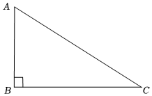
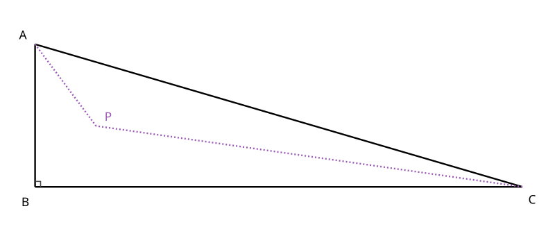

3. 如图，在 $\triangle ABC$ 中，$\angle B=90^\circ$，$AB=7$，$BC=24$，$AC=25$。$\triangle ABC$ 内是否有一点 $P$ 到各边的距离相等？如果有，请利用尺规作图作出这一点，说明理由并求出这个距离。

> [!question]- 点击查看答案与解析
> 【答案】有，$P$ 为 $\triangle ABC$ 的内心（两条角平分线的交点），到三边的距离为 $3$。
>
> 【考点】三角形内心的性质、角平分线交点、直角三角形内切圆半径 → [[【初中数学知识点体系-人教版】#14-3 角的平分线]]、[[【初中数学知识点体系-人教版】#20-1 勾股定理]]
>
> 【解析】
> 到三角形三边距离相等的点是三角形三条角平分线的交点（内心）。作 $\angle A$、$\angle B$（或 $\angle C$）的角平分线，两线交点即为所求点 $P$。
> 设内切圆半径为 $r$。$\because \angle B=90^\circ$，$AB=7$，$BC=24$，$AC=25$，满足 $7^2+24^2=25^2$，为直角三角形。
> 直角三角形内切圆半径 $r=\dfrac{AB+BC-AC}{2}=\dfrac{7+24-25}{2}=3$。
> 也可由面积法验证：$S_{\triangle ABC}=\dfrac12\cdot 7\cdot 24=84=\dfrac12 r(AB+BC+AC)=\dfrac12 r\cdot 56$，解得 $r=3$。
> 
>
> 【易错点】内心是角平分线交点，不是中线或高的交点；直角三角形内切圆半径公式 $r=\dfrac{a+b-c}{2}$ 只适用于直角三角形，一般三角形用面积法 $r=\dfrac{2S}{a+b+c}$。
