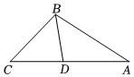
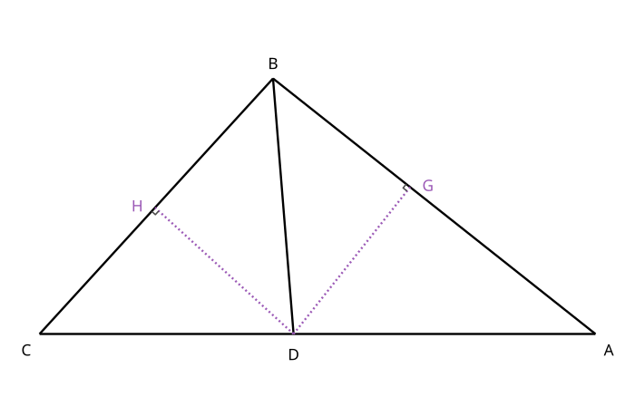

5. （2021秋•南召县期末）我们已经学习过角平分线性质定理，即：角平分线上的点到角两边的距离相等。如图，已知 $\triangle ABC$ 的角平分线 $BD$ 交边 $AC$ 于点 $D$。

（1）求证：$\frac{S_{\triangle BCD}}{S_{\triangle BAD}}=\frac{BC}{AB}$；

（2）求证：$\frac{BC}{AB}=\frac{CD}{AD}$；

（3）如果 $BC=4$，$AB=6$，$AC=5$，那么 $CD=$ ___ 。

> [!question]- 点击查看答案与解析
> 【答案】$(3)$ $CD=2$。
>
> 【考点】角平分线的性质、三角形面积比、角平分线分对边成比例 → [[【初中数学知识点体系-人教版】#14-3 角的平分线]]、[[【初中数学知识点体系-人教版】#13-2 与三角形有关的线段]]
>
> 【解析】
> 过 $D$ 作 $DH\perp BC$ 于 $H$，$DG\perp AB$ 于 $G$。$\because BD$ 平分 $\angle ABC$，$\therefore DH=DG$。
>
> $(1)$ $S_{\triangle BCD}=\dfrac12 BC\cdot DH$，$S_{\triangle BAD}=\dfrac12 AB\cdot DG$，两式相除得 $\dfrac{S_{\triangle BCD}}{S_{\triangle BAD}}=\dfrac{BC}{AB}$。
>
> $(2)$ $\triangle BCD$ 与 $\triangle BAD$ 以 $CD$、$AD$ 为底时，共用从 $B$ 到 $AC$ 的高，$\therefore \dfrac{S_{\triangle BCD}}{S_{\triangle BAD}}=\dfrac{CD}{AD}$。结合 $(1)$ 得 $\dfrac{BC}{AB}=\dfrac{CD}{AD}$。
>
> $(3)$ 由 $\dfrac{CD}{AD}=\dfrac{BC}{AB}=\dfrac{4}{6}=\dfrac23$，且 $CD+AD=AC=5$，$\therefore CD=5\times\dfrac{2}{2+3}=2$。
> 
>
> 【易错点】面积比有两种求法：以角两边为底用“到两边距离相等”，以同一直线上的线段为底用“共用高”；角平分线分对边之比等于邻边之比，不要把 $CD/AD$ 写成 $AB/BC$。
