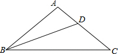
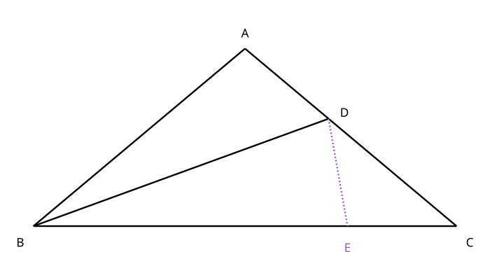

6. （2013秋•武侯区校级月考）如图，$\triangle ABC$ 中，$AB=AC$，$\angle A=100^\circ$，$BD$ 平分 $\angle ABC$。

（1）求 $\angle ADB$ 的度数。

（2）求证：$BC=BD+AD$。

> [!question]- 点击查看答案与解析
> 【答案】$(1)$ $\angle ADB=60^\circ$；$(2)$ $BC=BD+AD$，证明见解析。
>
> 【考点】等腰三角形底角、角平分线、截长补短构造全等 → [[【初中数学知识点体系-人教版】#15-3 等腰三角形]]、[[【初中数学知识点体系-人教版】#14-2 三角形全等的判定]]
>
> 【解析】
> $(1)$ $\because AB=AC$，$\angle A=100^\circ$，$\therefore \angle ABC=\angle C=\dfrac{180^\circ-100^\circ}{2}=40^\circ$。
> $\because BD$ 平分 $\angle ABC$，$\therefore \angle ABD=20^\circ$。在 $\triangle ABD$ 中，$\angle ADB=180^\circ-100^\circ-20^\circ=60^\circ$。
>
> $(2)$ 截长法：在 $BC$ 上截取 $BE=BD$，连接 $DE$。
> 由 $BD=BE$，$\angle DBE=20^\circ$，得 $\angle BDE=\angle BED=80^\circ$，$\therefore \angle EDC=180^\circ-100^\circ-40^\circ=40^\circ=\angle C$，故 $DE=EC$。
> 再由角平分线条件与等腰三角形边角关系可证 $AD=DE$（在 $BA$ 侧补作等长线段构造全等三角形），于是 $AD=DE=EC$。
> $\therefore BC=BE+EC=BD+DE=BD+AD$。
> 
>
> 【易错点】截长后先由等腰 $\triangle BDE$ 得到 $DE=EC$，$AD=DE$ 这一步需要再构造一次全等，不能直接由 $DE=EC$ 跳到 $AD=EC$。
