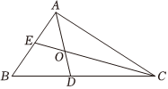
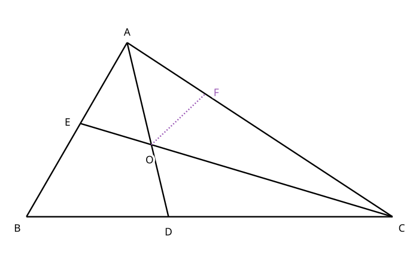

7. （2018秋•高港区校级月考）如图，在 $\triangle ABC$ 中，$\angle B=60^\circ$，$\triangle ABC$ 的角平分线 $AD$、$CE$ 相交于点 $O$。

（1）求 $\angle AOC$ 的度数；

（2）求证：$OE=OD$；

（3）猜测 $AE$，$CD$，$AC$ 三者的数量关系，并证明。

> [!question]- 点击查看答案与解析
> 【答案】$(1)$ $\angle AOC=120^\circ$；$(2)$ $OE=OD$；$(3)$ $AE+CD=AC$。
>
> 【考点】三角形内心角度公式、截长构造全等、角平分线性质 → [[【初中数学知识点体系-人教版】#14-3 角的平分线]]、[[【初中数学知识点体系-人教版】#14-2 三角形全等的判定]]、[[【初中数学知识点体系-人教版】#15-3 等腰三角形]]
>
> 【解析】
> $(1)$ $O$ 为两条角平分线交点（内心），$\angle AOC=90^\circ+\dfrac12\angle B=90^\circ+30^\circ=120^\circ$。
>
> $(2)$ 在 $AC$ 上截取 $AF=AE$，连接 $OF$。在 $\triangle AEO$ 与 $\triangle AFO$ 中：$AE=AF$，$\angle EAO=\angle FAO$，$AO=AO$，$\therefore \triangle AEO\cong\triangle AFO$（SAS），$\therefore OE=OF$，$\angle AOE=\angle AOF$。
> 由 $\angle AOC=120^\circ$ 得 $\angle AOE=\angle COD=60^\circ$，$\therefore \angle AOF=60^\circ$，$\angle COF=120^\circ-60^\circ=60^\circ=\angle COD$。
> 在 $\triangle COD$ 与 $\triangle COF$ 中：$\angle OCD=\angle OCF$，$OC=OC$，$\angle COD=\angle COF$，$\therefore \triangle COD\cong\triangle COF$（ASA），$\therefore OD=OF$，故 $OE=OD$。
>
> $(3)$ 由上面全等得 $AE=AF$，$CD=CF$，$\therefore AC=AF+CF=AE+CD$。
> 
>
> 【易错点】截长点 $F$ 在 $AC$ 上，先证 $\triangle AEO\cong\triangle AFO$ 得到 $OF$ 为中间等量，再证 $\triangle COD\cong\triangle COF$；两组全等缺一不可。
